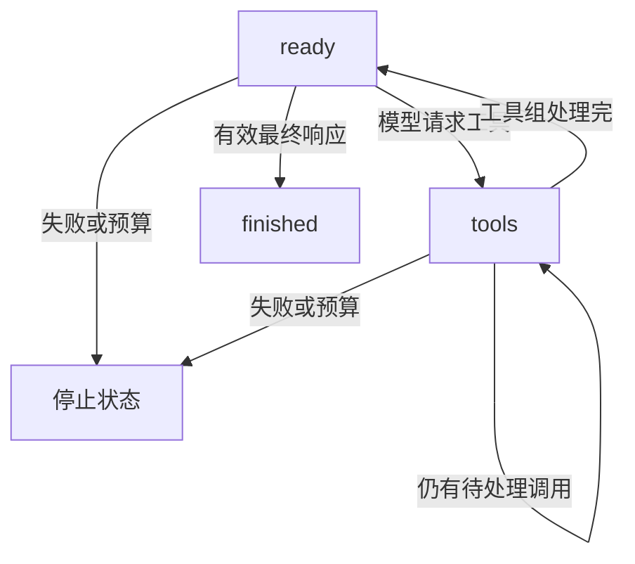

# A04 状态与事件：让每一步都能解释、检查和恢复

一个 Agent 能连续输出文字，并不意味着你知道它现在处于什么状态。模型刚提出工具请求、工具已经开始、工具已经完成、结果已经保存、模型已经看到结果，这几个时刻有不同含义。程序如果在其中任意位置中断，下一步应该做什么也不同。本章把这些差别写成明确状态、事件和转移规则，帮助你从一个会运行的循环走向一个能调试的系统。

本章主要研究状态的语义、表示和检查。A10 会进一步展开数据库事务、执行账本和跨服务恢复；这里先回答“究竟要保存什么，以及这些字段怎样共同表达一个可继续的过程”。没有清楚状态模型，换成更强数据库也只是更可靠地保存一份含糊数据。

## 第一课：状态对象、字段与可变数据

### 状态、事件、日志和视图不是同一个东西

状态回答“现在是什么情况”。例如待执行队列里有两个工具，已经使用一次模型调用预算，当前阶段是 tools。事件回答“发生了什么变化”。例如模型完成了一轮并提出两个工具，或者某个工具已得到结果。日志是记录这些信息的一种形式，可以是文本行、JSON 对象或观测平台记录。视图则是把状态整理给用户看，例如界面上的“正在检索”。

把四者混用，会产生很难调试的问题。界面显示“完成”可能只是动画结束；日志打印“工具开始”不能证明工具完成；一条完成事件可能已经写入独立日志，但主要状态快照还没有更新。你需要先定义每个词的精确含义，再决定它怎样显示和存储。界面措辞不能反过来成为业务状态机的唯一依据。

假设你只有 messages 历史。模型请求 c1 和 c2，工具 c1 执行成功后进程崩溃。若 messages 尚未写入 c1 结果，你无法仅靠这份历史判断 c1 是否发生；若只保存了最终自然语言摘要，更无法判断 c2 是否仍待执行。为了正确继续，程序需要待执行队列、执行账本、预算和阶段等信息。消息历史是状态的一部分，通常不是全部状态。

反过来，也不是所有可记录信息都必须进入恢复状态。终端颜色、调试时打印的对象地址和某次界面刷新时间，通常不决定下一步动作。把过多无关信息混进快照会增加迁移与一致性成本。一个实用判断是：如果删除这个字段，程序在恢复后是否可能做出不同且错误的动作？若是，它很可能属于必要状态；若否，可以考虑放在独立观测记录中。


### 逐个解释课程 State 的字段

课程 State 是一个数据类。数据类减少初始化、字段展示和转换的样板代码，不会自动使对象不可变，也不会自动完成业务校验。你可以把它理解成一个有命名字段的记录。字段名字让代码表达含义，字段之间的关系则仍需由状态机与验证器维护。

```python
from dataclasses import dataclass, field

@dataclass
class SmallState:
    run_id: str
    messages: list = field(default_factory=list)
    pending: list = field(default_factory=list)
    model_calls: int = 0
    tool_calls: int = 0
    status: str = "ready"
```

run_id 标识一次任务运行。它不是用户 ID，也不是单次 HTTP 请求 ID。同一个用户可以启动多次运行，一次运行可以包含多次网络请求和工具调用。把这些身份分开后，你才能按运行恢复状态，同时按请求排查网络问题。课程 ledger 用 run_id 与 call_id 组合定位工具执行，这体现了调用身份的作用域。

messages 保存模型协议材料，包括用户任务、assistant 请求和 tool 观察。它决定下一次模型能看到什么，但不应该被当作任意日志的垃圾桶。把数据库异常堆栈、内部凭据或全部调试事件都塞进 messages，会增加成本和泄露风险，也会改变模型行为。模型可见历史与系统内部状态有交集，却不需要完全相同。

pending 保存已经提出、尚未在主历史中完成处理的工具调用。它通常有顺序，因为课程版本串行执行。pending 不只是“模型计划清单”；其中每项已经有调用身份和参数，后续执行器应按其合同处理。若你在恢复时让模型重新生成这份清单，新的调用可能与原业务意图不同，原执行账本也无法自然关联。

model_calls 与 tool_calls 记录不同资源。模型调用计数在请求之前预留，即使请求失败也计入尝试；工具计数在结果准备进入主历史时推进，具体含义由课程实现定义。你不能把它们随意相加后称为统一步骤成本，因为一次模型调用与一次文件读取的时间、费用和故障语义都不同。更完整系统可能另外保存 attempts 与 successes。

output_chars 记录已经纳入历史的工具输出字符量。它不是精确 token 数，也不代表工具实际生成的全部字节数。某个过大结果可能保存在 ledger，但没有进入 messages，因此输出预算与持久结果大小不同。明确这个字段的口径，才能解释为什么预算停止时工具仍可能已经执行。

status 是阶段标签，final 是最终模型文本。状态标签决定是否可以继续推进；final 只是结果内容之一。一个 error 状态中可能仍保留部分文本，一个 limit 状态可能保留待执行动作，不能仅根据 final 是否非空判断系统是否成功。反过来，finished 需要非空最终文字且没有未完成工具，这些关系由验证器表达。

version 是快照并发版本，每次成功保存推进一次。它不是模型轮次数，也不是事件数量，更不是课程版本。一次 step 可能保存两次，事件与快照也不一一对应。把 version 叫做步骤号会诱导错误推断，例如看到版本六就以为模型调用六次。

events 保存本地逻辑事件序列，每项有 seq、kind 和 data。seq 是在该运行中追加的顺序号。它可以帮助发现缺口或重复，但不能证明跨机器真实时间先后，更不等于全局事务顺序。事件 payload 应保存支持诊断的必要信息，不应该无界复制全部输入输出。

inflight_model 表示已经为模型请求记录了在途状态，但尚未确认一个可保存的完整结果。这个字段专门表达未知窗口。恢复时若仍为真，课程 Harness 进入 uncertain，不会自动假定服务端未执行。它牺牲了一点自动继续的便利，换来对远端效果与费用状态的诚实表达。


### 可变默认值与状态对象的别名

SmallState 使用 default_factory，而不是把 messages 默认设为一个共享列表。原因是每次创建状态都应该得到自己的列表。如果多个运行共享同一个默认列表，某个用户的消息可能出现在另一个运行中，形成严重的语义混乱。这个问题来自普通 Python 对象别名，不需要任何复杂并发才能出现。

```python
from dataclasses import dataclass, field

@dataclass
class SafeRecord:
    items: list = field(default_factory=list)

a = SafeRecord()
b = SafeRecord()
a.items.append("only-a")
assert b.items == []
assert a.items is not b.items
```

即使默认列表正确，后续赋值仍可能引入共享。执行 `b.messages = a.messages` 会让两个状态引用同一列表。浅复制外层列表可以隔离 append，但内部消息字典仍可能共享。若你要保存历史快照，应明确复制深度或采用不可变结构。不要只检查两个列表地址不同，就认为所有嵌套资料都独立。

课程模型调用使用 deepcopy(state.messages)，使模型适配器不能通过普通原地修改直接污染运行中的历史。这个设计主要防止意外副作用，并不是恶意代码隔离；同进程函数仍可能访问其他对象或外部资源。复制解决的是数据所有权问题，沙箱解决的是执行权限问题，二者不能混为一谈。

快照也需要区分“内存对象复制”和“持久化记录”。把状态 asdict 成一个新字典，可以为序列化准备数据，但只有保存操作成功后，持久存储才拥有对应版本。若保存失败，内存状态可能已经改变，数据库仍停在旧版本。恢复逻辑应重新加载可信持久快照，而不是继续把失败后对象当成已提交状态。

## 第二课：状态转移与不变量

### 允许的状态转移应先画出来

课程的主要活动状态是 ready 与 tools。ready 表示当前没有必须先处理的工具，可以请求模型；tools 表示 pending 中有动作，需要执行工具阶段。finished、cancelled、limit、uncertain 和 error 是当前运行器的终止状态，普通 step 不会从它们继续产生动作。终止不等于成功，前一章已经区分过这些语义。



这个图只表达一条关系：活动阶段怎样推进到下一阶段。它没有把所有异常细节挤进一张图。停止状态的具体原因仍由 status 与事件表达。如果以后增加 waiting 状态用于人工审批，应明确它与终态的区别：等待可能通过一个受控恢复动作继续，错误停止则可能需要新的运行或管理流程。

一个合法状态不是任意字段组合。ready 与非空 pending 同时出现通常矛盾，因为系统既声称可调用模型，又存在未处理工具。tools 与空 pending 同时出现也可疑。finished 若仍有 inflight_model 或未处理调用，则表示系统提前宣布完成。验证器应检查这些组合，而不只是检查 status 是否属于某个枚举集合。

终态保护特别重要。后台回调可能迟到，用户已经取消的任务不应被普通执行代码重新激活。你可以为管理操作设计显式恢复接口，但应保留原因、权限和版本，不能随手把 status 改成 ready。状态机的边界一旦被任意赋值绕过，前面所有转移图与测试都会失去意义。


### 把不变量写成可以检查的句子

不变量不是“希望程序一直正常”的愿望，而是可以对某个状态明确判断真假的性质。例如计数器非负、事件序号连续、pending 调用 ID 唯一、ready 没有 pending、finished 有有效最终文本。这些性质不会告诉你答案在业务上一定正确，却能抓住状态结构已经自相矛盾的情况。

你应区分局部不变量与跨历史不变量。局部不变量只看当前字段，例如 status 与 pending 的关系。跨历史不变量需要看以前发生过什么，例如工具结果必须对应之前的请求，计数器不能倒退，已经完成的调用身份不能被换参数复用。后者可能需要完整历史、执行账本或上一版本状态，不能强行用一个局部字段证明。

课程 advanced_solutions.validate_state 检查负计数、事件顺序、阶段与 pending、finished 的完整性和重复 pending ID。在没有未完成调用时，它还调用 turn_groups 检查消息配对。为什么 pending 非空时不要求历史里的全部工具请求都已有结果？因为当前正处于执行中，完整结果尚未产生是合法的中间状态。验证器必须理解阶段，不能把所有中间态都当坏数据。

```python
from labs.agents.runtime import State
from labs.agents.advanced_solutions import validate_state
from labs.agents.contracts import ContractError

state = State(run_id="valid", messages=[{"role": "user", "content": "hello"}])
assert validate_state(state)
state.status = "tools"
try:
    validate_state(state)
except ContractError:
    pass
else:
    raise AssertionError("tools without pending must be rejected")
```

这个验证器仍是课程子集，不是任意损坏 JSON 的完整模式校验器。例如它假设字段具有合理基础类型，生产加载边界还应先验证类型与 schema 版本。你可以把验证分成“记录结构合法”“当前状态内部一致”“与旧版本转移合法”三步。分开之后，每一步的错误更容易解释，也避免一个巨大函数承担所有职责。

不变量测试应该包含反例与正常对照。只构造五个坏状态，并让验证器对所有输入都抛错，也能通过这些坏例测试，却不能证明可用。至少保留 ready、tools 中间态、finished 和带 pending 的 limit 等合法状态。特别是后两类容易被过严规则误伤，导致系统为了“整洁”而丢失恢复所需信息。

## 第三课：逐步手算三个 step 的全部变化

我们重新使用一次加法后回答的任务。new 创建初始状态，messages 一条、pending 空、计数零、status 为 ready。它记录 run_started，并保存版本一。版本零只是尚未创建记录的预期值，不是数据库里已经存在的初始快照。这个区别会影响首次插入与后续更新的分支。

第一次 step 进入模型路径。先取当前 model_calls 作为脚本索引零，再把 model_calls 加到一，设置 inflight_model 为真，记录 model_requested，保存版本二。然后才调用模型。模型返回 c1 后，程序验证响应，清除在途标记，追加 assistant 请求，pending 放入 c1，记录 model_completed，status 改成 tools，保存版本三。

第二次 step 发现 pending 非空，进入工具路径。执行器先通过 ledger 管理调用身份并得到结果。结果可以进入历史时，程序移除 c1，tool_calls 加到一，output_chars 增加结果字符数，追加 tool 消息，记录 tool_completed，pending 已空所以 status 回到 ready，保存版本四。注意 ledger 保存与主快照保存是两个边界，不是一个天然跨外部系统事务。

第三次 step 再次进入模型路径。预留第二次模型调用并保存版本五，收到最终文字后清除在途状态、追加 assistant 消息、记录完成事件、设置 final 与 finished，保存版本六。因此三个 step 对应六个持久版本，一条初始记录加两次模型调用各两个检查点，再加一次工具结果检查点。

| 可观察时刻 | version | model_calls | tool_calls | pending | status | inflight_model |
|---|---:|---:|---:|---:|---|---|
| new 完成 | 1 | 0 | 0 | 0 | ready | false |
| 第一请求前保存 | 2 | 1 | 0 | 0 | ready | true |
| 第一响应后保存 | 3 | 1 | 0 | 1 | tools | false |
| 工具结果后保存 | 4 | 1 | 1 | 0 | ready | false |
| 第二请求前保存 | 5 | 2 | 1 | 0 | ready | true |
| 最终响应后保存 | 6 | 2 | 1 | 0 | finished | false |

表中的 ready 与 inflight_model 为真不是说可以并发发起另一个请求。step 的优先检查会把恢复后未确认的在途状态转成 uncertain。状态含义来自字段组合与转移规则，不能只看一个 status 字符串。更复杂系统可能把 requesting 单独做成状态，本课程选择用布尔字段表达这个中间窗口；两种设计都需要一致不变量。

## 第四课：请求提交窗口与事件发生时刻

### 为什么请求之前与之后都要保存

外部调用不是一个可以随意回退的普通内存表达式。程序发出模型请求后，远端可能已经收到、计算并计费，而本地进程在收到响应前消失。若你只在响应后增加计数，恢复时会把这次尝试当作没有发生。若立即再次请求，可能重复花费，也可能获得不同输出。请求前检查点就是为了保存“我已经开始一次可能发生效果的尝试”。

请求前保存也有窗口：记录在途之后，网络请求尚未真正发出时进程就退出。此时实际远端可能没有执行，但本地仍只能保守地说结果未知。这个保守性不是错误，而是信息不足的反映。除非外部服务提供可验证的请求身份、状态查询或幂等保证，否则本地数据库无法凭空知道网络另一端发生了什么。

因此 inflight_model 不应解释为“远端一定在运行”，而应解释为“本地已开始请求流程，尚未记录完整确定结果”。字段命名可能让人联想到实时状态，但实际恢复语义更重要。写教材和监控说明时应明确这个区别，否则运维人员可能误以为可以根据这个布尔值精确判断服务端进程。

响应后检查点则保存新历史、pending 和清除在途标记。若响应已经返回，但这次保存失败，内存与数据库再次出现差异。程序不能因为自己看见了响应，就假定持久状态也已经更新；应让失败显现，并从已提交状态重新协调。一个常见错误是捕获保存异常后继续使用已修改对象，导致后续版本与动作建立在未提交状态上。

你可以用可控故障模拟这些位置，而不需要真的切断服务器电源。例如让 Store.save 在指定第几次调用时抛异常，或者让模型替身在请求时抛异常。每个故障点都写清持久版本、内存状态和可能外部效果。故障注入的价值是把“偶尔恢复错了”变成可以重复观察的状态差异。


### 事件什么时候才算发生

事件名字需要绑定明确时机。tool_started 可以表示执行器已接受请求，也可以表示函数即将被调用；tool_completed 可以表示函数返回，也可以表示结果已持久保存。若不同开发者按不同含义发同名事件，监控指标和恢复判断都会混乱。先写事件合同，再在代码中选择发出位置。

课程 model_requested 记录在预算预留之后、外部调用之前；model_completed 记录在响应通过基本检查之后；tool_completed 记录在结果准备加入主历史之后。它们支持理解本地控制流程，但没有包含每个网络字节、数据库提交或远端确认事件。不能根据一个本地完成事件推断所有下游系统都已经看到结果。

一个事件通常需要类型、关联身份、逻辑顺序和必要数据。必要数据取决于要回答的问题：如果你要知道哪个工具失败，记录工具名和调用 ID；如果要知道输出是否过大，记录字符数；如果要知道哪次请求慢，记录请求关联与耗时。不要默认把完整输入输出复制进每个事件，详细内容可以放在受控存储中，用引用关联。

事件 schema 也应有版本。若你把 data.chars 改成 data.bytes，却没有改变字段说明，旧统计程序可能仍按字符解读。更隐蔽的是把 tool_completed 从“函数返回”改成“结果已提交”，指标含义变了，但字段没变。版本管理不仅涉及 JSON 的形状，也涉及事件发生时机的语义。

事件顺序应区分本地追加顺序与因果依赖。单线程顺序执行时，seq 通常与控制流一致；并发时，两个工具可以独立完成，先追加的事件不一定代表它在业务上是另一个的前提。跨机器时间戳还可能受时钟偏差影响。需要表达依赖时，使用明确 parent 或 depends_on 关系，而不是让时间排序承担它无法保证的含义。

## 第五课：事件溯源、快照与恢复成本

### 本课程事件不是完整的事件溯源日志

这是必须讲清的一条边界。完整事件溯源要求事件包含足够信息，能够按确定规则重建当前业务状态。课程 events 主要用于观察：model_completed 只记录索引与工具数，没有保存整个模型响应；tool_completed 记录调用身份和字符数，没有保存完整结果。因此仅靠这份 events，无法重建全部 messages、pending 参数和 final。

可以用一个反例证明。两个模型都提出一个 add 调用，一个参数是一加二，另一个是十加二十。model_completed 事件中的 tool_count 都是一。若事件没有参数，你无法从相同计数区分这两个响应。信息已经丢失，任何重放函数都不可能可靠恢复原始内容。不能因为记录叫 events，就自动宣称系统采用了完整事件溯源。

本课程恢复主要依赖快照与工具 ledger。快照保存当前 State，ledger 保存调用执行状态和结果；events 帮助解释过程。三者互相补充，但职责不同。一个生产系统可以选择完整事件溯源，也可以选择快照加事务日志，关键是清楚说明恢复依据与一致性边界，而不是追求某个架构名词。

下面用一个计数任务展示真正可重放的最小事件集。事件保存了每次加多少，因此可以从初始值重建结果。reducer 是纯计算，不重新执行外部工具。

```python
from copy import deepcopy

def reduce_counter(state, event):
    if event["seq"] != state["next_seq"]:
        raise ValueError("event sequence gap or duplicate")
    if state["status"] == "finished":
        raise ValueError("cannot append an action after finish")
    result = deepcopy(state)
    kind = event["kind"]
    if kind == "add":
        amount = event["amount"]
        if type(amount) is not int:
            raise ValueError("integer amount required")
        result["total"] += amount
    elif kind == "finish":
        result["status"] = "finished"
    else:
        raise ValueError("unknown event")
    result["next_seq"] += 1
    return result

def replay_counter(events):
    state = {"total": 0, "next_seq": 0, "status": "running"}
    for event in events:
        state = reduce_counter(state, event)
    return state

events = [
    {"seq": 0, "kind": "add", "amount": 2},
    {"seq": 1, "kind": "add", "amount": 5},
    {"seq": 2, "kind": "finish"},
]
assert replay_counter(events) == {"total": 7, "next_seq": 3, "status": "finished"}
assert replay_counter(events) == replay_counter(events)
```

重放两次得到相同状态，并没有把真实世界再加两次。它只是从同一个初始状态应用已记录事实。如果你在 reducer 中发送消息、创建工单或调用模型，重放就会重复副作用，违背这个设计。命令提出“请执行”，事件记录“已经观察到什么”，reducer 负责从事实推导状态；三者必须分开。


### 快照、事件与恢复成本的取舍

完整事件历史可以解释每次变化，但历史越长，从头重放成本越大。快照保存某个位置的状态，可以从该位置之后继续重放。一个可靠组合需要记录快照对应的事件位置和数据 schema 版本，不能随便拿一个快照接上一段不匹配的事件后缀。

例如快照已经包含 seq 零到九的效果，恢复时应从十开始。如果误从九开始，最后一个效果重复；如果从十一开始，漏掉一次变化。你可以让快照保存 next_seq，并要求第一条后续事件等于它。这个检查与课程事件序号连续性相同，只是作用范围扩展到快照和日志之间。

快照不是压缩后的自然语言摘要。恢复状态需要保留精确字段和结构，不能把 pending 参数总结成“还有一个写文件任务”就希望程序继续。自然语言摘要适合帮助模型理解上下文，但机器恢复通常需要确定的身份、参数、版本和执行阶段。A07 的上下文压缩与本章的持久状态压缩应分别设计。

快照频率也不是越高越好。每个微小字段变化都同步写数据库，会增加延迟和存储成本；保存太少则扩大恢复时需要重新协调的窗口。应围绕外部效果和重要状态边界设置检查点。课程在模型请求前后、工具结果处理后保存，是为了展示这些边界，不代表所有生产系统都必须采用完全相同的保存次数。

恢复时还要检查快照与当前代码是否兼容。字段新增可能有安全默认值，也可能意味着旧记录缺少关键语义。例如新版本开始记录工具实现指纹，旧记录没有该字段，不能随便填“当前版本”并假定它当时就是当前实现。迁移函数应明确哪些情况可以升级，哪些需要人工检查或拒绝继续。

## 第六课：乐观版本检查如何防止盲覆盖

两个执行者都读到版本四。执行者甲修改状态并保存为五，执行者乙仍拿旧快照保存。如果数据库无条件按 run_id 更新，乙可能覆盖甲刚保存的消息和结果。乐观并发控制要求写入时同时提供“我基于哪个版本作出修改”，只有数据库仍处于那个版本时才接受。

课程 Store.save 使用 `WHERE id=? AND version=?`。其中 expected 是读取时的旧版本，new 是 expected 加一。数据库返回受影响行数，只有恰好一行说明条件匹配并成功更新。零行表示记录不存在或版本已变化，课程将其报告为 Conflict。这里的比较与更新处于同一 SQL 语句中，不是先查版本再无条件写入。

```python
from labs.agents.store import Store, Conflict
from labs.agents.runtime import State
from dataclasses import asdict

with Store() as store:
    first = State(run_id="cas-demo", messages=[{"role": "user", "content": "goal"}])
    assert store.save(asdict(first), 0) == 1
    left = store.load("cas-demo")
    right = store.load("cas-demo")
    left["final"] = "left update"
    assert store.save(left, left["version"]) == 2
    right["final"] = "stale update"
    try:
        store.save(right, right["version"])
    except Conflict:
        pass
    else:
        raise AssertionError("stale state overwrote newer state")
    assert store.load("cas-demo")["final"] == "left update"
```

这段例子只研究存储版本，不表示 ready 状态中随意设置 final 是推荐业务设计。Store 负责保存与冲突检查，不负责全部 State 语义；业务层仍需验证状态组合。把不同层的责任说清楚，能避免看到数据库接受一条记录就误以为它在业务上一定合法。

版本检查保护的是快照不被旧状态盲覆盖，不自动阻止外部工具重复执行。两个执行者可能各自先发送一次写入请求，再在保存快照时发现冲突。此时冲突已经不能撤销外部效果。真正多 worker 系统还需要执行所有权、租约、业务幂等或其他协调。不要把 CAS 当成分布式 exactly-once 的同义词。

冲突后正确动作也不是直接把 expected 改成最新版本重试旧 payload。那样只是把保护条件绕过，仍可能覆盖别人完成的工作。应重新加载新状态，比较变化，判断原动作是否仍然需要，再选择继续、合并或停止。对于消息历史这种有顺序和配对约束的数据，盲目把两个列表拼起来也不一定合法。

## 第七课：一次 step 与一个驱动循环的分工

step 定义“在当前状态下推进一个合法阶段”，run 定义“怎样反复调用 step”。把二者分开后，你可以使用不同驱动方式：交互界面每次点击推进，后台 worker 连续运行，测试在指定边界插入故障，调度器在多个任务间轮转。业务状态规则不需要因为驱动方式变化而全部重写。

但 step 不是数据库事务的别名。一次模型 step 可能包含两次保存和一次网络调用，中间存在故障窗口；一次工具 step 可能涉及 ledger 与外部效果。这里的“单步”指教学和调度上的可观察阶段，不承诺内部所有操作同时原子发生。名称容易制造误解，所以文档必须明确粒度。

run 的 max_transitions 是最后一道控制流保护，不替代模型调用预算、工具预算或总截止时间。假设开发者忘记从 pending 弹出已处理调用，工具阶段可能持续循环，但模型计数不增加；转移上限能让这个实现错误最终停止。反过来，一个模型请求可能卡很久，即使只发生一个转移，也需要单次超时和总 deadline。

边界判断必须发生在最后一次允许的 step 之后。若那一步已经进入 finished、error 或 uncertain，run 应返回真实终态；只有仍处于活动状态时，才标记 transition guard。对已结束状态调用 max_transitions 为零，也不应新加一个停止事件或推进版本。这些测试能够发现“只修正返回文字、数据库仍被覆盖”的不完整修复。

你还应定义驱动器遇到保存异常时的责任。若异常传播出来，调用者应停止使用当前已变更内存对象，从持久状态重新加载并协调。继续循环可能让版本、计数和历史与数据库越来越远。一个清楚的异常边界比在外面包一个宽泛 except 然后“继续试试”更容易保证可恢复性。

## 第八课：状态 schema 与恢复配置的版本

### 数据 schema 版本与运行 version 必须分开

运行 version 解决同一记录的更新竞争，schema_version 解决记录结构与解释方式的演进。假设一个运行已经保存到 version 二十，但它仍采用第一版数据结构；另一个新运行只保存一次，却采用第二版结构。两个数字表达不同维度，不能因为都叫版本就合成一个字段。

新增字段时，默认值是否安全取决于旧语义。给记录增加可选展示标题，缺省为空可能合理；增加“是否已经发出外部写入”的字段，缺省为 false 可能把旧的不确定调用误判成未执行。迁移不是机械补字段，而是解释旧数据在新合同下还能确定哪些事实。无法确定时，拒绝自动继续或标记需要协调，比猜一个方便默认值更可靠。

下面用一个独立计数记录展示完整迁移函数。第一版叫 count，第二版叫 total，并显式加入状态。未知未来版本被拒绝，调用者不能假定新结构只是多了几个可忽略字段。

```python
from copy import deepcopy

def migrate_counter_record(record):
    value = deepcopy(record)
    schema_version = value.get("schema_version", 1)
    if type(schema_version) is not int:
        raise ValueError("schema version must be integer")
    if schema_version == 1:
        if type(value.get("count")) is not int:
            raise ValueError("old count is invalid")
        value = {"schema_version": 2, "total": value["count"],
                 "status": "running", "record_version": value.get("record_version", 1)}
    elif schema_version != 2:
        raise ValueError("unsupported schema version")
    if type(value.get("total")) is not int or value.get("status") not in {"running", "finished"}:
        raise ValueError("invalid migrated state")
    return value

old = {"count": 7, "record_version": 12}
new = migrate_counter_record(old)
assert new["total"] == 7 and new["record_version"] == 12
assert old == {"count": 7, "record_version": 12}
assert migrate_counter_record(new) == new
```

迁移函数不修改输入对象，便于比较原件与迁移结果，也方便在失败时保留证据。它对已经是当前版本的记录保持同一语义，这使重复加载不会反复改变数据。实际课程 State 目前没有自动启用这份示例迁移；它是完整独立练习，不能因为教材给了一个函数，就声称所有旧运行都已经具备版本迁移能力。

迁移测试应覆盖最旧支持版本、当前版本、未知未来版本和损坏字段。还要检查迁移前后的业务不变量，例如调用身份是否保留、预算是否被重置、终态是否被意外改成运行中。仅检查新字典多了 schema_version，无法证明恢复行为保持正确。


### 恢复配置也是状态解释的一部分

一份检查点只保存消息与 pending，不一定足以在任意环境正确恢复。工具同名但实现改变、模型端点换成另一种协议、schema 收紧、业务权限变化，都可能改变待执行动作的含义。课程恢复要求调用者重建兼容的模型、协议与工具版本；当前 State 没有自动验证完整配置指纹，这是明确的教学边界。

可以把配置分成需要持久绑定的语义配置和不应直接存入快照的秘密。工具版本、模型选择、协议类型、允许能力集合和重要预算策略可以用可审查标识绑定；API Key、临时令牌和私有凭据应通过受控运行环境获取，而不是作为普通 JSON 字段写进公开或广泛可读的检查点。恢复需要能力，不意味着快照必须复制全部秘密。

配置指纹通常来自规范化后的公开配置摘要。规范化需要稳定字段顺序和明确默认值，否则同一语义配置可能因为字典排列不同产生不同摘要。指纹相同也只证明被纳入摘要的内容相同，不能证明外部服务实现或权限没有变化。你应记录指纹覆盖范围，而不是把一个 hash 当成所有环境都被冻结的保证。

恢复时还要重新检查动态条件。文档权限可能已撤销，文件版本可能已更新，工单可能已被别人关闭。不能因为旧快照中曾经允许某个动作，就把它当永久许可。状态保存的是过去观察与程序进度，动态业务约束仍需在真正执行时核验。A03 的权限与版本合同在恢复路径上同样有效。

一个好的恢复报告应说明使用哪个快照版本、哪些配置已匹配、哪些外部状态重新读取、哪些未知效果已对账，以及为什么下一步可以继续。这个报告可以是结构化事件，不必让用户阅读全部内部细节；关键是系统能够给出依据，而不是只有一个“恢复成功”的字符串。

## 第九课：计数器的单调性与资源账本

模型调用数通常单调不减，工具尝试数通常单调不减，但不是什么整数都应该单调。pending 长度会增加和减少，当前队列大小会变化，剩余预算会减少，恢复后的展示计时也可能重新计算。先写清字段口径，再决定适合检查哪种性质。机械地要求所有数字只能增加，会把正常状态变化当成错误。

预留、消耗与结算是三种不同概念。发起请求前预留一个额度，成功返回后得到实际用量，失败后可能只有保守估计。若将它们都塞进一个 used 字段，重试与退款语义容易混乱。课程 model_calls 主要记录尝试次数，不能直接当成精确 token 费用；output_chars 记录纳入历史的字符，也不是外部服务总传输量。

状态中保存累计值时，应考虑它是否能由其他记录重建。若 tool_calls 应等于某些完成事件数量，你可以在测试中核对它们；但如果事件被压缩或不完整，就不能再把这种等式当永久不变量。派生字段重复保存可以提高查询效率，却会增加一致性责任。设计时需要决定哪个来源是权威，哪个只是缓存视图。

例如界面显示“已完成三项工具”，可能从事件投影得到；运行器的预算账本可能记录四次尝试，其中一次失败。两个数字不同未必是 bug，前提是名称和口径明确。如果界面把成功数叫调用数，就会让用户误解成本，也让开发者错误地比较不同 Harness 的效率。A13 会进一步讨论指标分母，本章先把计数语义固定下来。

预算冲突还会出现在并发中。两个任务都看到剩余一次额度，然后各自调用模型，结果超过限制。仅把整数放进 State 不会自动使检查与扣减原子。你需要让一个所有者串行处理预留，或使用锁、事务等同步机制。A09 将实际实现原子预算；这里的状态模型应预留清楚的 reservation 身份与状态，而不是在事后总数超限时才发现问题。

## 第十课：单一状态所有者与外部工作者

课程 Harness 假设一个运行由一个所有者推进。这个所有者读取当前 State，决定下一步，接收工具或模型结果，再提交更新。其他组件可以执行耗时工作，但不应随意同时修改同一个 State 对象。这个模型类似一个任务有一位记账员：不同人可以完成工作，最终账本由明确位置按规则更新。

如果两个线程共享同一个 State 并各自调用 step，可能同时看到 pending 头部是同一调用，或者同时看到 model_calls 尚未达到上限。即使最终保存有版本检查，外部动作已经可能重复。Python 的某些单条操作具有实现层原子性，也不能让一整段“检查、调用、修改、保存”自动成为原子事务。不要把 GIL 当成业务并发控制。

一种常见设计是工作者返回结果消息，而不是直接修改状态。结果消息包含运行 ID、调用 ID、基于的版本或调度身份、成功或失败内容。状态所有者收到后核对它仍然对应当前等待的动作，再决定是否应用。迟到结果、重复结果和旧版本结果各有明确分支，而不是任由任何回调把 status 设置为 finished。

这也解释了为什么取消不是一个简单布尔值。用户取消后，已经在外部执行的动作可能仍然返回。所有者应停止新派发，并按合同记录迟到结果或对账信息；不能让迟到响应自动恢复运行，也不能假装取消一定撤销了外部效果。课程同步实现没有完整异步回调系统，但其终态规则为这种扩展提供了必要前提。

当系统需要多 worker 接管同一任务时，还要考虑所有权租约、过期接管和 fencing 等机制。版本号能发现旧快照写入，未必能阻止旧工作者继续访问外部服务。只有外部资源也识别并拒绝旧所有权凭证，才能在那一层实现更强约束。这里先理解问题形状，A10 会区分本地状态事务和跨系统效果。

## 第十一课：用户界面是投影，不能反过来覆盖执行事实

界面常需要把复杂状态简化成“准备中、执行中、已完成、需要处理”。这种简化是合理的，但它必须保留重要区别。例如 limit、error 与 uncertain 都可以显示为“已停止”，还应让用户知道停止原因不同；uncertain 不应被简化成“失败，未做任何事”，因为效果可能已经发生。

投影可以由状态和事件计算。例如界面显示最近工具名、已完成调用数和当前等待原因。投影更新可能异步到达，因此应带版本或事件位置，避免旧消息覆盖新界面。假设版本六已经 finished，随后一个延迟的版本三通知到达，界面不应退回“正在执行工具”。这与数据库 CAS 是相似问题，只是对象换成了展示状态。

反过来，用户点击按钮产生的是命令，不是直接修改数据库中的 status 字符串。取消按钮应该调用受控取消接口，重试按钮应该触发明确恢复策略，批准按钮应绑定具体待审动作。让前端随意发送任意状态值，会绕过状态机检查，也会使审计记录无法解释为什么发生转移。

本轮逐行审查发现并修复了一个具体例子：旧 cancel 方法无条件把状态改成 cancelled，因此一个已完成任务收到迟到取消时，会丢失真实 finished 终态；重复取消还会追加事件并增加版本。现在 cancel 只对 ready 与 tools 生效，对已有终态返回原状态。回归测试同时检查内存与持久快照，避免只修界面文字。

这项修复不表示取消可以强制终止任意底层函数。它保证的是状态转移合同：晚到或重复的取消不改写已经记录的结局。真正终止进程、请求远端取消或协调已发生效果，需要各自的执行机制。把状态语义与底层停止能力分开，才能向用户准确说明取消做到了什么。

## 第十二课：时间、顺序与可重复测试

墙上时钟回答现实日期与时间，单调时钟适合测量经过时长与 deadline。系统时间可能因校时发生调整，因此用墙上时间差判断超时可能出现异常。本课程 Harness 接收 clock 函数，默认使用 monotonic；测试可以注入可控时钟，不需要真的等待几秒或依赖机器负载。

注入时钟是一种依赖注入。程序不直接在内部到处读取系统时间，而是通过构造参数获得时间来源。这样你可以在测试中让时钟从零跳到十，验证截止条件恰好在边界生效。它不是为了“伪造测试通过”，而是让测试关注时间逻辑，而不是操作系统调度偶然性。

```python
from labs.agents.runtime import Harness, ScriptedModel
from labs.agents.contracts import Turn

now = [0.0]
h = Harness(ScriptedModel([Turn(text="done")]), [], deadline=5.0,
            clock=lambda: now[0])
s = h.new("clock-demo", "goal")
now[0] = 5.0
h.step(s)
assert s.status == "limit" and s.model_calls == 0
```

这个测试证明在执行 step 时已达到 deadline，不会再发起模型请求。它不证明正在进行的网络请求会在同一瞬间被终止；请求内部还需要超时或取消机制。边界检查与中途终止是不同能力，测试名称应反映实际验证范围。

跨机器事件顺序不能只靠时间戳。两个机器的时钟可能相差几十毫秒，而两个事件本身没有依赖。你可以保存本地 seq、运行身份、父调用身份与时间戳，让不同字段分别表达本地顺序、关联和观测时间。不要为了得到一条漂亮时间线，硬把不确定的并发先后解释成确定因果。

## 第十三课：四个状态故障现场

现场一：工具队列长度变成零，但历史没有结果。错误实现先 pop，再执行工具，工具随后抛异常。恢复时队列已丢失该调用，系统可能直接请求模型。修复不是在异常里随便补一句失败文本，而是重新定义执行、结果保存与队列推进的顺序，并保留调用身份。若存在副作用未知窗口，还需要 ledger 协调，不能简单把调用重新插回队头就视为安全。

现场二：调试快照里每一行最终都显示相同消息数。最小原因是反复 append 同一个可变状态对象到 snapshots。循环结束后，这些列表元素都指向最后状态。修复可以保存独立结构副本，或只提取不可变标量作为观察快照。验证时不仅检查列表长度，还要检查早期快照在后续推进后仍保留旧值。否则“有很多快照”只是形式上成立。

现场三：两个工作者都成功执行了创建操作，只有一个状态保存成功。数据库版本检查已经按设计拒绝旧快照，但外部效果在保存之前发生。修复方向是明确单一执行所有权与业务幂等，而不是把 Conflict 当成“第二次操作没有发生”的证据。这个现场说明局部正确组件可以组合成整体错误流程：CAS 正确不等于派发协调正确。

现场四：保存后检查点失败，调用者捕获异常继续复用内存对象，下一轮把未提交历史当成已提交。症状可能是版本冲突，也可能是模型看到一段恢复后不存在的消息。修复是把保存失败视为当前内存工作副本失去可信提交依据，停止推进，重新加载持久快照并协调。下面的小实验把这个位置稳定重现，不依赖真实断电。

```python
from labs.agents.store import Store
from labs.agents.runtime import Harness, ScriptedModel
from labs.agents.contracts import Turn

class FailThirdSave(Store):
    def __init__(self):
        super().__init__()
        self.saves = 0
    def save(self, state, expected):
        self.saves += 1
        if self.saves == 3:
            raise RuntimeError("simulated response-checkpoint failure")
        return super().save(state, expected)

with FailThirdSave() as store:
    h = Harness(ScriptedModel([Turn(text="done")]), [], store=store)
    memory = h.new("save-failure", "goal")
    try:
        h.step(memory)
    except RuntimeError:
        pass
    else:
        raise AssertionError("failure injection did not occur")
    assert memory.status == "finished"
    restored = h.resume("save-failure")
    assert restored.status == "ready" and restored.inflight_model is True
    assert restored.version == 2
    h.step(restored)
    assert restored.status == "uncertain"
    assert restored.model_calls == 1
```

这里内存里的 finished 是尚未成功提交的结果，数据库仍保存请求前在途状态。恢复后进入 uncertain 是正确的保守行为。这个例子没有真实网络费用，只用脚本模型模拟调用窗口；它验证的是检查点语义，不是某个提供方能够检索丢失响应。若真实服务提供响应查询能力，可以在明确关联身份下增加对账路径，再决定是否继续。

## 第十四课：十二道状态练习与完整参考答案

### 练习一：从字段推断下一步

给出 ready、pending 为空、inflight_model 为 false，下一步可以检查预算后请求模型。给出 tools、pending 有两项，下一步应处理工具队列。给出 ready、pending 为空、inflight_model 为 true，恢复时不能直接重新请求，应进入未知结果处理。答案必须使用字段组合，而不是只看 status。若你把第三种当成第一种，就忽略了请求前检查点表达的信息。

### 练习二：解释版本为什么不是轮次数

一次加法任务的模型调用数为二，工具调用数为一，step 数为三，最终快照版本为六。参考推导是初始保存一次、两次模型调用各保存前后两次、工具结果保存一次。事件数量也恰好可能为六，但这是当前具体路径的结果，不是 version 永远等于事件数的定律。增加一个事件或改变快照策略就会打破巧合，测试不应依赖未经定义的等式。

### 练习三：构造合法的停止中间态

模型已经请求工具，但工具预算为零，系统停止为 limit，pending 仍然保留。这是合法状态，保留动作有助于解释未完成原因。若验证器要求所有终态 pending 必须为空，就会迫使系统丢掉有用信息。完整参考程序如下：

```python
from labs.agents.runtime import Harness, ScriptedModel, Budget
from labs.agents.contracts import Turn, ToolCall
from labs.agents.tools import arithmetic_tool
from labs.agents.advanced_solutions import validate_state
h = Harness(ScriptedModel([Turn(calls=[ToolCall("c1", "add", '{"a":1,"b":2}')])]),
            [arithmetic_tool()], budget=Budget(tool_calls=0))
s = h.run(h.new("tool-budget", "goal"))
assert s.status == "limit" and len(s.pending) == 1
assert validate_state(s)
```

### 练习四：证明旧快照没有覆盖新状态

运行第六课 CAS 程序，除了捕获 Conflict，还必须重新 load 并检查 final 仍是甲的更新。只检查异常不够，因为某些错误实现可能先写入再抛异常。参考验收同时关注错误信号和持久结果。进一步把两个工作副本的不同字段分别修改，解释为什么无条件合并也可能破坏消息顺序或预算关系，不能把字典 update 当成通用冲突解决算法。

### 练习五：检验事件序号

把计数事件的 seq 从零、一起始改成零、二，replay_counter 应拒绝缺口；重复零也应拒绝。严格序列是本例的合同，不是所有消息系统都必须采用的唯一规则。如果实际传输允许重复，你需要另外定义同序号同内容是否忽略、同序号不同内容是否冲突。不能简单把所有重复跳过，否则修改过的重放数据也可能被静默接受。

### 练习六：证明课程观测事件不足以重建响应

构造两个工具数量相同但参数不同的模型响应，比较它们的 model_completed 事件。参考答案是事件的 index 与 tool_count 可以完全相同，无法从这些字段恢复参数。你应在报告中写“恢复依赖快照与 ledger”，而不是声称从 events 能重建全部 State。这个练习训练你根据实际保存的信息判断架构能力，不根据类名或文件名猜测。

### 练习七：最后一步终态不能被覆盖

设置 max_transitions 为一，脚本模型第一轮直接返回 done。期望 finished，而不是 limit。完整参考测试同时检查恢复后的状态：

```python
from labs.agents.runtime import Harness, ScriptedModel
from labs.agents.contracts import Turn
h = Harness(ScriptedModel([Turn(text="done")]), [])
s = h.run(h.new("last-step", "goal"), max_transitions=1)
assert s.status == "finished"
assert h.resume("last-step").status == "finished"
```

再把模型替身换成抛异常，期望保留 error。边界验证不应只覆盖成功路径，否则你可能修好了 finished，却仍把 uncertain 或 error 覆盖成 limit。状态机的终态集合应在控制逻辑中一致使用。

### 练习八：迟到与重复取消

先完成任务，再调用 cancel；状态、版本和事件数量都应不变。再创建一个活动任务，取消一次后保存快照，重复取消应不再追加事件。完整参考如下：

```python
from copy import deepcopy
from labs.agents.runtime import Harness, ScriptedModel
from labs.agents.contracts import Turn
h = Harness(ScriptedModel([Turn(text="done")]), [])
s = h.run(h.new("cancel-finished", "goal"))
before = deepcopy(s)
h.cancel(s)
assert s == before and h.resume("cancel-finished") == before
```

这个测试保护的是终态语义，不是证明底层任意任务能够被抢占。取消一个已经完成的任务不应重新定义过去发生的事实；若用户希望撤销业务效果，应使用独立补偿操作，并按其权限与合同处理。

### 练习九：迁移函数不能修改原件

运行第八课迁移例子，再构造未知 schema_version 为九十九，要求拒绝。原旧字典应保持不变，重复迁移当前版本应保持同一结果。答案需要解释为什么缺失关键安全字段不能总用 false 填充：旧数据可能无法区分未执行与未知，错误默认值会导致重复动作。迁移应保留不确定性，而不是只追求新代码能够顺利读入。

### 练习十：用可控时钟验证边界

deadline 为五，当前时钟正好五时，step 不应发起模型请求。当前四点九时可以进入请求，但这个检查本身不保证请求在五之前结束。参考程序在第十二课。请分别写“发起前截止检查”和“调用内部超时”两个测试目标，避免一个测试名称夸大成完整实时保证。真实系统还需考虑清理时间和已有工作回收。

### 练习十一：定义一个只读状态投影

写函数把 State 投影成公开状态摘要，只包含 run_id、status、模型与工具计数、pending 数量，不包含完整消息、参数或秘密。完整参考如下。它返回新字典，修改投影不应修改原 State。

```python
def public_state_view(state):
    return {"run_id": state.run_id, "status": state.status,
            "model_calls": state.model_calls, "tool_calls": state.tool_calls,
            "pending_count": len(state.pending), "version": state.version}
```

这个摘要适合界面和监控，不足以恢复运行。把展示字段与恢复字段分开后，用户界面不需要拥有全部敏感上下文，也不会因为显示格式变化破坏底层快照。若需要显示工具名，可以增加受控字段，但仍应避免默认暴露原始参数。

### 练习十二：为一种新状态写完整合同

假设增加 waiting，表示等待外部审批。你必须定义进入条件、允许字段、恢复命令、审批绑定对象、拒绝后的去向和预算是否继续计时。参考答案不能只有在枚举里加一个字符串。至少写出 waiting 不派发新工具、恢复必须核对动作版本、迟到批准不能作用于已改变动作三个不变量。A11 会实际实现审批图，你现在应能先用状态语言描述它，而不是从 UI 按钮倒推业务语义。

## 第十五课：小项目——一份可以逐步回看的运行报告

项目复用已有 Harness，不要求重写模型和工具。目标是每次 step 后保存一个独立公开快照，并在最后输出转移表、事件表和持久版本。你需要把内存状态、持久状态和展示投影分开，确保后续修改不会改变过去记录。运行一次正常加法、一次工具预算停止、一次空最终响应错误和一次保存失败恢复。

下面是正常路径的完整参考记录器。它在每次 step 返回后读取持久状态进行对照，不把日志打印当成提交成功的证明。真实保存失败会直接抛出，不会在这里被宽泛捕获后继续。

```python
from copy import deepcopy
from labs.agents.runtime import Harness, ScriptedModel
from labs.agents.contracts import Turn, ToolCall
from labs.agents.tools import arithmetic_tool

h = Harness(ScriptedModel([
    Turn(calls=[ToolCall("c1", "add", '{"a":17,"b":25}')]),
    Turn(text="42"),
]), [arithmetic_tool()])
s = h.new("state-report", "goal")
rows = [deepcopy(public_state_view(s))]
while s.status in {"ready", "tools"}:
    h.step(s)
    restored = h.resume(s.run_id)
    assert restored == s
    rows.append(deepcopy(public_state_view(s)))
assert [row["version"] for row in rows] == [1, 3, 4, 6]
assert rows[0]["model_calls"] == 0
assert rows[-1]["model_calls"] == 2
assert [event["seq"] for event in s.events] == list(range(len(s.events)))
```

注意报告只在 step 返回后采样，所以看见版本一、三、四、六，没有显示请求前的二与五。这不代表它们不存在；它说明观测点决定你能看到哪些中间状态。如果想观察内部检查点，需要在 Store.save 或事件出口增加明确的测试钩子，而不是根据外部采样猜测内部从未保存。

项目验收要求你为四条路径分别解释最后状态、持久版本、pending 和是否允许直接重试。正常完成不再派发动作；预算停止保留未完成依据；模型错误不伪装成功；保存失败丢弃不可信内存工作副本并重新加载。最后写出一个反例，证明“日志最后一行写成功”仍可能与持久状态不一致。能够完成这份报告，意味着你已经能围绕事实调试 Agent，而不只是重新运行碰运气。

## 深入辨析：局部合法、历史可达与业务正确是三个层次

一个状态通过 validate_state，只表示它满足该验证器实现的那些条件，不表示它一定由合法历史产生。例如你可以手工造一个 ready 状态，把 model_calls 设成很大的正整数，同时不提供对应事件；如果验证器只检查非负和部分配对，它可能接受这个对象。要证明历史可达，还需要检查从初始状态按允许转移能否产生它，或者检查足够完整的事件与快照关系。

历史可达也不等于业务正确。一个 Agent 可以完全按照合法状态转移查询错误文件、选择不相关证据并生成错误答案。状态机验证的是控制流程与恢复结构，任务 verifier 验证的是用户目标。两者必须共同存在，但不能互相替代。你应在报告中分别写“状态合同通过”和“业务验收通过”，避免用大量状态测试掩盖没有验证答案内容的事实。

可以把检查组织成三层。第一层是类型与结构：字段是否存在、类型是否正确、schema 版本是否支持。第二层是内部一致与可达约束：pending 与状态、消息关联、计数与事件、版本转移是否符合规则。第三层是任务语义：实际文件、记录或证据是否满足目标。每层失败都应指出不同责任边界，修复第一层并不会自动修复第三层。

对于小状态机，你可以穷举有限输入序列来发现遗漏。把模型输出简化为“最终文本、一个工具请求、空输出、抛异常”四种，把预算限制在零到二，把工具结果简化为成功或失败。然后运行所有短组合，检查终态之后不会再调用工具、计数不超合同、历史不出现孤立结果。穷举只覆盖这个有限模型，但往往比只写一条正常加法测试更容易发现边界错误。

穷举时要防止测试本身重复实现同一错误。若测试用与被测代码完全相同的分支计算期望值，两个地方可能一起错。更好的判据是独立不变量和可手算轨迹，例如最多两次模型请求、每个已记录工具结果有唯一请求、终态调用 step 不改变状态。对关键路径再用人工推导的版本表作为第二种证据。

另一个有用性质是终态幂等：在没有显式管理操作的情况下，对终态调用 step 或 run，应得到同一状态，不增加事件、不推进版本、不发起外部动作。这不是说业务工具本身都幂等，而是说“已经停止的运行器再被普通驱动一次”不应改变结局。迟到回调、重复调度和用户重复点击都使这个性质在真实工程中很重要。

最后，保存返回成功与任意灾难下绝对不丢数据也要区分。数据库事务提供特定配置下的原子提交与持久化语义，文件系统、磁盘和进程崩溃模型仍有边界。本课程离线测试验证正常进程与可控异常下的逻辑行为，没有做断电实验，也没有证明跨机器存储故障下的全部保证。学习时应把可证明的软件状态性质与实际基础设施验收分开记录，这样才能准确知道自己的系统已经保证什么、还需要在哪个环境检验什么。
