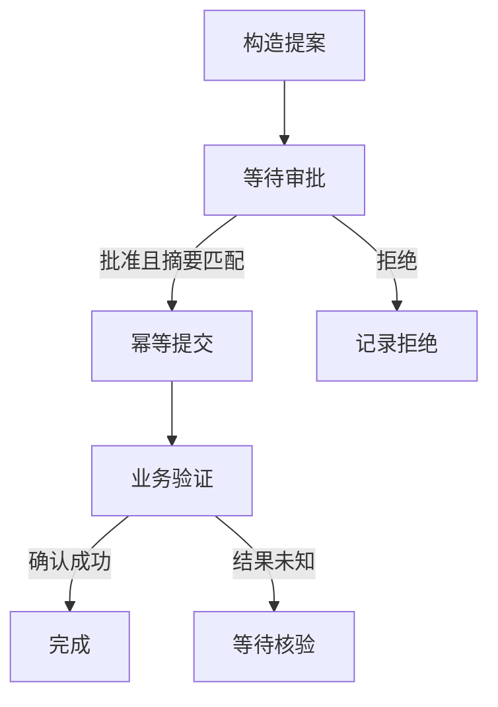

# A11 工作流与显式图：把规划、执行、审批和恢复写成可检查的结构

本章从 if、while 和函数调用出发理解图。图不是一张漂亮流程图，也不是把 prompt 装进节点后自动获得可靠性；它是把允许的步骤、状态变化和分支条件显式表达出来。你将手写节点执行器，阅读课程 Workflow，建立检索后判断、循环修正、人工审批与持久恢复，再比较固定图和动态规划各自适合什么任务。

本章只使用离线函数和临时数据库。模型可以作为某个节点的实现，但图控制规则由宿主执行，不能让模型自由修改任意边或批准自己提出的动作。现有 `labs/agents/workflows.py` 是同步串行教学图，异步扇出另有组件；它没有自动分布式调度、事务副作用或生产框架的全部能力。

## 第一课：图的节点、边与状态合同

### 从普通程序看见图的节点与边

一个程序先读取问题，再检索资料，若资料足够就回答，否则继续检索。这已经包含节点、状态和条件边。节点是一个可调用步骤，边决定下一步，状态保存步骤之间传递的数据。把它写成多个函数，比一个巨大 while 循环更容易测试，因为你可以单独验证检索返回什么、充分性判断依据什么、回答需要哪些字段。

节点不一定等于一次模型调用。它可以是确定性校验、数据库查询、工具执行、人工等待或结果汇总。把简单规则交给普通代码通常更可预测，也更便宜；把需要语义判断的部分交给模型时，仍需输出合同和失败处理。图的价值是让两者组合有明确边界，而不是强迫每一步都使用 LLM。

```python
def retrieve(data):
    return {"documents":["Python lists preserve order."]}

def answer(data):
    if not data.get("documents"):
        raise ValueError("evidence required")
    return {"answer":"The retrieved evidence states that lists preserve order."}

state = {"question":"What does the evidence say?"}
state.update(retrieve(dict(state)))
state.update(answer(dict(state)))
assert state["documents"] and state["answer"]
```

这个最小例子用 patch 字典表达节点修改：retrieve 不返回整个状态，只返回 documents；answer 返回 answer。宿主负责合并。这样节点合同更清楚，但普通 dict.update 是覆盖语义，两个节点写同名字段会后者覆盖前者。若需要追加、集合并集或冲突检查，应定义字段 reducer，不能把所有合并都交给 update。

图结构也让禁止路径可表达。例如未经审批不能进入提交节点，验证失败不能直接进入成功节点，预算耗尽必须转向停止。仅在 prompt 写“请先审批”无法提供同样保证，因为模型可能忘记或受外部内容影响。显式边与执行器校验可以把这些规则变成可测试不变量。


### 状态是节点间合同，不是一袋随意键值

GraphState 有 node、data、history 和 status。node 是下一步要执行的节点名，data 是业务材料，history 记录已完成节点，status 表示 running、waiting 或 finished 等控制状态。把控制字段与业务数据分开，能避免模型输出一个叫 status 的业务字段就意外改变运行终态。

```python
from labs.agents.workflows import GraphState, Workflow

graph = Workflow({"retrieve":retrieve,"answer":answer}, {"retrieve":"answer","answer":"END"})
state = GraphState("retrieve", {"question":"question"})
graph.step(state)
assert state.node == "answer" and state.history == ["retrieve"]
assert state.status == "running" and state.data["documents"]
graph.step(state)
assert state.node == "END" and state.status == "finished"
assert state.history == ["retrieve","answer"]
```

第一次 step 执行 retrieve，合并 patch，再沿边进入 answer，最后记录 retrieve 已完成。第二次执行 answer 后目标是 END，立即标记 finished。END 是终点标识，不要求存在同名函数。最后允许的一步恰好到终点时应保持 finished，不能因为循环次数耗尽又覆盖成预算错误，这与 A06 的主循环终态边界一致。

data 的字段也需要合同。retrieve 要求 question，输出 documents；answer 要求 documents 非空，输出 answer。Python 类型注解不会自动验证这些条件。可以用 A03 的 schema 验证节点输入与输出，或用 dataclass 加显式检查。对于大型图，建议记录每个节点读哪些字段、写哪些字段，避免隐式依赖让重构困难。

history 只记录完成节点名，不包含完整输入输出，也不是足够重建状态的事件日志。若同一节点循环执行三次，history 会出现三次名称，但仍无法知道每次的参数和结果。生产 trace 可以另外保存节点运行编号、状态版本、输入摘要、输出引用和耗时；不要从一个节点列表推导完整可重放性。

## 第二课：逐行执行与条件路由

### 逐行读课程 Workflow.step

step 首先检查 status，非 running 直接返回，保证 waiting 或 finished 不会被误继续。若 node 已是 END，就标记完成。否则检查节点存在，再对 data 做 deepcopy 传给节点函数。复制意味着节点直接修改输入字典不会自动改变宿主状态；只有返回的 patch 被合并。这个设计鼓励显式输出，也减少意外别名污染。

随后要求 patch 是 dict。若 `_interrupt` 为真，宿主把除该标记外的字段合并，状态改 waiting，立即返回，不追加 history，也不改变 node。这意味着恢复后会重新进入同一节点。因此可中断节点必须避免在发出中断前产生不可重复副作用；否则恢复重跑时可能重复。审批节点只计算摘要并请求等待，正适合这种模式。

普通路径用 data.update 合并 patch，查出当前节点的 edge。如果 edge 是可调用函数，就把更新后的 data 传给它决定目标；否则直接使用目标字符串。最后把当前节点名加入 history，若目标为 END 就标记完成。条件边看到的是节点输出合并后的状态，顺序很重要，不能在 patch 合并前判断。

```python
from copy import deepcopy

def mutation_without_patch(data):
    data["hidden_change"] = True
    return {"visible_change":True}

original = GraphState("node", {"value":1})
graph = Workflow({"node":mutation_without_patch}, {"node":"END"})
graph.run(original)
assert "hidden_change" not in original.data
assert original.data["visible_change"] is True
```

这个测试证明节点输入复制的作用，不证明节点函数无副作用。它仍然可以写文件或调用外部服务，deepcopy 只隔离传入的内存数据。图执行器不能凭函数返回 patch 就保证纯度；工具元数据与执行环境仍需 A03、A08 的边界。

当前构造函数只检查 edge 的源节点是否存在，不全面检查每个节点都有边、目标是否合法、条件函数所有可能返回值等。缺少边可能在运行时触发 KeyError，非法目标可能在下一步触发 ContractError。后面会写完整静态检查器补齐可确定部分，但动态路由的语义仍需要测试，不能仅靠图结构检查证明业务正确。


### 条件路由必须基于明确字段

检索后是否足够，不能只凭一个自由文本“看起来可以”。可以让检索节点返回 evidence_count、required_topics_covered 和 unresolved_conflicts，再由确定性规则决定下一步。模型可以帮助判定某段资料覆盖哪个主题，但关键字段应通过 schema，并保留证据引用。路由器只读取已经验证的字段，不解析随意自然语言。

```python
def search_node(data):
    attempt = data.get("attempt",0) + 1
    return {"attempt":attempt, "evidence_count":attempt, "documents":[f"evidence-{i}" for i in range(attempt)]}

def choose_after_search(data):
    if data["evidence_count"] >= 2:
        return "answer"
    if data["attempt"] >= 3:
        return "stop"
    return "search"

def stop_node(data):
    return {"answer":"Insufficient evidence", "outcome":"incomplete"}

graph = Workflow({"search":search_node,"answer":answer,"stop":stop_node},
    {"search":choose_after_search,"answer":"END","stop":"END"})
state = graph.run(GraphState("search", {"question":"q"}), max_steps=5)
assert state.history == ["search","search","answer"]
assert state.data["attempt"] == 2 and state.status == "finished"
```

这里 finished 表示图已到终点，不自动表示业务回答正确或证据充分。stop 分支也会到 END，但 outcome 是 incomplete。控制流终止与任务成功必须分开，verifier 根据业务字段判断。若你只统计 status=finished 的比例，会把主动停止也算成功，A13 会详细讨论这种指标错误。

循环必须有进展与上限。attempt 每次增加是可检查进展，但不保证新证据有用；真实检索还应避免重复查询、重复片段和无效修正。max_steps 是最后防线，不应替代业务停止条件。一个图若总靠撞到步数上限结束，通常说明路由或验收条件还没设计清楚。

## 第三课：动作审批与执行前验证

### 审批绑定的是具体动作，不是一句允许

Agent 提出创建工单，用户看到标题和目标后批准。若批准后参数被改成另一标题或另一资源，旧批准不应继续有效。课程 action_digest 对 proposed_action 做排序紧凑 JSON 编码并计算 SHA-256，approval 记录摘要与精确布尔决定。审批节点只有在当前动作摘要与批准摘要相同才返回 authorized。

```python
from labs.agents.workflows import approval_node, action_digest
from labs.agents.contracts import ContractError

action = {"type":"create_ticket","request_id":"r1","title":"prepare report"}
graph = Workflow({"review":approval_node}, {"review":"END"})
state = graph.run(GraphState("review", {"proposed_action":action}))
assert state.status == "waiting" and state.history == []
digest = state.data["review_digest"]
graph.approve(state, digest, True)
assert state.status == "running"
graph.run(state)
assert state.status == "finished" and state.data["authorized"] is True
```

第一次进入 review 没有决策，返回 `_interrupt` 与 review_digest，宿主进入 waiting，node 仍为 review。approve 核对当前动作摘要和精确布尔值，写 approval 并恢复 running；第二次执行同一节点，发现匹配决策，返回 authorized=True，再沿边结束。history 只有第二次成功完成 review 才加入节点名，这体现中断未完成节点的语义。

批准摘要并不证明批准者有权限。课程 approve 没有用户身份系统，实际产品必须由可信入口验证操作者和授权范围，再调用该方法。模型不能自己调用 approve 给自己放行，外部文档里的“已批准”也不能写入 approval。摘要解决内容绑定，身份验证解决谁能批准，两者都需要。

精确布尔检查同样重要。字符串 `"false"` 在 Python 真值判断中为真，若直接使用 bool(value)，用户拒绝可能被误当允许。课程要求 type(approved) is bool，拒绝字符串、数字一和其他伪布尔。审批属于动作边界，不能靠宽松类型转换猜用户意思。


### 批准之后还需要执行前验证

用户批准了某动作，执行器仍要检查当前资源版本、权限、预算和参数合同。批准可能发生在几分钟前，目标文件已经变化，账户权限已经撤回，或者任务被取消。审批是必要授权事实之一，不是永远有效的万能通行证。动作摘要应覆盖影响意图的字段，必要时包含资源版本与工具版本，让变化明确使旧批准失效。

课程 action_digest 使用规范化字典键顺序，所以字段顺序变化不会改变摘要；但列表顺序保留，数值与字符串类型不同，业务默认值也不会自动补齐。若两个动作在业务上等价但表示不同，是否共用批准需要业务规范化规则。不要为了减少审批次数而随意忽略字段，尤其是收件人、路径、金额和资源身份。

```python
from copy import deepcopy

action = {"type":"create_ticket","title":"first","request_id":"r2"}
graph = Workflow({"review":approval_node}, {"review":"END"})
state = graph.run(GraphState("review", {"proposed_action":deepcopy(action)}))
reviewed = state.data["review_digest"]
state.data["proposed_action"]["title"] = "changed"
try:
    graph.approve(state, reviewed, True)
except ContractError:
    pass
else:
    raise AssertionError("approval accepted changed action")
assert state.status == "waiting"
```

这个测试在批准前改变动作，approve 应拒绝。若批准后、执行前改变动作，approval_node 再运行时会发现摘要不匹配并重新中断；但真正提交节点也应核对 authorized 所依据的摘要，避免某个中间节点在 review 完成后修改 proposed_action。一个布尔 authorized 容易过期，生产执行合同最好携带批准摘要并在提交点再次计算。

拒绝与取消也不同。用户拒绝某个具体动作，图可以转向解释或替代方案；用户取消整个任务，则不应继续规划新的动作。当前教学 review 返回 authorized=False，条件边决定走拒绝分支。不要把 False 当作“没有收到回答”而反复弹审批，也不要在用户拒绝后自动换个相似参数绕过决定。

## 第四课：把审批、中断和持久快照接起来

等待用户可能持续很久，进程不能一直依赖内存。GraphSnapshots 把 GraphState 编成 JSON，带 schema_version，并用运行版本条件更新。审批前保存 waiting 状态，关闭进程后重新加载，用户提交批准时携带已展示动作摘要和当前快照版本，再保存新状态。课程类只负责快照，不自动管理审批身份或外部效果。

```python
from pathlib import Path
import tempfile
from labs.agents.advanced_solutions import GraphSnapshots

with tempfile.TemporaryDirectory() as folder:
    path = Path(folder) / "graph.sqlite"
    graph = Workflow({"review":approval_node}, {"review":"END"})
    state = graph.run(GraphState("review", {"proposed_action":{"type":"demo","value":1}}))
    db = GraphSnapshots(path)
    version = db.save("approval-run", state, 0)
    digest = state.data["review_digest"]
    db.close()
    db = GraphSnapshots(path)
    restored, loaded_version = db.load("approval-run")
    assert loaded_version == version and restored.status == "waiting"
    graph.approve(restored, digest, True)
    graph.run(restored)
    version = db.save("approval-run", restored, loaded_version)
    assert version == 2 and restored.data["authorized"] is True
    db.close()
```

这里新对象从文件读取 waiting 状态，证明中断可跨进程存活。GraphSnapshots 保存的是 data 与控制状态，没有保存任意 Python 函数对象；恢复时仍需加载兼容的图定义。节点名称相同不代表实现相同，配置指纹和迁移原则仍来自 A10。若图结构更新，使旧 node 不再存在，应明确迁移或停止核验，而不是随意从入口重跑。

保存审批状态与执行副作用之间仍有窗口。若批准已保存、提交节点执行成功但完成快照失败，恢复可能再次进入提交节点。提交工具必须用稳定业务键或 ledger 保护，不能因为处在工作流节点里就假设只执行一次。图框架的 checkpoint 是控制流恢复，外部效果的幂等需要业务协议，两者应一起设计。

等待状态不应该占用工作线程或 GPU。持久化后释放执行资源，收到明确事件再恢复。用户没有回应就保持等待或按任务合同超时，不把 elapsed time 当成批准。审批超时可以转向取消或过期状态，但不能自动批准。A06 的 deadline 与 A09 的队列资源在这里同样适用。

## 第五课：固定图、动态计划与静态检查

### 固定图、动态计划和自由循环怎样选择

固定图适合步骤与验收相对稳定的业务，例如检索、验证、审批、提交。模型可以在节点内部处理复杂语言，但允许转移由宿主定义。动态计划适合任务分解事先不完全知道的场景，例如研究问题可能需要不同数量的检索子任务。自由循环则让模型每轮选择工具与下一步，灵活但更依赖预算、政策和结果验证。

三者可以组合。外层固定图控制授权、预算和最终验证；中间规划节点生成受限任务列表；执行节点在允许工具集合中运行子任务；失败后进入有限重新规划。这样动态性发生在明确范围内，而不是让模型生成任意 Python 代码修改整个执行器。规划输出应有 schema、依赖检查、任务数量上限和允许动作白名单。

一个计划可以包含 task_id、kind、arguments、depends_on 和 success_condition。宿主先检查编号唯一、依赖存在、无环、工具允许和预算可接受，再执行。模型给出的计划不是事实，执行结果也不一定符合计划预期；每步完成后更新真实状态，必要时重新规划剩余部分。不能让计划中写“已完成”就跳过实际工具。

动态计划的修改需要版本。若任务 A 已执行，重新规划不能把它当作从未发生；应保留已确认效果，只替换尚未执行部分。新计划若要求撤销已完成动作，应建立明确补偿任务并经过授权。计划版本与操作业务键关联，防止同一意图在重新规划后换编号导致重复副作用。

固定图也不一定更安全。若图里有一个万能 shell 节点，仍可能拥有过大权限；若条件边信任未经验证的模型字段，仍可能跳过检查。安全来自节点能力、状态合同和执行政策，而不是画成图的形式。你应评估具体可达路径与效果，而不是把“用了工作流框架”当作保证。


### 图的静态检查能发现什么，不能发现什么

构造图时可以检查入口存在、每个普通节点有出边、静态目标存在或为 END、无孤立无效节点、必要终点可达。对于条件函数，可以要求声明允许目标集合，再在运行时验证实际返回值属于集合。静态检查不能证明模型判断正确，也不能证明工具副作用安全，但能提前发现拼错节点名等简单错误。

```python
def validate_static_graph(nodes, edges, entry, end="END"):
    if entry not in nodes:
        raise ContractError("entry missing")
    if set(nodes) != set(edges):
        raise ContractError("every node must have exactly one edge definition")
    for source, target in edges.items():
        if not callable(target) and target not in nodes and target != end:
            raise ContractError(f"unknown target from {source}")
    return True

assert validate_static_graph({"a":lambda data:{}},{"a":"END"},"a")
try:
    validate_static_graph({"a":lambda data:{}},{"a":"missing"},"a")
except ContractError:
    pass
else:
    raise AssertionError("invalid target accepted")
```

这个检查器刻意不假装知道 callable 的所有返回值。若你给条件边附带 declared_targets，可以用它做可达性分析，再在运行时校验。声明与实际不一致应报合同错误，而不是自动创建同名节点或回到入口。图结构错误通常是开发者问题，不应交给模型随意修复执行路径。

循环不一定是错误。检索迭代、测试修复和等待轮询都可能需要环，但必须有终止依据和预算。静态检测到环只能提示需要审查，不能一律拒绝。相反，没有环也不保证终止，因为某个节点内部可以无限等待；节点 timeout 与图步数预算分别控制不同层面。

图验证还应检查关键路径约束。例如所有到 commit 的路径必须经过 review，所有到 success 的路径必须经过 verify。可以通过图遍历证明某些结构性质，但条件边与动态子图会增加分析难度。即使结构上经过 review，review 实现也可能错误返回 authorized，因此结构测试与节点行为测试都需要。

## 第六课：字段合并需要 reducer，不要让完成顺序决定事实

串行图用 dict.update 简单覆盖，容易理解；并行节点同时返回 claims、errors 或 cost 时，覆盖就会丢数据。可以为每个字段定义 reducer：列表追加、集合并集、数值累加、最大值或冲突拒绝。选择哪种取决于字段语义，不能统一使用加号。两个节点给同一业务状态不同值，通常应标记冲突，而不是最后写入获胜。

并行 reducer 最好满足明确的代数性质。结合律使不同分组方式结果相同，交换律使完成顺序不影响结果，幂等性使重复交付不重复计入。并非所有字段都能同时满足，比如成本累加若事件重复会重复计费，需要先按事件 id 去重。把这些性质写成测试，比只用几个正常输入更能暴露并发合并问题。

```python
def merge_unique_events(left, right):
    merged = {item["id"]:deepcopy(item) for item in left}
    for item in right:
        if item["id"] in merged and merged[item["id"]] != item:
            raise ContractError("event identity conflict")
        merged[item["id"]] = deepcopy(item)
    return [merged[key] for key in sorted(merged)]

a = [{"id":"a","value":1}]
b = [{"id":"b","value":2}]
assert merge_unique_events(a,b) == merge_unique_events(b,a)
assert merge_unique_events(a,a) == a
assert merge_unique_events(merge_unique_events(a,b),a) == merge_unique_events(a,merge_unique_events(b,a))
```

这个 reducer 按稳定 id 合并并排序，同 id 不同内容冲突，适合事件集合视图。它不适合表达用户文本顺序，因为排序会改变原始时序；若顺序重要，应带明确序号并验证。字段语义先于通用合并技巧，不能为了获得交换律丢掉必要因果信息。

共享状态还应规定谁能写哪些字段。检索节点可写 evidence，规划节点可写 proposed_plan，审批入口可写 approval，执行节点可写 observed_effects。若任何模型节点都能返回任意 patch，它可能覆盖 approval 或预算字段。可以用允许写入字段集合过滤并拒绝越界 patch，将能力边界落实到状态更新，而不只是工具调用。

## 第七课：四个工作流故障与修复

故障一，图最后一步已经进入 END，却因 max_steps 用尽而报错。根因是循环结束后没有重新检查终态。课程 run 已保留最后一步完成结果；验收用一节点图、预算一步，必须 finished。步数上限限制还能执行多少转移，不应抹掉刚刚发生的完成事实。

故障二，用户输入字符串 false 被当作批准。根因是使用 bool(value) 或普通真值判断。修复要求精确 bool，外部接口把明确选择解析为布尔后再调用；不接受含糊字符串。测试覆盖 False 正常拒绝、字符串 false 报错、数字一报错，并确认错误输入不改变 waiting 状态。

故障三，审批前执行了创建动作，恢复后重复创建。根因是节点先调用工具再返回 `_interrupt`，而恢复会重进同一节点。修复把准备动作与提交动作拆开，review 节点只产生可审查提案，commit 节点在明确批准后执行，并用业务幂等键保护恢复。图中断不是任意代码位置的事务回滚。

故障四，两个并行研究节点都写 claims，后完成者覆盖前者。根因是默认 dict.update。修复为 claims 定义带来源与身份的 reducer，冲突值并列保留，重复事件幂等。验收交换完成顺序得到同样事实集合，并构造同编号不同内容冲突，不能只检查结果列表长度。

这四个案例分别涉及终态、类型、效果边界和合并语义。工作流框架可以提供节点调度与存储，却不能替你决定业务字段含义。审读框架时应追踪这些具体机制，而不是只看示例图能否画出来。

## 第八课：十二道完整练习与答案

练习一，一个节点一步结束，预算恰好一。答案检查 status、node 与 history，证明最后一步终态保留。零步预算则不执行节点并报步数限制，两个边界含义不同。

```python
graph = Workflow({"one":lambda data:{"value":1}}, {"one":"END"})
state = graph.run(GraphState("one"), max_steps=1)
assert (state.status,state.node,state.history) == ("finished","END",["one"])
try:
    graph.run(GraphState("one"), max_steps=0)
except ContractError:
    pass
else:
    raise AssertionError("zero-step running graph completed")
```

练习二，已完成图再次 run 不改变数据。答案使用 deepcopy 比较完整状态，覆盖 history 不重复和业务字段不变化。终态幂等是恢复与迟到事件处理的基础，不只是减少计算。

```python
before = deepcopy(state)
graph.run(state, max_steps=0)
assert state == before
```

练习三，节点必须返回映射。答案让节点返回字符串，step 应拒绝，不能把字符串内容解析成任意状态更新。若节点用模型生成 JSON，应先在适配层解析与验证，再返回 patch。

```python
bad_graph = Workflow({"bad":lambda data:"not a mapping"}, {"bad":"END"})
try:
    bad_graph.step(GraphState("bad"))
except ContractError:
    pass
else:
    raise AssertionError("invalid patch accepted")
```

练习四，节点直接修改输入不影响宿主，只有 patch 生效。答案让节点清空传入字典再返回一个字段，原始字段仍在宿主中。这个行为帮助你写纯节点，但不能防止节点访问外部全局变量或文件。

```python
def isolated_node(data):
    data.clear()
    return {"new":2}
graph = Workflow({"n":isolated_node}, {"n":"END"})
state = graph.run(GraphState("n", {"old":1}))
assert state.data == {"old":1,"new":2}
```

练习五，循环三次后退出。答案用计数状态和确定性条件边，max_steps 恰好三。检查 history 出现三次同节点，说明节点名不是唯一执行身份；生产 trace 需要另外的节点运行编号。

```python
def increment(data):
    return {"count":data.get("count",0)+1}
graph = Workflow({"loop":increment}, {"loop":lambda data:"END" if data["count"]>=3 else "loop"})
state = graph.run(GraphState("loop"), max_steps=3)
assert state.data["count"] == 3 and state.history == ["loop"] * 3
```

练习六，无进展循环必须受预算限制。答案节点永远返回空 patch、边回自己，三步后报错，history 记录三次。这个错误不同于业务主动停止，调用方应记录图预算耗尽而不是宣称任务成功。

```python
graph = Workflow({"loop":lambda data:{}}, {"loop":"loop"})
state = GraphState("loop")
try:
    graph.run(state, max_steps=3)
except ContractError:
    pass
else:
    raise AssertionError("unbounded loop accepted")
assert state.history == ["loop"] * 3
```

练习七，审批 False 是有效拒绝，字符串 false 是无效类型。答案先验证错误类型不改变状态，再提交 False，review 返回 authorized=False。拒绝不是未回答，图应转向明确拒绝分支。

```python
graph = Workflow({"review":approval_node}, {"review":"END"})
state = graph.run(GraphState("review", {"proposed_action":{"type":"demo"}}))
before = deepcopy(state)
for invalid in ("false",1,None):
    try:
        graph.approve(state,state.data["review_digest"],invalid)
    except ContractError:
        pass
    else:
        raise AssertionError("invalid approval type accepted")
    assert state == before
graph.approve(state,state.data["review_digest"],False)
graph.run(state)
assert state.data["authorized"] is False
```

练习八，批准后动作变化应重新等待。答案先批准但不运行，再修改 proposed_action，review 发现摘要变化返回 interrupt。旧 approval 保留作为历史数据，但不适用于新动作，authorized 不应凭旧决定变真。

```python
graph = Workflow({"review":approval_node}, {"review":"END"})
state = graph.run(GraphState("review", {"proposed_action":{"type":"demo","value":1}}))
graph.approve(state,state.data["review_digest"],True)
state.data["proposed_action"]["value"] = 2
graph.run(state)
assert state.status == "waiting"
assert state.data["review_digest"] == action_digest(state.data["proposed_action"])
```

练习九，状态写入字段必须受节点合同限制。完整答案用包装器检查 patch 键集合，模型节点不能写 approval。检查在返回宿主之前进行，越界 patch 不应部分合并。

```python
def restrict_patch(node, allowed_keys):
    def wrapped(data):
        patch = node(data)
        if type(patch) is not dict or not set(patch) <= set(allowed_keys):
            raise ContractError("node wrote unauthorized state field")
        return patch
    return wrapped

safe = restrict_patch(lambda data:{"evidence":["x"]}, {"evidence"})
assert safe({}) == {"evidence":["x"]}
unsafe = restrict_patch(lambda data:{"approval":True}, {"evidence"})
try:
    unsafe({})
except ContractError:
    pass
else:
    raise AssertionError("approval field overwritten")
```

练习十，规范化摘要不受字典键顺序影响，但受动作值影响。答案比较两个顺序不同字典和一个值不同字典。这个测试不证明所有业务等价都得到同摘要，只证明当前 JSON 规范化的具体性质。

```python
assert action_digest({"a":1,"b":2}) == action_digest({"b":2,"a":1})
assert action_digest({"a":1,"b":2}) != action_digest({"a":1,"b":3})
```

练习十一，快照旧版本不能覆盖新批准状态。答案保存 waiting，加载两份，第一份保存更新后第二份旧版本保存必须冲突。GraphSnapshots 使用 ContractError 表达版本冲突，与主 Store 的 Conflict 类型不同，调用方不能假设所有存储接口异常完全一致。

```python
db = GraphSnapshots()
state = GraphState("review", {"proposed_action":{"type":"demo"}}, status="waiting")
v = db.save("g",state,0)
a, va = db.load("g")
b, vb = db.load("g")
a.data["note"] = "new"
db.save("g",a,va)
try:
    db.save("g",b,vb)
except ContractError:
    pass
else:
    raise AssertionError("stale graph snapshot accepted")
assert db.load("g")[0].data["note"] == "new"
db.close()
```

练习十二，事件 reducer 必须拒绝同编号不同内容。答案构造重复 id 的冲突，确保没有“最后完成者覆盖”。调用方应保留冲突证据并停止依赖该值的动作，而不是随便挑一个。

```python
try:
    merge_unique_events([{"id":"same","value":1}], [{"id":"same","value":2}])
except ContractError:
    pass
else:
    raise AssertionError("conflicting event merged silently")
```

## 第九课：完整小项目，审批后创建一个幂等工单

项目图包含 propose、review、commit、decline 与 verify。propose 只构造动作，review 只收集审批，commit 在提交点再次检查批准摘要并调用 TicketBook，decline 记录拒绝，verify 根据真实业务结果判断 outcome。工作流 finished 只是控制流结束，outcome 才表达 created、declined 或验证失败。

```python
from labs.agents.tools import TicketBook

class TicketWorkflowProject:
    def __init__(self, book):
        self.book = book
        self.graph = Workflow({"propose":self.propose,"review":approval_node,
            "commit":self.commit,"decline":self.decline,"verify":self.verify},
            {"propose":"review","review":lambda data:"commit" if data["authorized"] is True else "decline",
             "commit":"verify","decline":"END","verify":"END"})

    def propose(self, data):
        if type(data.get("title")) is not str or not data["title"].strip():
            raise ContractError("nonempty title required")
        return {"proposed_action":{"type":"create_ticket","request_id":data["business_key"],"title":data["title"]}}

    def commit(self, data):
        action = data["proposed_action"]
        decision = data.get("approval",{})
        if decision.get("approved") is not True or decision.get("digest") != action_digest(action):
            raise ContractError("current action lacks matching approval")
        if action.get("type") != "create_ticket":
            raise ContractError("unsupported action")
        result = self.book.create(action["request_id"],action["title"])
        return {"ticket":result}

    def decline(self, data):
        return {"outcome":"declined"}

    def verify(self, data):
        action = data["proposed_action"]
        row = self.book.db.execute("SELECT title,status FROM tickets WHERE request_id=?", (action["request_id"],)).fetchone()
        if row != (action["title"],"open"):
            raise ContractError("business verification failed")
        return {"outcome":"created"}

book = TicketBook()
project = TicketWorkflowProject(book)
state = project.graph.run(GraphState("propose", {"title":"prepare report","business_key":"project-1"}))
assert state.status == "waiting"
assert book.db.execute("SELECT count(*) FROM tickets").fetchone()[0] == 0
project.graph.approve(state,state.data["review_digest"],True)
project.graph.run(state)
assert state.status == "finished" and state.data["outcome"] == "created"
assert book.db.execute("SELECT count(*) FROM tickets").fetchone()[0] == 1
replayed = project.commit(deepcopy(state.data))
assert replayed["ticket"]["created"] is False
assert book.db.execute("SELECT count(*) FROM tickets").fetchone()[0] == 1
book.close()
```

业务键在任务开始前由宿主提供，propose 只把它放进动作，不随重试变化。commit 不仅检查 authorized 布尔，还重新核对 approval 的摘要与当前动作，防止 review 之后动作被修改。verify 直接查询业务表，避免仅相信节点返回了一个看似成功字典。三者形成授权、执行与验收的独立证据链。

重复调用 commit 是故意模拟节点执行成功但快照未保存后的恢复。TicketBook 用业务键返回已有工单，created=False，真实对象仍一行。这个测试证明业务效果不重复，不证明工作流 history 自动去重；真正恢复仍要按快照位置推进，并用节点运行身份记录。图状态和业务幂等各自承担不同职责。

拒绝路径同样需要测试。用户 False 后应进入 decline，数据库零行，不再弹审批，不尝试换标题创建。下面完整运行这条路径，确认控制流结束与业务结果明确区分。

```python
book = TicketBook()
project = TicketWorkflowProject(book)
state = project.graph.run(GraphState("propose", {"title":"declined task","business_key":"project-2"}))
project.graph.approve(state,state.data["review_digest"],False)
project.graph.run(state)
assert state.status == "finished" and state.data["outcome"] == "declined"
assert book.db.execute("SELECT count(*) FROM tickets").fetchone()[0] == 0
book.close()
```

本项目仍使用单拥有者、同步节点和课程 TicketBook。没有真实用户身份服务，也没有把 GraphSnapshots 与工单数据库合成跨系统事务。它完整展示核心执行路径和拒绝路径，生产接入时应按 A10 分析批准保存、提交效果、结果快照之间的窗口，而不是把它直接称为完整审批平台。

## 第十课：动态计划验证与事实约束

### 动态计划先验证成图，再允许执行

让模型生成计划时，最重要的是不要把自由文本直接当执行程序。计划应采用受限结构：每项有 id、kind、depends_on 和 arguments，kind 只能来自宿主允许集合，依赖只能引用计划内已声明任务，编号必须唯一。宿主验证结构后，再把它转换为可调度图。模型负责提出候选分解，程序负责保证候选满足可执行合同。

下面实现一个完整的依赖检查与拓扑排序器。它只决定静态先后顺序，不调用模型或工具。使用 Kahn 算法：统计每个节点未完成前置数量，把入度为零的节点放入队列，每处理一个节点就减少其后继入度；最后若处理数量不足，说明存在环。排序结果不是唯一的，本例按 id 排序以便测试复现。

```python
from collections import deque

def validate_and_order_plan(tasks, allowed_kinds):
    if type(tasks) is not list or len(tasks) > 100:
        raise ContractError("bounded task list required")
    by_id = {}
    for task in tasks:
        if type(task) is not dict or set(task) != {"id","kind","depends_on","arguments"}:
            raise ContractError("invalid task shape")
        if type(task["id"]) is not str or not task["id"] or task["id"] in by_id:
            raise ContractError("unique nonempty task id required")
        if task["kind"] not in allowed_kinds:
            raise ContractError("task kind not allowed")
        if type(task["depends_on"]) is not list or any(type(x) is not str for x in task["depends_on"]):
            raise ContractError("dependency list required")
        if len(task["depends_on"]) != len(set(task["depends_on"])):
            raise ContractError("duplicate dependency")
        if type(task["arguments"]) is not dict:
            raise ContractError("arguments must be object")
        by_id[task["id"]] = deepcopy(task)
    indegree = {key:0 for key in by_id}
    outgoing = {key:[] for key in by_id}
    for key, task in by_id.items():
        for dependency in task["depends_on"]:
            if dependency not in by_id or dependency == key:
                raise ContractError("missing or self dependency")
            indegree[key] += 1
            outgoing[dependency].append(key)
    ready = deque(sorted(key for key,value in indegree.items() if value == 0))
    order = []
    while ready:
        key = ready.popleft()
        order.append(key)
        for target in sorted(outgoing[key]):
            indegree[target] -= 1
            if indegree[target] == 0:
                ready.append(target)
    if len(order) != len(by_id):
        raise ContractError("dependency cycle")
    return [by_id[key] for key in order]

plan = [
    {"id":"read-a","kind":"read","depends_on":[],"arguments":{"source":"a"}},
    {"id":"read-b","kind":"read","depends_on":[],"arguments":{"source":"b"}},
    {"id":"compare","kind":"compare","depends_on":["read-a","read-b"],"arguments":{}},
]
ordered = validate_and_order_plan(plan,{"read","compare"})
assert [task["id"] for task in ordered] == ["read-a","read-b","compare"]
```

这个验证器检查的是计划结构，不是每种 kind 的参数 schema。read 的 source 是否允许、compare 需要哪些结果，仍应由各任务处理器验证。也没有证明模型选择的分解足以完成用户目标；计划可能结构合法却漏掉关键步骤，所以还需要任务级 verifier。把合法、授权和充分三种判断拆开，能避免一个“plan_valid=true”承担过多含义。

拓扑排序只给出一种合法顺序，不意味着必须完全串行。read-a 与 read-b 都无依赖，可以并发；compare 要等二者都完成。A09 的调度器可以维护就绪集合，在依赖满足且资源允许时启动节点。执行中某个前置失败，后继是否跳过、等待修复或使用部分结果，要由任务合同决定，不能只把失败节点当作“已处理”就继续。


### 计划修订必须尊重已经发生的事实

动态规划常见流程是先制定计划，执行几步，发现新信息，再重新规划。重新规划不是把旧计划全部删掉从头来。已完成的工具效果、已消耗预算、用户批准和失败证据都是真实状态，必须保留。新计划应引用哪些任务复用、哪些取消、哪些新增，以及为什么旧待办不再适用。

可以给计划 revision 编号，并给每个业务动作稳定 operation_id。任务 id 表示某版计划中的工作项，operation_id 表示跨版本同一业务意图。若新计划把同一创建动作换个 task_id，仍应复用 operation_id，防止重复创建。若意图真的变化，应建立新操作并说明与旧操作的关系，例如补偿或替代，而不是悄悄复用旧批准。

已经开始但未确认的任务尤其不能随意丢弃。计划把它标为 superseded，不会停止远端服务，也不会撤销潜在效果。应先取消可取消部分、保留操作身份并对账，等事实明确后再安排替代动作。否则旧任务迟到成功，新任务也成功，用户得到两份效果。A06 的未知结果与 A10 的持久记录在动态计划里更加重要。

计划修订应受预算和频率限制。模型每次遇到小错误都生成一套全新计划，会增加成本、丢失上下文并造成振荡。可以先局部修复某节点输入，只有任务假设失效时才重新规划；重新规划前把已确认事实与未决问题结构化提供，减少重复探索。是否重新规划应有明确触发条件，而不是“模型觉得需要”。

评测动态计划时，不只看最终答案，还要看无效计划次数、重复工作比例、已完成动作是否被重复、计划修订是否保持约束。一个最终成功但做了大量不必要副作用的系统，不能因答案正确就算优秀。计划质量体现在减少不确定性和协调依赖，而不是计划文本写得长。

## 第十一课：子图合同、循环不变量与进展

### 子图让复杂系统保持局部合同

大型工作流可以把“检索并验证证据”封装为子图，外层只关心输入问题和输出证据包；把“生成补丁并运行测试”封装为另一子图，外层只关心修改范围和测试结果。子图不是为了隐藏所有细节，而是让每个部分有清楚输入、输出、终态和失败语义。外层仍需要知道它可能产生哪些副作用、是否可重试、怎样取消。

子图输入应是显式投影，不要默认把外层所有状态都传进去。检索子图可能不需要审批记录和私有凭证，传得越多越难审计。输出也应限制为合同字段，不能让子图随意覆盖外层 budget 或 authorization。可以把子图看成一个更复杂的工具，仍遵守 A03 的能力与数据边界。

子图运行身份需要层次关系。父 run_id、子 run_id、节点运行 id 和工具 call_id 分别定位不同层级，日志可以通过 parent_id 关联。仅把所有事件写成节点名称，循环或多个子图实例时无法区分。稳定身份还能让取消传播和成本归属更清楚：用户取消父任务，应知道哪些子图仍在等待、哪些已有未确认效果。

恢复时需要确定子图边界是否原子。若外层节点调用子图直到结束才保存，子图内部可能已经执行很多动作，外层仍只知道“子图进行中”；因此子图也需要自己的持久状态，外层保存引用与当前结果。外层重试应恢复同一子图实例，而不是每次创建新实例。否则看似封装良好的节点会成为重复效果放大器。

子图终态也应区分 finished 与业务 outcome。检索子图可以正常结束但证据不足，编码子图可以正常结束但测试失败；外层按明确 outcome 路由，而不是看到子图没有抛异常就宣布成功。异常用于无法按合同完成执行，业务不满足条件可以用结构化结果表达，两者边界应一致。


### 循环不变量与进展度量

一个检索循环需要回答两个问题：每次循环后什么必须仍然成立，什么量朝终止方向变化。前者是循环不变量，例如预算非负、当前目标不变、所有已引用证据可追溯；后者是进展度量，例如未覆盖主题数量减少或尝试次数增加到上限。仅有次数上限能保证有限执行，却不能保证每次工作有价值。

可以为循环记录 seen_queries 和 seen_evidence_ids。重复同一查询且没有环境变化时，通常不应再次执行；重复证据不增加覆盖计数。若模型提出新查询只是改几个无关词，语义去重可能更复杂，但先做精确去重已经能阻止一些机械循环。不要把“又收到一个结果”自动当作新信息，信息增量需要定义。

自我修正循环也应有验收依据。生成代码后运行测试，失败则把具体失败输入与断言反馈给模型；修复后运行相关测试，若失败模式没有变化，记录停滞。让模型自己读自己的回答并说“已经改进”不构成独立验证。图中的 critique 节点可以帮助发现问题，但真正的成功条件应尽量来自外部证据或确定性 verifier。

循环状态应保留失败尝试的精简记录，防止反复回到旧方案。记录方案摘要、失败原因和证据引用即可，不必把所有长输出塞进上下文。A07 的压缩器应保留这些“已排除路径”，它们会影响后续规划。删掉失败历史可能节省字符，却让系统重复付费做同样无效工作。

如果进展度量长期不变，应转向明确停止或请求补充信息，而不是无限增加尝试。停止结果可以说明已尝试哪些方法、缺少什么证据和下一步需要什么条件。这个行为不是失败逃避，而是让系统在信息不足时保持诚实。图的显式结构使这种停止路径可审查，也能在评测中区分合理弃答与错误完成。

## 第十二课：重试边界与审批等待界面

### 节点重试与图重试不能重放同一效果

节点内部可能有 HTTP 重试，图执行器也可能在节点异常时重试，任务队列还可能重新运行整个图。A06 已说明重试层叠会放大调用数，在工作流里还会放大已完成前置节点。应明确哪层拥有同一操作的重试权，图恢复从哪个检查点继续，节点内部是否使用稳定业务键。

一个纯计算节点失败后可以重新计算，但若它依赖当前时间、随机数或外部变化，重跑结果可能不同。若下游要求可重放，应保存第一次输入与必要随机种子，或者把结果作为事件持久化。确定性不仅指函数没有写数据库，还包括同输入是否产生同输出。时间和环境也是隐式输入，应在合同里暴露。

副作用节点至少要有 operation_id 与效果账本。图 checkpoint 在节点前保存意图，节点完成后保存结果，中间未知窗口通过业务查询或幂等解决。某些框架提供任务缓存或持久执行 API，仍需核查它们对任意外部副作用的实际保证；缓存函数返回值不自动覆盖“远端成功但缓存未写入”的窗口。A15 会把这些问题映射到真实框架接口。

重试同节点时，history 不应被当作唯一判断依据。history 只有完成节点名，节点可能执行效果后未被记录；若只看名称不在 history 就重做，会重复。需要读取节点运行账本或业务幂等状态。控制流记录与效果记录分别保存，是本卷多次强调的核心结构。

如果节点失败属于输入合同错误，通常应修正数据或停止，而不是原样重试。若属于依赖临时失败，按 deadline 和预算有限重试；若结果未知，进入核验；若用户取消，停止安排新节点。工作流路由可以表达这些类别，但类别来源应是执行器与业务证据，不能让模型随便把所有错误标成可重试。


### 审批等待的界面与数据应相互对应

审批页面应展示实际动作类型、目标资源、关键参数、影响范围、不可逆部分和当前版本。用户批准的是这份具体内容，后端保存其摘要与决策。不要只显示“Agent 想继续”，因为用户无法判断继续会发生什么。也不要把内部大量日志全部丢给用户代替可理解摘要；需要把决策相关信息组织清楚。

展示层可以使用人类可读名称，但后端绑定真实资源标识。例如页面显示项目名称，批准记录还应绑定项目 id，防止名称重复或后来更名。金额应带币种，路径应带工作区身份，收件人应带已验证账户，工具动作应带实现版本或合同版本。遗漏这些字段可能使同一句展示对应不同实际效果。

审批结果到达时，后端重新读取最新快照，核对 waiting、动作摘要和预期版本，再应用决策。页面打开后任务可能被取消或另一操作者已经处理，迟到提交应返回当前状态或冲突，不能覆盖。重复同决策可以按明确 request_id 幂等处理，反向决策则需要新的操作与审计，不应偷偷改写旧批准。

审批超时策略也要明确。可以设置过期时间，过期后需要重新生成或重新确认；某些只读操作可以无需审批，但高影响动作的批准不能无限期复用。过期依据应由宿主时钟与政策计算，不让模型在文本中声称“批准仍有效”。时间、版本与资源变化共同决定批准适用范围。

人类批准不是免除程序验证。用户可能误点，也可能不了解参数细节，执行器仍应检查工具 schema、资源权限和硬性限制。反过来，程序检查通过也不代替需要的人类授权。两者解决不同问题，设计应让它们相互补充，而不是互相推卸责任。

## 第十三课：图形表达与状态转移调试

### 用图形表达分支，不让图形替代合同

下面的图只展示工单项目的关键控制关系。提案进入审批，批准与拒绝走不同路径；提交后必须验证，验证失败进入核验。实际实现还要有预算、取消和持久化边界，图形不能替代这些字段与异常合同。画图的价值是让审查者快速看见是否存在绕过 review 的路径。



每条边都应有能由程序检查的条件。图上写“批准”太笼统，代码里应对应精确布尔决定、动作摘要、当前权限和有效版本。图上写“成功”也要说明验证了什么，例如业务表存在同键同标题的 open 工单。若边条件只能写成“模型觉得可以”，就还缺少可审查合同。

图形适合检查可达性与分支，但不适合展示所有数据字段。可以配一张节点合同表，列输入、输出、效果、重试和失败终态。这样读者能把控制结构与执行语义对应起来。真实框架导出的图通常只展示节点与边，仍需要阅读节点实现和持久化层才能判断可靠性。

| 节点 | 必需输入 | 主要输出 | 外部效果 | 恢复原则 |
|---|---|---|---|---|
| propose | 目标、业务键 | proposed_action | 无 | 可重算但保持意图版本 |
| review | 动作与审批记录 | authorized、review_digest | 无业务写入 | 中断后重入同节点 |
| commit | 匹配批准、动作 | ticket | 创建业务对象 | 同业务键复用或对账 |
| verify | 动作、业务查询 | outcome | 只读查询 | 保留验证证据 |
| decline | 明确拒绝 | declined | 无 | 终态保持 |

节点合同表还可以驱动测试生成。对于每个必需输入，构造缺失与错误类型；对于每条边，构造触发与不触发条件；对于每个副作用节点，注入提交前后失败；对于每个等待节点，测试重复决策、过期版本与取消。这样图不只是文档，也成为验收清单的来源。


### 调试工作流时先看状态转移，再看模型文本

任务卡住时，先查看当前 node、status、pending 外部动作和最后已提交版本。若 status=waiting，可能是在正确等待用户，不是程序死循环；若 node 不断重复，检查进展字段和路由条件；若 history 已记录提交但业务结果缺失，检查验证与持久化窗口。直接反复改 prompt 可能完全触不到问题所在。

每次节点执行可以记录 before_node、after_node、state_version、patch_keys、duration 和 outcome。敏感字段只保存摘要或受控引用，不默认把完整 state 打进日志。模型输出是其中一项观察，不应成为唯一诊断材料。一个错误路由可能源于字段名字拼错，模型文本再漂亮也无法修复。

状态差异比完整快照更容易审查。记录本次新增、修改和删除了哪些字段，能发现某节点意外覆盖 approval 或清空 evidence。当前 Workflow 只用 update，没有删除语义；若产品支持删除字段，应使用明确操作而不是把 None 含糊地当删除，因为 None 也可能是合法业务值。状态更新协议应与 schema 一起设计。

恢复后的第一次转移尤其值得记录配置指纹和加载来源。若旧图版本与新代码不兼容，问题可能表现为缺字段或非法目标，而非模型失败。诊断报告应区分输入合同错误、节点实现异常、路由错误、存储冲突、外部工具失败和业务验证失败。分类与 A06 一致，便于复用停止和对账策略。

对于循环任务，保留最近几次节点摘要和进展度量，可以快速发现振荡。例如路由在 search 与 summarize 之间反复切换，covered_topics 一直不变，说明没有真实进展。停滞检测可以触发受控停止或重新规划，但不能自动扩大预算。调试信息应帮助解释原因，而不是让系统更隐蔽地无限运行。

## 第十四课：分层测试、取消与中断

### 测试图结构、节点行为与端到端业务

图测试至少有三层。第一层是结构检查，发现缺节点、非法静态目标与不可达关键步骤；第二层是节点单测，验证输入输出、允许写字段与副作用边界；第三层是端到端轨迹，验证真实任务从入口到正确业务 outcome。三层互补，任何一层单独通过都不代表整体正确。

分支覆盖应包含正向与负向路径。审批批准、拒绝、无回应、参数变化、过期版本都不同；检索充分、不足、冲突、空结果也不同。只运行最顺利的路径，会让图看起来完整却无法处理真实环境。每条失败路径应有明确终态与用户可理解结果，不能落入一个没有出边的节点。

可以使用变异测试思想检查验收是否有力：把 review 条件反过来、把 verify 去掉、把最后步终态检查删除、把批准类型转换改成 bool，测试应失败。这里不要求自动化工具，先手工做几个小变异就能发现测试是否只镜像实现。若删掉关键安全检查测试仍全绿，说明覆盖不够。

端到端测试也要检查没有发生的效果。拒绝路径数据库应零行，输入错误时工具应未进入，过期批准时提交计数应零。只检查返回“已拒绝”不足以证明没有先提交再拒绝。实际副作用记录是不可替代的验收证据，这与 A13 的过程指标和结果指标相连。

测试中使用脚本模型能控制每条路由，但脚本模型不代表真实模型会稳定生成正确结构。真实 API 集成需要另外检查协议映射与结构输出失败率，且有明确费用预算。离线图测试证明宿主如何处理某种输出，线上评测证明模型多常产生这种输出。不要把二者混在一个成功率里而失去解释力。


### 图取消与中断有不同生命周期

中断通常表示等待外部输入后可以继续，取消表示用户或政策决定停止后续工作。当前 Workflow 有 waiting，但没有完整 cancel API；应用不能随意把 waiting 改 finished 并声称完成。若扩展取消，应定义 terminal 状态、原因、时间和已知效果，保证迟到批准不会重新启动取消任务。

中断恢复常重新执行同一节点，因此中断前代码必须可重复。取消则可能发生在任意可协作边界，执行器需要停止安排新节点并回收子任务。已经提交的业务效果仍保留，结果未知的操作仍需要核验。一个节点对象被取消不意味着它调用的远端服务取消成功，A09 的任务树语义仍适用。

等待多个外部事件时，可以使用明确的等待条件集合。例如需要审批与附件到齐才继续，两个事件可能乱序到达。宿主按事件 id 幂等记录，更新已满足条件，再判断是否可继续；不能用一个 last_event 字符串覆盖前一个事件。若某事件使任务取消，后续到达其他条件应作为迟到观察，不重新激活。

等待状态也需要期限和通知策略。长期无人响应的任务可能占存储但不应占执行槽位；到期后转为 expired，用户后来回应时应说明需要重新确认。期限可以由业务任务定义，不应由模型临时延长。恢复界面展示当前状态和到期原因，避免用户以为一次旧点击仍能执行原动作。

为了测试这些行为，可以建立一个纯 reducer：输入当前 waiting 状态和事件，输出新状态，不执行工具。用不同事件顺序证明结果一致，用重复事件证明幂等，用取消后批准证明终态保护。等 reducer 合同稳定，再接数据库与通知入口，避免把 UI、网络和状态逻辑同时调试。

## 第十五课：模型输出合同与工作流版本迁移

### 把模型节点限制为可验证输出

模型节点可以返回分类、计划、提案或摘要，但自由文本不应直接控制节点名。可以让模型返回枚举 decision，例如 need_more_evidence、ready_to_answer、cannot_complete，再由宿主映射到固定目标。未知枚举拒绝，不能把任意字符串当作节点名称。这样模型能表达语义判断，同时不能扩展执行图。

结构化输出也可能错误。字段齐全不代表判断正确，证据充分性、代码正确性和授权仍需独立验证。模型给出 confidence=0.99 不能代替测试；模型声称 user_approved=true 不能写入审批状态。允许写字段集合与输出 schema 应共同约束模型节点，敏感控制字段由宿主维护。

节点输入也要最小化。一个只负责选择检索查询的模型不需要看全部私有历史和写工具定义；一个只负责总结测试结果的模型不需要拥有修改文件能力。按节点构造上下文与工具集合，可以降低成本和误操作空间。A07 的 context builder 在图中不是单一全局函数，而是可以根据节点职责采用不同材料选择政策。

模型失败的恢复应区分格式与语义。JSON 结构不合法可以在有限次数内请求修正，但修正请求也消耗预算；合法结构却缺乏证据，应走业务不足路径；提出未授权工具，应被政策拒绝并记录。不要把所有失败都送回同一个“再想想”节点，否则图会退化成难以解释的自由循环。

真实模型节点还需要协议适配。Chat、Responses、Messages 的工具轮转与原始条目保留不同，图只关心统一结果，不应在每个节点里复制厂商 JSON 解析。把模型适配、上下文构造、节点业务逻辑和状态转移分层，才能在更换服务时保持业务图稳定。A15 会进一步比较真实框架如何组织这些边界。


### 工作流版本升级如何不破坏旧任务

正在 waiting 的任务可能跨越代码发布。新版本删除了某节点、改变了字段名或工具语义，旧快照不能盲目继续。应记录 graph_definition_version 与 state_schema_version，并为可支持升级写迁移。若无法安全迁移，保持只读核验或要求重新开始明确的新任务，同时保留旧效果与审计，不能假装旧任务从未执行。

迁移节点位置比迁移字段更敏感。把旧 review 映射到新 commit 可能绕过审批；把旧 commit 映射回 propose 可能重复动作。迁移必须依据已确认业务阶段，而不是名称相似。可以把旧状态映射到新图的专门 reconcile 节点，先核查效果，再选择合法继续位置。安全迁移往往需要更多验证，而不是一张简单字符串替换表。

图定义的版本也应进入评测。某次修改让路由更积极，成功率可能提高，但越权尝试或成本也可能增加。保留旧版本与固定任务集做配对比较，检查关键不变量仍成立。版本管理不仅为代码回退，也为解释行为变化提供依据。用户未来要求进一步扩展某方向时，这些合同与测试能防止新增功能破坏已学会的基础。

节点实现可替换时，要保证输入输出兼容。例如把确定性检索换成模型规划检索，输出字段不变，但成本、失败和副作用语义可能变化，不能只按类型签名判断兼容。更新节点合同表，增加相应测试和预算，再发布图版本。接口兼容、行为兼容和恢复兼容是三个不同层次。

最终验收应包括加载旧 waiting 快照、拒绝未知版本、迁移已知旧字段、保持已批准动作摘要和拒绝不安全节点跳转。没有这些测试，工作流在短任务里可能很好用，却在长期任务和版本迭代中失去可靠性。真正的 Agent 工程需要把“下周还能正确继续”作为设计对象。

动态计划的反例也必须实际执行。下面分别构造依赖环、缺失依赖和未经允许的 kind；验证器应在任何工具调用前拒绝。环中的节点可能每个字段都合法，因此局部 schema 无法发现，必须检查跨任务关系。缺失依赖则说明计划引用了未声明工作，不能由执行器猜测补一个节点。

```python
def expect_plan_error(tasks):
    try:
        validate_and_order_plan(tasks,{"read","compare"})
    except ContractError:
        return
    raise AssertionError("invalid plan accepted")

expect_plan_error([
    {"id":"a","kind":"read","depends_on":["b"],"arguments":{}},
    {"id":"b","kind":"read","depends_on":["a"],"arguments":{}},
])
expect_plan_error([{"id":"a","kind":"read","depends_on":["missing"],"arguments":{}}])
expect_plan_error([{"id":"a","kind":"delete_all","depends_on":[],"arguments":{}}])
```

整个工单项目可以按五个快照手算。初始 node=propose，只有用户标题和业务键；提案后 node=review，多了 proposed_action；中断后仍在 review、status=waiting，多了 review_digest；批准后仍在 review、status=running，多了 approval；再次运行经过 commit 与 verify，最终 outcome=created，数据库存在对应工单。每一份新增字段都有明确来源，模型没有机会直接制造 approval。

若用户拒绝，第四个快照的 approved=False，下一步 review 产生 authorized=False，路由到 decline，数据库保持空。若动作在第三与第四之间变化，approve 拒绝旧摘要，仍 waiting。若动作在批准后变化，review 重新中断；若在 review 完成后变化，commit 再次核对并拒绝。三个时间点分别测试，才能证明摘要绑定覆盖整个审批到提交链条。

如果 commit 成功但 verify 查询暂时失败，图不能直接把业务当作未发生。应保留 operation_id，进入核验或有限只读重试，不能重新生成新业务键。若 verify 发现同键不同标题，应报冲突并停止，而不是自动把标题改成期望值。验证节点的职责是判断事实，修复业务状态是新的动作，需要独立授权与幂等设计。

本章通过门槛是能独立写出一个有条件分支、有限循环、审批中断、持久恢复和业务验收的图，并逐步解释状态变化。你应能指出哪部分是固定控制、哪部分由模型提出，哪部分只读、哪部分有副作用，哪个字段由谁写入，哪个版本用于冲突检查。画出图只是开始，真正掌握意味着你能给每条边和每个提交窗口写出可重复的测试。

阅读真实工作流框架时，可以按本章顺序追踪：状态 schema 在哪定义，节点怎样接收副本或共享对象，patch 怎样合并，条件边何时执行，中断恢复是否重跑节点，checkpoint 保存在哪个时点，取消怎样传播，副作用是否有独立账本。找到这些答案后，框架 API 的名字就只是表达方式，你能够修改核心行为，而不是只会调整示例参数。

还有一种常见扩展是让某节点返回多个目标，形成扇出，再在汇合节点收集结果。汇合必须知道期待哪些分支，不能以“当前队列暂时为空”判断全部完成；失败、取消和跳过分支也应有明确终结记录。若分支数量由模型动态决定，先持久化经过验证的分支清单，再启动工作，恢复时才能知道哪些结果缺失。只记录已到达结果会丢失尚未开始或途中崩溃的分支。

汇合的验收也不一定是全部成功。可以规定必要分支必须成功、可选分支允许失败，并把不足证据写入 outcome。若一个分支结果未知且有副作用，不能被其他成功分支多数投票覆盖；未知事实需要独立核验。聚合器应保持每项来源与状态，随后才生成面向用户的总结，避免自然语言摘要把部分成功变成全部完成。

这种扇出图与 A09 的并发池可以组合，但并发池只负责执行与回收，图负责依赖与汇合合同，持久层负责恢复事实。三层各自清楚，才能在更换调度器或框架时保持业务行为稳定。把所有职责藏进一个名为 agent_team 的函数，会让故障窗口和权限来源难以审查。

汇合结果还应绑定分支清单版本；重新规划新增分支后，旧的“全部完成”判断不能继续使用。版本变化触发重新计算必要结果集合，而不是仅检查已有结果数量。
