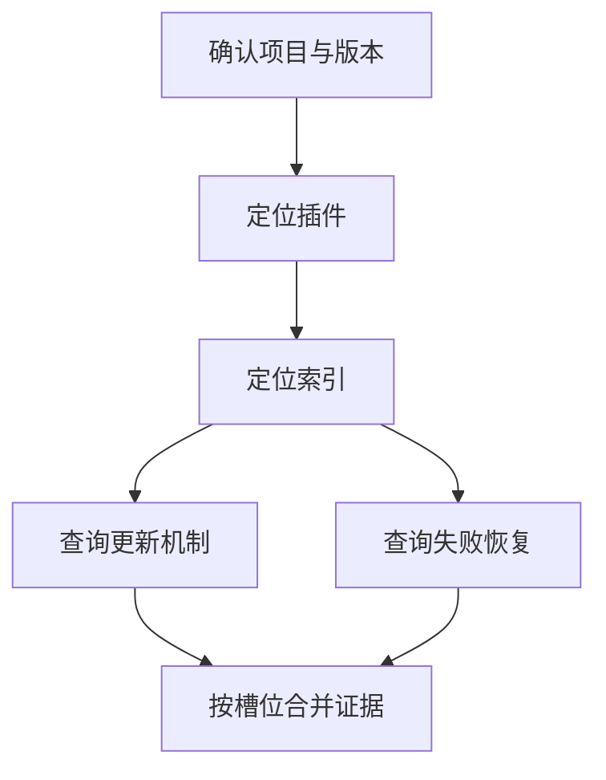

# R07 查询规划与多跳检索：把缺口变成下一步操作

先修 R01–R06，尤其是候选、相关性、版本与证据支持的区别。本章把一次搜索扩展成可以解释、可以停止、可以重放的研究过程。你不需要先购买任何 API；固定函数就能把状态、预算和错误处理学透。学完以后再把其中一个决策函数替换成模型，才知道模型被允许决定什么，以及系统必须替它检查什么。

## 小课一：先识别问题的结构，才能知道搜什么

“介绍缓存”与“为什么我的这个配置仍然发生等待”需要的证据完全不同。第一种可以接受概念定义，第二种需要配置、版本、现象与机制之间的联系。如果拿同一个简短字符串丢给检索器，然后把排名第一的说明书当答案，两种问题都可能得到流畅的介绍，但后者没有完成诊断。检索规划的第一步不是把句子改得更像搜索关键词，而是明确完成任务所需的证据类型。

把用户问题拆成五个字段：对象、任务、条件、需要比较的维度、完成判据。对象回答“在讨论谁”，如虚构项目 Jade 的索引；任务回答“要说明、比较、定位还是操作”；条件包括版本、平台、时间、不能使用的资源；维度包括延迟、容量、更新方式；完成判据规定什么算答完。字段之间不能互相替代。用户说不能使用 GPU，这是方案边界，不是一个可以因查询改写而消失的普通词。

例如“在 Linux 上，不用 GPU，比较 Jade 1 与 Jade 2 的索引更新和失败恢复”。对象是两个版本的 Jade；任务是比较；平台与设备是硬约束；比较维度有更新和恢复；完成判据是两个版本在两个维度上都有可追溯证据。我们需要四个格子的证据表。某一份文档把 Jade 2 写得很详细，并不能补上 Jade 1 的空格。先画表能防止因为资料不对称而写出貌似全面的比较。

注意“任务分解”不是把每个名词都变成子问题。若拆成 Linux 是什么、GPU 是什么、Jade 是什么，虽然每个问题都能搜索，却不推进比较任务。好的子问题有一个明确的答案槽位，并且其答案能被合并规则使用。这里合并规则是按照版本和维度对照，而不是把四段介绍机械拼接。

```python
from dataclasses import dataclass

@dataclass(frozen=True)
class Need:
    object_name: str
    versions: tuple[str, ...]
    dimensions: tuple[str, ...]
    platform: str
    forbidden_devices: tuple[str, ...]

need = Need("Jade", ("1", "2"), ("更新", "恢复"), "Linux", ("GPU",))
slots = [(version, dimension)
         for version in need.versions for dimension in need.dimensions]
assert slots == [("1", "更新"), ("1", "恢复"), ("2", "更新"), ("2", "恢复")]
```

这个列表推导式有两层循环。外层先取版本一，内层依次取更新和恢复；然后版本二重复内层。四个二元组不是四份事实，它们是四个尚未填充的证据槽位。不可变数据类使后续函数不能随意把禁止 GPU 改成允许 GPU。实际应用仍要从经过认证的运行上下文取得权限，不能把这个任务对象当身份凭证。

## 小课二：改写、扩展、分解与假设，各有不同责任

改写保留问题含义、改变表达。用户说“资料改了以后，旧答案还会不会冒出来”，可以改写为“文档更新后的旧版本引用与答案缓存失效”。改写成功的判据是原来的约束和关系仍在，而不是术语更多。扩展是在保留原查询的同时加入可能相关的表达，例如补入 revision、stale citation、cache invalidation。它主动扩大搜索范围，因此同时增加召回机会与噪声。

分解把大任务变成有依赖关系的子任务。要比较两个实现，通常可以并行查询各自的更新与恢复；要找“某服务依赖的库的许可证”，必须先确定依赖库，再查询那个库的许可证，这两个子任务有顺序依赖。假设则是一个待验证解释，例如“等待可能来自缓存容量”。假设不是用户事实，也不是检索证据。把它放进查询是允许的，把它偷偷写进结论不允许。

有一个很实用的三栏记录法：第一栏保存原问句，第二栏保存本轮检索句，第三栏保存转换理由及保留约束。第三栏的用途不是要求模型展示内部思维，而是记录一个简短、可审计的动作说明，如“把口语缓存爆了映射到 capacity exhausted；保留版本二与仅 CPU 条件”。这个说明可以由固定规则生成，也可以由模型提供的结构化动作字段生成。不要把长篇自然语言推演作为执行依据。

精确标识符需要特别处理。函数名 `build_index`、错误码 `E204`、版本 `2.1.0` 和路径都可能决定唯一对象。把下划线去掉、把版本小数化、把错误码翻译成中文，都可能毁掉检索能力。因此查询规范化只能做经过验证的转换。大小写是否可折叠也取决于系统；课程英文词法检索会小写，而代码搜索中的变量名可能区分大小写。

```python
def expand_query(original, glossary):
    if not isinstance(original, str) or not original.strip():
        raise ValueError("nonempty query required")
    result = [original.strip()]
    for phrase, alternatives in glossary.items():
        if phrase in original:
            for alternative in alternatives:
                candidate = original.strip() + " " + alternative
                if candidate not in result:
                    result.append(candidate)
    return result

expanded = expand_query("Jade 2 缓存满了且不能用 GPU", {
    "缓存满了": ["cache capacity exhausted", "admission control"]
})
assert len(expanded) == 3
assert all("不能用 GPU" in text for text in expanded)
```

第一项始终保留原查询，这是可比较的基线。词典映射只追加检索术语，避免直接覆写原需求；它仍不是自然语言语义保证，因为追加的词可能误导排名。断言检查禁止条件没有被删除，但不能证明检索引擎理解了否定。后续筛选必须使用独立条件字段。该函数用于演示透明扩展，不是自动生成任意领域的同义词词典。

## 小课三：多跳的每一步必须增加可追溯的连接

设三份虚构资料分别写着：Jade 服务通过 Quartz 插件检索；Quartz 插件使用 Cedar 索引；Cedar 索引更新时先构建新代际再切换活动指针。用户问 Jade 的知识怎样更新。第一跳识别插件，第二跳识别索引，第三跳寻找更新机制。后一步的查询对象来自前一步证据，这就是多跳。单纯把同一问题搜索三遍，不会因为次数变多就自动成为多跳。

每次跳转都至少产生两个对象：一个新的检索参数和一个连接证明。检索参数是 Quartz 或 Cedar；连接证明是“Jade 使用 Quartz”或“Quartz 使用 Cedar”的来源与范围。缺少连接证明时，最后关于 Cedar 的答案可能完全正确，但与用户的 Jade 无关。多跳系统最常见的隐性错误，恰好是终点资料真实、中间连接错误。

关系不能任意传递。A 使用 B，B 支持 GPU，不能推出 A 的当前部署启用了 GPU。A 的某个旧版本使用 B，也不能证明 A 的新版本仍使用 B。实体名称相同也不能自动连接：Jade 项目里的 Cedar 和另一公司的 Cedar 可以是两个系统。实体身份应至少包含命名空间、类型和必要版本；如果来源没有足够信息，就把连接标为未消歧，而不是强行选择一个看起来熟悉的对象。

手工检查一条三跳链时，可以逐边提出三个问题：谁与谁发生何种关系；这条关系在哪些条件下成立；来源能否在当前身份下读取。第三个问题很重要。若中间边来自内部文档，而终点资料公开，不能因为最终答案只引用公开终点就把内部依赖关系泄露出来。整条路径的所有必要前提都必须经过授权检查。

## 小课四：先写状态，再写循环

一个研究过程需要保存哪些状态？至少包括任务、待查槽位、已执行查询、证据池、已经验证的连接、剩余预算、最近新增量和终止原因。把状态放进一个字典并不自动产生可靠性，但它使你能检查每轮到底发生了什么。否则循环里只有一个不断增长的字符串，发生错误后很难分辨模型看到了什么、哪个查询重复了、哪个证据已过期。

证据池以稳定片段 ID 为键。第一轮返回 a、b，第二轮返回 b、c，最终只有三个不同片段。查询去重与证据去重是两个不同集合：两个不同查询可能返回相同证据；一个查询重跑也可能因为资料更新而返回新版本。课程固定快照实验中可以按规范化查询去重；动态系统还需要把语料快照纳入查询身份，否则“我已经查过”可能指的是旧世界。

预算也应拆开。最多五轮不是最多五次外部调用，因为一轮可能同时调用改写模型、两个检索器、一个重排器。总请求数、总输入输出 token、累计费用、墙钟截止时间、并发上限和单响应字节数属于不同限制。一个 API 在取消后仍可能完成计费，取消不能被理解成把已发生费用撤回。离线练习先用整型调用次数，把控制流学清楚，之后再增加真实计量。

下面的固定执行器没有模型规划。它接收一组查询和一个确定性检索函数，返回明确状态。结果对象只含虚构片段 ID，使你可以直接手算每轮变化。

```python
from dataclasses import dataclass, field

@dataclass
class ResearchState:
    executed: list[str] = field(default_factory=list)
    evidence: dict[str, str] = field(default_factory=dict)
    events: list[dict] = field(default_factory=list)
    stalls: int = 0
    stop_reason: str = "not_started"


def run_plan(queries, retrieve, max_queries=4, max_stalls=2):
    if type(max_queries) is not int or max_queries < 1:
        raise ValueError("invalid query budget")
    if type(max_stalls) is not int or max_stalls < 1:
        raise ValueError("invalid stall budget")
    state = ResearchState(stop_reason="plan_exhausted")
    seen = set()
    for raw in queries:
        query = raw.strip()
        if not query or query in seen:
            state.events.append({"action": "skip", "query": query})
            continue
        if len(state.executed) >= max_queries:
            state.stop_reason = "query_budget"
            break
        seen.add(query)
        state.executed.append(query)
        before = len(state.evidence)
        try:
            rows = retrieve(query)
            for identity, text in rows:
                if identity in state.evidence and state.evidence[identity] != text:
                    raise ValueError("immutable identity changed")
                state.evidence[identity] = text
        except Exception as error:
            state.stop_reason = "tool_error"
            state.events.append({"action": "error", "type": type(error).__name__})
            break
        gained = len(state.evidence) - before
        state.stalls = state.stalls + 1 if gained == 0 else 0
        state.events.append({"action": "retrieve", "query": query,
                             "new_chunks": gained, "total": len(state.evidence)})
        if state.stalls >= max_stalls:
            state.stop_reason = "no_progress"
            break
    return state

fixture_results = {
    "Jade": [("a", "Jade uses Quartz")],
    "Quartz": [("a", "Jade uses Quartz"), ("b", "Quartz uses Cedar")],
    "Cedar": [("c", "Cedar switches generation after build")],
    "again": [("c", "Cedar switches generation after build")],
}
state = run_plan(["Jade", " Jade ", "Quartz", "Cedar"], fixture_results.__getitem__, 2)
assert state.executed == ["Jade", "Quartz"]
assert set(state.evidence) == {"a", "b"}
assert state.stop_reason == "query_budget"
```

`default_factory` 每次创建新列表或字典，避免两个研究状态共享同一可变默认值。`executed` 保存实际尝试过的独立查询，因此调用前就追加；即使工具失败，这次尝试仍消耗预算。`seen` 则只在本次运行内去重。重复项记录 skip，但不消耗检索额度。预算检查放在实际调用之前，防止“先调用第六次，再发现只许五次”。

`before` 保存本轮前的证据数量。增加两个新 ID 时 gained 为二；只返回旧片段时为零。正增量把连续停滞计数重置为零。错误分支只记录异常类型，避免把可能含内部地址或服务响应的错误全文暴露给报告。为了清楚演示，函数捕获普通异常并停止；生产实现应区分可重试超时、永久输入错误与权限错误，不能把所有问题统一重试。

这个函数还有一个有意公开的边界：它在迭代结果时直接合并，若第十条结果违反身份不变性，前九条可能已进入内存证据池。停止状态会标记错误，但不保证整轮结果原子合并。练习中将修复它，使“成功一轮”成为清楚的提交单位。这种主动说出简化边界，比给一个简单循环贴上生产级标签更有学习价值。

## 小课五：逐轮手算，不要只盯最后答案

对上面的输入，初始 executed 为空、evidence 为空、stalls 为零。第一轮 Jade 返回 a，查询数一，证据数一，新增量一，停滞计数仍零。第二项带两侧空白，strip 后也是 Jade，产生 skip 事件，查询数和证据池均不变。第三项 Quartz 返回 a、b，a 已存在且文本相同，b 新增，所以证据数二、新增量一。第四项 Cedar 执行前发现预算已用二，终止为 query_budget，Cedar 没有被调用。

现在把预算改为四，计划改成 Jade、again、again2。若 again 和 again2 都只返回 a，第一轮 gained 一，后两轮都是零，第三次实际查询后 no_progress。注意这不是“整个计划没有价值”，而是一个可计算的代理信号。两个旧片段可能组合出新解释，同一片段也可能解决不同槽位。因此停滞计数适合阻止明显循环，不适合单独证明问题已回答。

更好的完成判断来自槽位。若任务需要更新机制与失败恢复，而证据只说明切换指针，更新槽位可填，恢复槽位仍空。此时预算耗尽应返回部分完成，列明缺口。若系统把“已有三条证据”当作完成，资料切得越碎越容易过关，根本没有测量任务需求。证据数量与证据充分性是两种指标。

## 小课六：计划有依赖时，把它画成一个小图

并行查询适合彼此独立的槽位，例如已经确定两个版本后，分别查它们的恢复机制。依赖查询需要等待前驱结果，例如尚不知道依赖库名称时，不能可靠地查询其许可证。计划图的节点是任务，边表示后者需要前者的输出。它与知识图不同：知识图表达世界中的关系，计划图表达执行的先后约束。两种图可能都画箭头，但箭头含义不同。



图中 D 与 E 可以并行，因为共同依赖 C，却不依赖彼此。并行执行缩短墙钟时间，但不降低总调用数。若 D 成功而 E 失败，最终不能把整个节点集合当全成功；应保留两个独立状态。重新执行 E 时也无需重复 D，只要 D 的证据版本仍有效。这就是把计划状态持久化的价值。

为了从零理解拓扑顺序，先实现一个只处理有限无环任务图的调度顺序函数。它不执行工具、不处理分布式租约，只说明何时一个任务的依赖已经满足。无进展时可能是环，也可能引用不存在的前驱；我们分别检查，避免报一个不明确的错误。

```python
def execution_order(dependencies):
    names = set(dependencies)
    for task, prerequisites in dependencies.items():
        missing = set(prerequisites) - names
        if missing:
            raise ValueError(f"unknown dependencies for {task}: {sorted(missing)}")
    done, order = set(), []
    while len(done) < len(names):
        ready = sorted(task for task in names - done
                       if set(dependencies[task]) <= done)
        if not ready:
            raise ValueError("cycle in plan")
        order.extend(ready)
        done.update(ready)
    return order

plan = {"identify": [], "plugin": ["identify"], "index": ["plugin"],
        "update": ["index"], "recovery": ["index"],
        "merge": ["update", "recovery"]}
order = execution_order(plan)
assert order.index("index") < order.index("update") < order.index("merge")
assert order.index("index") < order.index("recovery") < order.index("merge")
```

`set(prerequisites) <= done` 表示所有前驱都已完成。每一轮收集当前全部 ready 节点，相当于一个可并行批次；这里只把它们按名字排序加入线性列表，保证演示可复现。真实调度器要区分 ready、running、succeeded、failed、cancelled，并限制并发。把任务名字放进 done 之前必须确认输出提交成功，而不是仅确认工具请求已发出。

## 小课七：如何把查询改写交给模型而不丢失边界

模型输出可以是结构化的提案，包含 action、query、slot 和 based_on。action 限定为 retrieve 或 stop；query 是长度受限的文本；slot 必须属于任务中的未完成槽位；based_on 是本次已授权证据池中的 ID。这样模型负责提出下一步，执行器负责检查这一步是否合法。模型不能在提案里设置 tenant、actor、API 地址、任意 Python 代码或最大预算。

检查结构还不够。模型可能提出语法正确但无意义的查询。运行器需要记录动作是否增加相关证据，评估时才能区分格式可靠和规划有效。对于多跳连接，还应要求 based_on 指向确实包含下一实体的来源；如果模型凭自己的参数知识提出 Cedar，可以允许它作为假设搜索，但不能把它登记为已证实依赖。

```python
def validate_action(proposal, slots, known_ids, max_query_chars=300):
    if not isinstance(proposal, dict):
        raise ValueError("object required")
    action = proposal.get("action")
    if action == "stop":
        if set(proposal) != {"action", "reason"}:
            raise ValueError("invalid stop fields")
        if proposal["reason"] not in {"sufficient", "no_next_query"}:
            raise ValueError("invalid stop reason")
        return proposal.copy()
    if action != "retrieve" or set(proposal) != {"action", "query", "slot", "based_on"}:
        raise ValueError("invalid retrieval action")
    query = proposal["query"]
    if not isinstance(query, str) or not 0 < len(query.strip()) <= max_query_chars:
        raise ValueError("invalid query")
    if proposal["slot"] not in slots:
        raise ValueError("unknown slot")
    references = proposal["based_on"]
    if not isinstance(references, list) or not all(isinstance(x, str) for x in references):
        raise ValueError("invalid references")
    if not set(references) <= set(known_ids):
        raise ValueError("unavailable references")
    return {**proposal, "query": query.strip(), "based_on": list(dict.fromkeys(references))}

valid = validate_action({"action": "retrieve", "query": " Cedar 更新 ",
                         "slot": "update", "based_on": ["b"]},
                        {"update", "recovery"}, {"a", "b"})
assert valid["query"] == "Cedar 更新"
```

函数返回一个新的字典，不修改原始提案，方便把原始模型输出与接受后的动作分别审计。stop 提案的 sufficient 只是模型声明，最终运行器仍要检查槽位证据。不能因为模型说找齐了，就绕过引用校验。这里的 based_on 仅验证身份存在，不证明因果关系成立；语义连接需要额外的关系提取或人工标签，我们在图章节继续展开。

## 小课八：路由不是“让模型随便挑工具”

路由决定某个子问题去哪里查询。精确错误码适合关键词或代码索引；表达相近但用词不同的概念问题适合语义检索；确定实体之间的依赖路径适合图查询；当前某个运行实例的状态应查受控状态工具，而不是查半年前的文档。路由依据是任务和数据类型，不是给每个工具写一句华丽描述后完全相信模型选择。

先做规则基线路由非常有价值。比如问题包含已知错误码格式时同时走关键词路线；明确要求引用某文档版本时锁定版本；问依赖链时增加图路线。不要把规则理解成永远优于模型，而是它可作为可测量对照。如果模型路由增加成本却没有改善召回，系统不应仅因为“更智能”就保留它。

混合路由也需要融合规则。两个检索源的分数不可直接相加，R05 的 RRF 可以作为候选融合基线；但来源身份、权限和版本要先统一。数据库行、网页段落、图路径不是同一种输出对象，应该转换成包含来源和支持范围的证据对象，不能只取它们的 text 字段拼接。路径尤其需要保存每一条边，而不只是最终实体名。

## 小课九：故障定位要看查询改变了哪一项假设

故障一是约束漂移。原问题说“版本一无需 GPU 的恢复流程”，改写变成“Jade 最新版本 GPU recovery”。检索结果都很相关，相关的是被改错的问题。定位时对比任务字段与每次 query，发现版本和设备限制丢失。修复不能只把提示词加粗，而应保留不可变约束字段，并在候选选择时验证版本与平台。

故障二是反馈漂移。第一轮由于同名实体返回另一项目 Cedar，系统从错误候选提取关键词，后续查询越来越集中到另一项目。轨迹中可见每一步都有新文档，所以 no_progress 不会触发。修复是给实体加命名空间，保留原查询路线，并要求连接边有来源。新增证据数量没有下降，错误却不断累积，这说明“有进展”的代理指标不等于任务进展。

故障三是重复消费预算。执行器先调用模型产生查询，再发现与上轮一样，于是又调用模型重新想；检索次数未超标，规划模型却调用一百次。修复要有总规划次数与总工具次数两个独立上限，在生成提案前也检查预算。拒绝无效提案本身仍消耗模型调用。日志必须记录 rejected_action，而不能只记录成功搜索，让成本看起来凭空消失。

故障四是错误完成。模型已经看到更新机制，因此 stop sufficient，但恢复槽位没有证据。最终检查应该返回 partial，并展示缺失恢复信息。继续无限搜索也不是唯一正确选项；预算用尽时坦诚说明缺口，本身是可靠结果。检索系统的目标是产生有根据的回答，而不是保证每个输入都有完整答案。

## 小课十：十二道递进练习与完整解答

**练习一，识别转换。** 把“资料修改后旧答案怎么办”变成“版本与缓存失效”是改写；同时增加 stale citation 是扩展；拆成文档版本、向量索引、答案缓存三项是分解；猜测错误源于缓存未失效是待验证假设。完整答案的关键在于第四项不能被登记成事实。你应在轨迹里给它标记 hypothesis，而不是 evidence。

**练习二，补证据表。** 用户比较 A、B 两框架的更新与恢复，当前只有 A 更新和 B 更新。缺口是 A 恢复、B 恢复，不能用两篇更新文档填入恢复列。下一步可并行发出两个恢复查询，查询里分别保留框架身份与版本。最终比较应明确每一格的来源，任何空格都需要标成未获得证据。

**练习三，手算预算。** 查询 a、a、b、c，预算二。实际执行 a、b；第二个 a 跳过；到 c 时终止。若 b 抛出异常，实际尝试仍为二，stop_reason 为 tool_error，不能因为失败就把预算退回并无限重试。用本章 run_plan 和字典检索函数可直接复现这两个情况。

**练习四，修复整轮原子合并。** 完整参考函数如下。它先在局部 staging 中检查所有记录，确认同一批次和既有证据都没有身份冲突，最后才一次更新。错误时 original 不变，成功时返回新字典，调用者可把它当状态转移结果。

```python
def merge_round(original, rows):
    staging = {}
    for identity, text in rows:
        if not isinstance(identity, str) or not identity or not isinstance(text, str):
            raise ValueError("invalid evidence row")
        old = staging.get(identity, original.get(identity))
        if old is not None and old != text:
            raise ValueError("immutable identity changed")
        staging[identity] = text
    return {**original, **staging}

old_pool = {"a": "first"}
try:
    merge_round(old_pool, [("b", "second"), ("a", "changed")])
except ValueError:
    pass
else:
    raise AssertionError("conflict was accepted")
assert old_pool == {"a": "first"}
assert merge_round(old_pool, [("b", "second")]) == {"a": "first", "b": "second"}
```

**练习五，触发停滞。** 让 q1、q2、q3 都返回同一个 a。第一次新增一条，第二次零，第三次零，max_stalls 为二时执行三次后停止。若 q2 返回 b，计数会归零，因此 q3 的零只是连续第一次停滞。不要写成“累计两次没有新证据就停止”，那会惩罚中间已经成功的探索。

```python
same = lambda query: [("a", "constant")]
stalled = run_plan(["q1", "q2", "q3", "q4"], same, 4, 2)
assert stalled.stop_reason == "no_progress"
assert len(stalled.executed) == 3
assert [e["new_chunks"] for e in stalled.events] == [1, 0, 0]
```

**练习六，找计划环。** A 依赖 B，B 依赖 A，没有任何 ready 节点。`execution_order({"A":["B"],"B":["A"]})` 必须抛出 cycle，而不是死循环。如果 A 依赖不存在的 C，应先报 unknown dependencies。两种错误的修复不同：前者重设计任务依赖，后者补全节点或纠正名字。

**练习七，关系传递。** 应用 uses 库，库 supports GPU，不推出应用 supports GPU。完整答案应给反例：应用只调用库的 CPU 接口，或运行环境没有启用 GPU。下一步查应用当前配置与实际调用路径。图路径可帮助提出验证问题，不能替代那个问题的证据。

**练习八，验证模型提案。** 提案包含 actor 字段，即使值是 learner，也必须被严格字段检查拒绝；身份来自运行器。based_on 含不存在的 x 也拒绝。query 为空白拒绝。stop sufficient 可以通过格式检查，但不能绕过完成检查。按这四个输入调用 validate_action，你应该观察前三个 ValueError、第四个返回结构化停止请求。

**练习九，完成判据。** 所需槽位为 update 与 recovery，证据字典只有 update。完整代码答案采用集合差，不依赖文档数量。允许每个槽位有多个来源，但空列表不能被算作完成。

```python
def completion(required_slots, supports):
    covered = {slot for slot, evidence_ids in supports.items() if evidence_ids}
    missing = sorted(set(required_slots) - covered)
    return {"status": "complete" if not missing else "partial", "missing": missing}

assert completion({"update", "recovery"}, {"update": ["a"]}) == {
    "status": "partial", "missing": ["recovery"]}
```

**练习十，计算延迟。** 每轮规划两秒、检索五十毫秒、重排二百毫秒，顺序五轮约十一点二五秒，尚未含最终生成、重试和网络波动。两个独立检索并行只能缩短那部分墙钟时间，不能减少调用费用。完整预算设计要同时记录规划次数、检索次数、总成本和截止时间。

**练习十一，设计回归集。** 最少包含否定限制、精确版本、错误码、函数名、同名不同项目、缺失终点证据各两题。给每题标出不能丢失的字段和必需来源，而不是只有参考答案字符串。测试改写后每个字段仍保留，再测召回与最终证据链，才能发现格式正确但召回退化的改写。

**练习十二，实现停止原因优先级。** 如果工具已失败，不要随后覆盖成 plan_exhausted；如果预算在下一次调用前耗尽，记录 query_budget；如果全部槽位已经校验完整，才记录 sufficient。完整实现方式是把每一种结束路径在发生处设定 reason 并立即退出循环，最终报告从状态读取，不根据“是否有一些证据”重新猜测。run_plan 展示前两种分支，completion 提供第三种判据，把二者连接即可。

## 小课十一：把固定执行器接入真实课程语料

先运行既有入口，观察已经通过单元测试的固定计划执行器：

```bash
python -m labs.knowledge.lab 21-multihop
python -m labs.knowledge.lab 25-graph
```

前者调用 `labs.knowledge.rag.bounded_research`，它只接受预先给定的查询列表，使用查询去重、最大查询数和证据 ID 去重。它并不调用规划模型，也没有本章新增示例中的连续停滞规则。后者通过有出处的图边找路径。比较两段输出时，应区分文本证据池和结构化关系路径：同样涉及多个文档，不代表输出支持范围相同。

把本章 `run_plan` 接入课程存储时，用一个闭包绑定 Context。检索函数只接受 query，内部调用 `hybrid(store, ctx, query)` 并把每个命中转换成 `(chunk_id,text)`。不要把 ctx 交给模型生成，也不要在检索函数里为了找全资料而读取所有租户。源码的实际混合函数名应从 `labs.knowledge.retrieval` 导入确认；本章下面给出对应的可运行封装。

```python
from labs.knowledge.store import CorpusStore, Context
from labs.knowledge.retrieval import hybrid

with CorpusStore() as corpus:
    corpus.ingest("plan-demo", "jade", "Jade", "Jade uses Quartz retrieval.", allowed=("*",))
    corpus.ingest("plan-demo", "quartz", "Quartz", "Quartz uses Cedar index.", allowed=("*",))
    corpus.ingest("plan-demo", "cedar", "Cedar", "Cedar rebuilds before switching revision.", allowed=("*",))
    context = Context("plan-demo", "learner")
    def retrieve_visible(query):
        return [(hit.chunk.chunk_id, hit.chunk.text)
                for hit in hybrid(corpus, context, query, k=2)]
    research = run_plan(["Jade", "Quartz", "Cedar revision"], retrieve_visible, 3)
    assert len(research.executed) == 3
    assert research.evidence
```

这个示例的计划仍是人工给定，所以不应把结果介绍成自主发现三跳关系。真正的下一阶段是从 Jade 的授权片段抽取 Quartz，再把它填入下一条查询；每个抽取值都带来源 ID。规则提取器可以先只接受固定句式，这样你能构造失败输入并验证不会凭空生成实体。之后替换为模型提取时，同一套来源与预算检查保持不变。

## 小课十二：分阶段项目与验收作品

第一阶段制作一套十二题的小语料，其中四题单跳、四题两跳、两题同名消歧、两题不可回答。每条事实都属于虚构项目，设置公开与私有两种权限，手工填写必需证据边。交付数据、查询、标签与检索轨迹。最初用固定计划，目标是把控制流与标签搞对，不追求自动化比例。

第二阶段加入词典改写与任务槽位。对每题同时运行原查询、改写查询、二者融合三种方案，记录相关候选新增量、必需证据召回、调用次数和约束保留。若改写让平均指标提高却使精确版本题退化，应按类别报告，不能把关键回归藏在平均值里。把有害改写加入回归集，说明是哪一条规则造成了问题。

第三阶段加入规则或模型动作提案。保留严格 schema、运行器身份、最大规划次数和证据充分性检查。模型不可用时固定提案序列仍能跑完整生命周期，这让离线测试不依赖付费服务。外部 API 实验应仅发送虚构资料，明确记录模型标识、配置、调用数与未知 usage；没有真实调用时写未执行，而不是把离线测试当作 API 验证。

第四阶段制作失败报告。至少演示一次约束丢失、一次实体串线、一次重复提案循环、一次预算耗尽部分回答。每份报告应包含触发输入、状态变化、第一次偏离发生在哪一步、修复代码或规则、修复后回归结果。优秀的研究 Agent 不只是能偶然找对答案，而是能在找不到、搜错、数据变化时仍保持可解释的边界。

最终掌握检查不是背诵“多跳”“路由”“反思”这些名称。请关闭教材，拿一个新问题画出证据槽位和依赖图，手算三轮状态，指出每个查询为什么必要，解释停止原因，再运行程序对照。如果你能发现程序多调用了一次、漏算了一次失败成本、用了一条没有出处的连接，并能修改测试使它再也悄悄通过，你已经掌握了本章最关键的工程能力。

## 小课十三：查询反馈的数学视角与可验证代价

为什么“下一次查询带来新东西”很难定义？先区分三个集合。设当前所有已获取片段的 ID 集合为 E，任务需要的事实槽位集合为 G，已经有合格证据支持的槽位为 C。一次查询返回集合 H。片段新增量是 H 中不在 E 的元素数；槽位新增量是本轮新增支持的槽位数；答案质量改善则还涉及支持强度、矛盾处理与输出。三者可能完全不同。查询返回十段同一个概念的重复介绍，片段新增十，槽位新增零；查询返回一段已见过的原文，但新的结构化抽取发现恢复条件，片段新增零，槽位新增一。

因此你可以定义一个教学用效用：新增槽位数量减去每次调用的固定代价，再减去引入不可靠连接的惩罚。这个数并不是普适真实奖励，它强迫你说清想优化什么。假如一个查询填上两个槽位、调用代价折算为零点二、没有连接错误，效用是一点八；另一个查询只增加十篇无关介绍，效用为负零点二。若只优化证据池大小，第二种查询反而可能得到更高奖励。自动规划系统常因奖励定义不当学会“搜索很多”而不是“解决问题”。

信息增益有时用不确定性的减少来描述。若你在查询前有两个互斥假设且各半相信，得到能排除一个的证据就很有价值。但这要求概率模型、证据似然与假设集合有可靠定义。直接把模型嘴里说的置信度当概率，再计算熵，可能得到精确的小数却没有可靠含义。本章使用明确槽位和标注证据集作为评估基线，是因为初学阶段能人工检查；这不意味着复杂研究任务最终都能压缩成固定清单。

对同一问题比较两种计划时，不要只报最终成功率。假设计划甲十题答对八题，平均搜索两次；计划乙答对九题，平均搜索二十次。乙是否值得采用，取决于增加的一题价值与延迟费用。再看失败分布：若甲失败的是资料本来缺失的问题，而乙多答对的一题其实依赖模型猜测，单一自动评分可能误判。报告至少同时列支持充分率、不可回答题的正确拒答率、平均及尾部调用数、时间和费用已知程度。

无法得到 API usage 时不能写零。你知道发生了四次请求，但不知道其中一个响应的 token 计数，就应记录已知三次的小计、总请求四、计量不完整。费用预算可以事前按最大输入输出估算并保守预留，事后按真实回执核对；两者不一致需要说明。这样才能避免代理在“未知费用等于免费”的错误逻辑下继续扩张查询。

## 小课十四：设计一个能重放的研究记录

重放不是把最后答案保存下来再打印一次。一个可用记录至少包含任务版本、数据快照、执行器版本、规划配置、每次被接受或拒绝的动作、每次工具观察的身份与内容摘要、预算变化、停止状态和最终报告的证据依赖。固定测试可以保存虚构的完整工具结果；涉及真实资料时，记录应遵守同样的权限边界，不能让日志成为绕过资料库的后门。

你可以把事件视为一串只追加的事实。第一个事件说明运行开始；第二个记录执行了查询；第三个记录工具结果；第四个记录候选合并；最后记录终止。每个事件有 run_id、连续序号和事件类型。连续序号用于检查缺失和重复，不用于证明真实时间。时间戳用于观测耗时，但不同机器时钟可能漂移，因此不要用墙钟先后直接决定并发写入谁有效。版本与事务才定义数据状态。

重放时至少有两种模式。控制流重放使用保存的工具观察，检查相同输入是否产生同样状态；实时复查重新调用检索器，观察资料更新后旧计划是否仍有效。两者不能混为一谈。前者测执行器确定性，后者测当前环境行为。若实时复查得到不同文档，不能立即判为规划器不稳定，应该先比较语料快照、权限和检索配置。

给每个动作一个 attempt_id，可以把重试与新动作区分开。工具超时后请求可能已经完成，只是响应没回来；在只读搜索中重复调用通常不会修改业务数据，但仍消耗费用。在具有写入副作用的工具里，必须额外有幂等键和结果查询，不能沿用“超时就再执行”的搜索逻辑。本章只授权读取资料；后面 Agent 卷再研究带副作用操作的批准与提交边界。

故障重放的完整训练方法是：先固定输入和工具观察，让失败稳定出现；再修改一个因素；最后比较事件差异。假如修复查询去重后执行次数由四变三，但结果也意外丢失一条新版本证据，应检查去重键是否漏了语料版本。这样你不是只看最终答案是否相同，而是在检查修复有没有改变不该改变的状态转移。

## 小课十五：四个完整案例的推演答案

案例一是词不同但意思相同。用户问“为什么请求被挂起”，资料用“admission 队列等待容量”。第一轮原查询没有证据，词典扩展加入 admission 与 capacity，第二轮得到机制说明。正确报告是“资料把等待与容量准入联系起来；要确认你的实例是否如此，还需要运行时容量和队列观察”。不能把资料中的一般机制直接当现场诊断。该案例的成功槽位是机制解释，现场原因槽位仍未完成。

案例二是同名库。Jade 文档说 Cedar 由 Team Blue 维护，第一次检索 Cedar 返回 Team Red 的数据库。仅名字相同不够，规划器应该把 namespace=Team Blue 加入下一查询，并把第一次结果标为不同对象。若没有找到 Team Blue 的更新资料，正确终态是无法获得终点证据。继续引用 Team Red 的权威文档会让错误看起来更可信，却没有补上身份连接。

案例三是两版本差异。资料甲说版本一重建时不可查询，资料乙说版本二构建期间继续提供旧代际查询。用户问升级是否避免停机。比较表可以证明文档描述的构建阶段行为不同，却还需要切换时刻和部署流程才能承诺整个升级无停机。下一步查询应针对切换与部署，而不是再收集十篇“版本二支持在线构建”的介绍。这里的新问题来自证据范围的缺口，不来自任意好奇。

案例四是权限变化。第一轮普通用户能读取公开的插件文档；第二轮前管理员把它改为受限。研究状态里保留的旧片段并不会自动消失，最终输出前必须重新验证当前访问与版本。若连接证据不可用，不能只删除引用标记、保留结论。应把依赖该边的结论标记为无法在当前权限下支持，并根据预算决定是否寻找公开替代来源。这说明权限校验既在工具入口，也在最终报告出口。

四个案例分别训练词汇映射、实体消歧、证据范围和时变权限。它们不能靠同一个“再搜一次”口号解决。你应该为每例保存一个失败实现和一个修复实现，通过相同输入比较轨迹。完成后再用真实 API 生成动作提案，你就能评价模型在哪类决策上确实有帮助，在哪类决策上必须由确定性代码兜住。

在个人 Win11 环境中，这些练习用 Python 与内存 SQLite 即可完成；Linux 服务器 CPU 也足够。没有任何一步需要占用 H100。真正需要更多计算的场景是批量训练语义编码器、在大规模语料上建立索引或系统评测，那属于另一层实验，不应通过使用昂贵设备来掩盖计划逻辑错误。把三跳链条在三份资料上走清楚，比在百万文档上得到一份无法解释的答案更能训练本章能力。

补做一次口头代码审查也很有用。请让同伴只看到 `ResearchState` 的字段，不看实现，猜测每个字段在什么时候改变。然后逐行读循环核对：跳过重复查询不会改 executed；工具失败会留下 attempted 查询；证据合并成功才计算新增量；终止原因不从最终证据条数反推。若字段名字让同伴误解，就改名或补契约。可读性在这里直接影响正确性，因为未来维护者会据此判断重试、恢复和费用统计。

还应区分“空结果”和“工具失败”。空结果是一次成功查询得到零条匹配，可增加停滞计数；超时、权限服务不可用、响应格式错误则意味着没有得到可靠观察。把工具失败伪装成空列表，会诱导规划器认为资料不存在，并可能生成错误拒答。反过来，空结果也不该无限重试。两者应拥有不同事件类型、不同停止策略和不同报告措辞。

若要增加查询缓存，缓存对象应是一次特定语料与权限快照下的观察，而非永久知识。缓存键至少绑定检索配置、查询规范形式、可见范围及语料代际；使用缓存的事件仍要记录命中与原始观察版本。缓存命中可以不消耗外部请求额度，但仍消耗计划步骤和一定处理时间。预算字段必须说明衡量的资源，避免因为某一轮免费就允许无限循环。

最后尝试把一条问题故意改成不可回答：删除唯一说明失败恢复的资料。原先成功的系统现在应该返回缺口，测试也应随标签改变。如果它仍输出完全相同的恢复方案，说明它依赖了硬编码答案、模型背景知识或失效缓存。这个删除证据实验尤其适合初学者，因为结果应该发生何种变化很清楚，能直接揭露“看似检索，实际猜测”的实现。

验收记录还应注明检索是固定语料快照还是持续变化的数据源。前者适合精确重放，后者必须允许结果随版本改变，并把改变解释清楚。不要为了让测试始终输出同一句答案而冻结过时资料；也不要因为实时资料变化就放弃测试。把算法确定性与数据时效性分开，你才能同时得到可复现的实验和尊重当前事实的系统。
