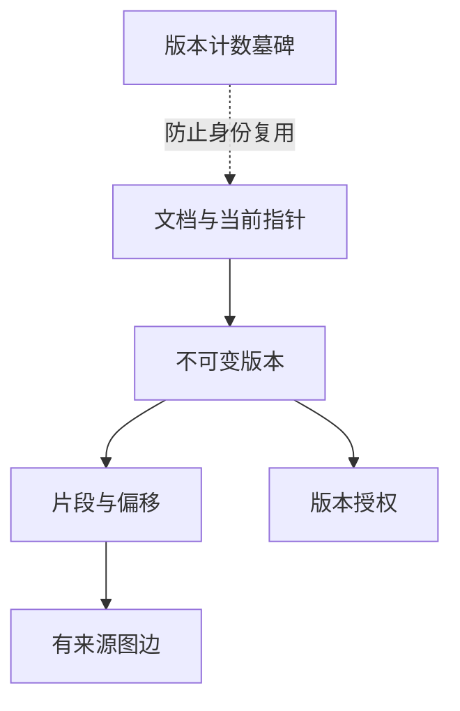

# R08 摄入、权限、版本与删除：让知识变化有明确语义

先修 R02 的片段身份、R06 的引用复核，以及基础卷的字典、异常、文件与数据库入门。全部必做实验使用 CPU、SQLite 和虚构资料。这里的目标不是背诵事务、幂等、CAS 等缩写，而是亲手构造“两个编辑者”“更新中断”“撤权”“删除后重建”四种情形，证明你的系统不会把旧观察误认成新事实。

## 小课一：从文件变成可查询对象，究竟发生了什么

摄入 ingestion 是把外部资料转换为系统能够检索和追溯的数据。它通常包括发现文件、读取字节、解析格式、提取文本、保留结构、规范化、切块、生成身份、计算索引产物、检查权限、发布版本。把摄入理解成“把 PDF 塞进向量数据库”会漏掉大多数正确性问题。PDF 解析可能漏表格，文本清理可能改数字，权限可能没跟随文件，索引也可能只完成一半。

先用一个最小例子理解各层对象。磁盘路径 `guide.txt` 是来源定位方式；逻辑文档 ID `jade-guide` 是系统持续跟踪的对象；正文“容量为七”是内容；revision 一表示这一次不可变快照；chunk 是该快照某段字符区间；embedding 是用特定模型处理这个区间得到的派生数值。路径、对象、快照、片段、派生产物不是同一个身份。路径改名不一定表示新文档，正文改动则一定需要重新判断相关派生产物。

“不可变快照”意味着 revision 一的正文一旦发布，就不原地改成容量九。更新产生 revision 二，然后当前指针切到二。这样旧引用指向一时仍有明确含义：它引用的是过去那个内容，而不是今天文件里的新句子。是否允许用户访问历史版本是另一个策略问题。本卷读取当前可见版本，旧引用在当前答案验证中失效；历史数据留在库里并不意味着自动可以用于当前回答。

时间又是另一条轴。revision 二今天摄入，正文可能描述上个月的制度；未来生效的政策也可能今天发布。系统版本、源发布时间、业务有效时间、采集时间不能混成一个 timestamp。课程数据库只实现版本与当前状态，没有声称实现双时态数据库。学习时可以在虚构资料里保留“适用于版本一”“自某日生效”等正文条件，避免把最新摄入误当最新有效事实。

## 小课二：先读表的关系，再读 SQL 语句

本卷 `CorpusStore` 使用几张有明确职责的表。documents 只保存文档身份、当前版本和删除标志；revisions 保存每个版本的标题、来源、正文、指纹和词元规则；chunks 保存片段身份与精确偏移；grants 保存某版本允许哪些主体读取；edges 保存从片段抽出的图关系及原文证据；document_revision_counters 保存不重复分配版本号所需的计数墓碑。

这些表分开不是为了显得复杂。假如权限直接放在某个字符串字段中，修改权限时很难判断旧片段和缓存是否应该失效；如果正文与当前指针混在一行，旧引用就没有稳定快照；如果图边只保存实体名，删除来源后不知道该撤销哪条关系。表的分解体现了对象之间的依赖，而外键把其中一部分依赖交给数据库检查。



图中的箭头表示内容依赖，不代表所有数据都自动随每次更新删除。历史版本会保留，当前读取通过指针选择新版本。只有 purge 硬删除文档时，开启的外键级联才删除对应 revisions、chunks、grants 和 edges。墓碑表独立存在，所以 purge 后它仍保留。`counts()` 只数五张内容表，不数墓碑，不能看到五个零就宣称所有元数据都消失。

主键 `(tenant, doc_id)` 表示不同租户可以有相同文档 ID 而互不覆盖。版本主键再加 revision，片段 ID 则由租户、文档、版本、偏移与文本共同确定。请注意稳定哈希不能替代授权：知道一个 chunk_id 并不代表有权读取它。`get_visible_chunk` 仍要通过 Context 检查当前可见性。

## 小课三：上下文身份与授权集合的逐项展开

Context 包含 tenant、actor、groups。tenant 是数据命名空间，actor 是当前用户，groups 是可信服务确认的组集合。它们不是模型猜出来的字段。在本地 CLI 中你可以传 `--actor` 模拟用户，这是实验能力；把同样字段直接接受为网络请求中的自报身份，就等于任何人都可以声称自己是管理员。认证确定“你是谁”，授权确定“这个对象是否允许你做这件事”，两者都不由检索分数决定。

课程 `principals` 把上下文转成授权主体集合。用户 learner 属于 study 组时，主体为租户公开 `*`、`user:learner`、`group:study`，排序后去重。星号只表示当前租户中的公开授权，不表示全互联网公开，更不表示跨租户读取。没有 grants 的文档默认拒绝所有读者。默认拒绝的好处是遗漏权限配置时不意外公开。

可见集合必须同时满足四个条件：租户匹配、文档未删除、片段版本等于当前版本、至少一条 grant 匹配当前主体。四个条件是逻辑与；grant 匹配内部是逻辑或。若把租户条件漏掉，即使用户名字相同，也可能读取另一个组织的资料。若把版本条件漏掉，同一文档新旧片段会同时参与检索。若只在最终显示时检查权限，私有资料还可能进入重排器、模型输入或共享缓存。

```python
from labs.knowledge.store import CorpusStore, Context, ConflictError

with CorpusStore() as store:
    store.ingest("team-a", "public", "公开", "public cache guide", allowed=("*",))
    store.ingest("team-a", "private", "受限", "private cache capacity", allowed=("group:ops",))
    store.ingest("team-b", "public", "另一租户", "other tenant cache", allowed=("*",))
    learner = Context("team-a", "learner")
    operator = Context("team-a", "operator", ("ops",))
    assert {c.doc_id for c in store.visible(learner)} == {"public"}
    assert {c.doc_id for c in store.visible(operator)} == {"public", "private"}
    assert set(learner.principals) == {"*", "user:learner"}
```

第一条摄入只有 team-a 内可见；第三条虽然文档 ID 也是 public，却属于 team-b，不能进入前两个查询。列表可能包含同一文档的多个切片，因此断言用文档 ID 集合，避免把片段数误当文档数。该测试只验证本地授权过滤，不证明远程认证安全；可信调用者仍要在调用 ingest、delete、purge 前检查管理权限。

## 小课四：参数化查询保护语法，不能代替业务授权

源码 visible 使用问号占位符传 tenant 与 principals。假设用户名包含单引号，数据库应把它当普通值，而不是 SQL 的结束标记。正确方式是 `execute(sql, parameters)`，不是用字符串拼接把用户名塞进 SQL。源码中动态拼接的是占位符数量，由主体数量决定；具体主体值仍作为参数传入。这是允许的结构化构造，和拼接不可信 SQL 片段不同。

参数化解决语法注入，不解决错误身份。若攻击者通过一个不安全的 HTTP 层把自己声明成 ops，参数化 SQL 会非常正确地按照错误身份返回 ops 资料。反过来，正确认证也不允许你随意拼 SQL，因为正常用户名同样可能包含特殊字符。把每个机制的保护范围说清楚，能避免一种检查被误认为万能屏障。

观察 `EXISTS` 的用途：它只询问是否存在至少一条匹配授权，不需要把所有授权行联接成重复片段。一份文档同时公开且授予某用户时，普通 JOIN 可能产生两行同一 chunk；EXISTS 保持一条片段一行。即使后续代码会去重，也应理解数据库查询为什么天然避免重复，防止重复影响排名与上下文预算。

```python
with CorpusStore() as store:
    strange = "reader' OR 1=1 --"
    store.ingest("sql-demo", "ordinary", "普通", "one", allowed=("user:" + strange,))
    store.ingest("sql-demo", "hidden", "隐藏", "two", allowed=("user:other",))
    assert {x.doc_id for x in store.visible(Context("sql-demo", strange))} == {"ordinary"}
    assert store.visible(Context("sql-demo", "nobody")) == []
```

预期第一位用户只读 ordinary，不能因为名字看起来像 SQL 就读 hidden。这个测试没有向任何外部系统发请求，所有字符串都是本地虚构数据。它训练的不是攻击技巧，而是数据与查询代码必须分离的基本编程原则。

## 小课五：事务把多张表的一次更新变成一个提交单位

摄入要更新计数器、当前指针、版本、授权与片段。若插入版本后进程失败，当前指针却已经指向没有完整片段的新版本，读者就会看到不一致状态。事务的目标是让这组写入一起提交或一起回滚。它并不保证外部网络调用、另一个数据库与本地 SQLite 自动共享同一事务。

源码先在事务外计算 spans、规范化 grants 与 fingerprint，然后执行 `BEGIN IMMEDIATE`。这样纯计算不会长时间占有写事务。进入事务后读取当前版本，检查 expected_revision，判断是否幂等重试，分配新版本，再写所有行，最后 commit。任何异常都 rollback 并重新抛出。`except BaseException` 在这里确保中断等情况也尝试回滚，但并不意味着应用应吞掉这些异常继续成功返回。

为什么用 IMMEDIATE？它在开始时尝试取得写事务，避免先读后写时才发现另一个写者已改变状态而出现不清楚的升级竞争。SQLite 的并发模型仍有具体限制：同一数据库同时只有一个写事务，读者行为又与日志模式和事务时长有关。本课程不通过这一个词宣称实现高吞吐分布式存储。理解事务边界后，才能讨论锁等待、busy timeout、批量大小与部署方式。

手算一次成功更新。初始没有文档，current 视为零，墓碑不存在。调用 expected_revision=0，检查通过，分配一，插入所有对象后提交。再次改正文并携带 expected_revision=1，检查通过，分配二，旧版本行仍在，documents 指向二。读取只返回二的片段。若在插入新片段时抛错，事务回滚，指针仍是一，计数也不应因为未提交更新而成为二。

## 小课六：CAS 是“我基于哪个世界修改”的声明

CAS 可以理解为比较并交换。调用者说“只有当前版本仍等于我看到的一，才接受这次修改”。两个编辑者同时读取一：甲提交后变二；乙仍携带 expected_revision=1，因此被拒绝。拒绝不是系统故障，而是正确发现乙的修改基于过期状态。乙应该读取二、比较差异，再决定合并或放弃，而不是自动把 expected_revision 设成 None 强行覆盖。

版本号不是正文哈希。即使内容后来又变回原句，生命周期与授权可能已改变，版本仍应前进。expected_revision=0 的含义也不是“下一版必须是第一版”，而是“当前文档对象不存在”。删除后的持久计数可能已是五，因此不存在对象重新创建会得到六。这个区别是后面防止 ABA 的核心。

```python
with CorpusStore() as store:
    first = store.ingest("cas", "guide", "Guide", "capacity seven", allowed=("*",), expected_revision=0)
    second = store.ingest("cas", "guide", "Guide", "capacity nine", allowed=("*",), expected_revision=first)
    assert (first, second) == (1, 2)
    try:
        store.ingest("cas", "guide", "Guide", "capacity eleven", allowed=("*",), expected_revision=first)
    except ConflictError:
        pass
    else:
        raise AssertionError("stale writer was accepted")
    assert {c.text for c in store.visible(Context("cas", "learner"))} == {"capacity nine"}
```

这个测试按顺序模拟两个编辑者的观察，不涉及真实线程，却能验证基本版本契约。真实竞争还需要在两个连接之间制造交错，特别是删除操作。顺序测试不能证明所有竞态都不存在，因此教材会把基本 CAS 与跨连接竞争证据分别记录。

## 小课七：幂等重试为何不能只比较正文

网络响应丢失时，调用者不知道上一次摄入是否已提交。相同请求重试如果总是生成新版本，会制造无意义历史、重复索引和重复模型费用。课程用 fingerprint 检查当前未删除版本是否与输入完全一致；一致则返回原版本。这里的完全一致包括标题、正文、来源、排序去重后的授权、切块参数和 tokenizer 版本。

为什么标题也算？标题可能进入检索文本或用户引用显示。为什么来源算？相同句子来自不同来源，证据意义不同。为什么权限算？正文不变但从公开改成 ops 可见，旧缓存和引用必须失效。为什么切块参数算？同样正文可能产生不同片段集合与偏移。为什么词元规则算？同样字符串在不同规则下有不同倒排索引。只比较正文哈希会漏掉所有这些变化。

幂等只在契约规定的范围内成立。本卷是“相同当前摄入输入不增版本”，不是通用请求去重服务。若文档被软删除，再摄入同样正文，状态从删除变为可用，必须生成新版本。若业务需要按 request_id 在更长时间内识别重复动作，可以增加请求账本，但不能把两种语义混淆。一次真实权限变化不应因为正文一样就被错误去重。

```python
with CorpusStore() as store:
    a = store.ingest("idempotent", "d", "Guide", "same text", allowed=("*",))
    b = store.ingest("idempotent", "d", "Guide", "same text", allowed=("*",))
    c = store.ingest("idempotent", "d", "Guide", "same text", allowed=("group:ops",))
    assert a == b == 1 and c == 2
    assert store.visible(Context("idempotent", "learner")) == []
    assert len(store.visible(Context("idempotent", "operator", ("ops",)))) == 1
```

注意 grants 的集合顺序经过规范化。allowed 为 user:a、user:b 与反过来的顺序表达同一授权，不应该仅因输入排序不同而增版本。重复 grant 也应去重。这里又能看见规范化的正确边界：授权主体集合可以排序，但正文不能随便排序句子，因为顺序可能改变语义。

## 小课八：软删除、硬删除、撤权和过期各是什么

软删除把 documents.deleted 设为一，使当前检索看不到文档，但历史内容仍存数据库。撤权修改授权，让某些主体不再可见，其他主体可能仍可见。硬删除 purge 删除内容对象及外键派生项。过期则通常由有效时间条件决定，即使没有删除操作，到时也不再可用。本卷文档实现软删除、硬删除与授权版本变化，记忆卷再实现显式 TTL。

用户说“删除”时，系统设计者要有明确的数据契约：搜索立即不可见是否足够，历史审计是否保留，图边是否删除，备份多久到期，导出文件是否纳入范围。这里不是要求每次正常操作都向用户反复确认，而是工程实现必须知道成功意味着什么。否则 delete 返回 True 可能只改了一张表，却被报告为“所有信息已彻底消失”。

SQLite 的 SQL DELETE 不保证磁盘取证意义上的每个字节立即清零。日志、备份、快照与操作系统缓存有独立生命周期。本课程 purge 的保证是逻辑内容表与所声明外键依赖的删除，并保留防 ABA 的哈希墓碑。它不是对所有外部系统、所有备份和所有硬盘扇区的承诺。准确表述边界是工程诚信的一部分。

```python
with CorpusStore() as store:
    rev = store.ingest("deletion", "d", "Guide", "visible before delete", allowed=("*",))
    ctx = Context("deletion", "learner")
    old_id = store.visible(ctx)[0].chunk_id
    assert store.delete("deletion", "d", expected_revision=rev)
    assert store.visible(ctx) == []
    assert store.counts()["revisions"] == 1
    store.purge("deletion", "d")
    assert all(count == 0 for count in store.counts().values())
    new_rev = store.ingest("deletion", "d", "Guide", "visible before delete", allowed=("*",), expected_revision=0)
    assert new_rev == 2
    assert store.visible(ctx)[0].chunk_id != old_id
```

最后两行非常重要：正文一样、逻辑 ID 一样，重建后的身份仍不同。旧引用不能因为新对象碰巧拥有相同内容就悄悄复活。下面用更细的时间线解释这个问题。

## 小课九：ABA 为什么会让旧引用看起来仍然正确

假设线程甲读到文档 d、revision 一、chunk x。线程乙删除 d，再用相同正文重建 d。如果重建时版本从一开始，chunk 的哈希输入也完全相同，得到的仍是 x。甲稍后提交 expected_revision=1 会通过，旧引用也会命中新对象。甲无法分辨“原对象始终存在”和“原对象消失后出现了另一个对象”。状态从 A 到不存在，再到表面相同的 A，因此称为 ABA。

解决方式之一是永不复用同一命名空间下的代际标识。课程保存 `digest(tenant,doc_id)` 对应最后分配的版本，即使 purge 内容也保留计数。重建时新版本取当前版本与历史计数较大者再加一。若当前不存在，CAS 比较仍以零判断不存在，而分配版本可以是二、六或更大。比较条件与分配规则是两件事，不能因为当前为空就把计数清零。

墓碑哈希不含正文、标题、来源和明文 doc_id，但它是稳定假名标识，不等于匿名化证明。低熵文档 ID 可以被枚举推测，跨次操作仍可关联。若系统要求连关联元数据也删除，需要设计新身份命名空间或随机代际，并使旧客户端持有的身份永久失效。简单删除计数器然后继续复用原 ID，会重新引入 ABA，不能同时承诺所有元数据清除与旧身份永不复活而没有额外机制。

持久化也是保证的一部分。内存里保存计数、进程重启就忘记，不能防止重启后的 ABA。课程把计数存在 SQLite，并在打开旧格式数据库时把已有文档版本迁入计数表，用 MAX 防止迁移把更高计数降低。迁移逻辑不仅服务新建数据库，也关系已存在用户数据的正确性；升级不能只测试空库。

## 小课十：删除的 CAS 必须进入同一条写语句

一个容易写错的删除实现是先 SELECT current_revision，检查等于 expected，再无条件 UPDATE deleted=1。看起来有比较和写入，但两者之间另一个连接可能更新文档。甲读一并通过比较；乙提交二；甲无条件删除当前对象，结果把自己从未见过的二删除了。仅在 Python 中把两行写在一起，不会消除数据库连接之间的交错。

当前实现把条件写进 UPDATE 的 WHERE：租户与文档匹配，并且 current_revision 等于 expected。比较与写入由同一条语句完成。如果更新行数为零，再查询对象是否存在，以区分不存在返回 False 与版本冲突抛 ConflictError。这次后续查询只用于解释失败，不参与决定是否删除，因此不会重新引入“先检查再写”的竞态。

rowcount 也需要结合数据库行为理解。文档已被软删除，重复执行同一版本的 UPDATE 在此契约下仍可视作幂等成功；对象不存在则返回 False。应用层应明确是否需要区分“这次首次删除”和“已经删除”。课程只需要当前不可见与旧版本不能删新版本的保证，不把返回布尔值当完整审计事件。

跨连接测试不能依赖随机 sleep 等待碰巧出现竞争。更可靠的方法是在甲执行 UPDATE 前通过一个受控钩子让乙完成更新，再继续甲的语句，断言 ConflictError 且版本二仍可见。仓库已有对应的确定性回归测试。学习者应阅读测试如何安排顺序，而不是仅看到测试名字含 race 就相信并发覆盖完整。

## 小课十一：增量索引的状态机，从准备到发布

到目前为止，SQL 中的切片与授权在同一个事务里写完，所以发布很直接。但真实语义索引可能需要发送多个 embedding 请求，再把向量写入另一个服务。一次 SQL 事务不能让外部服务自动回滚。若先切换当前指针再计算向量，读者会看到索引不完整的新版本；若先写向量再写 SQL，进程崩溃可能留下没有对应内容的孤儿向量。关键不在于选择哪个先写就一劳永逸，而在于定义“准备中”和“已发布”的可见性边界。

一个清楚的状态机包含 discovered、parsed、embedded、indexed、validated、published、failed。状态名字可以不同，但职责必须明确。discovered 只表示知道有来源；parsed 表示已得到带来源映射的文本；embedded 表示所有要求的向量计算完成且元数据一致；indexed 表示外部索引已接受这些向量；validated 表示数量、身份、维度、权限依赖等通过检查；published 才表示读者可以使用。中间状态不能被当成完成，只因为某个任务返回 HTTP 成功。

每个阶段的输入应该是不可变版本而非“当前文件路径”。如果 embedding 第一批读取正文一，第二批时文件已修改成正文二，就会生成一个混杂索引。正确做法是在开始时固定内容快照、切片清单、模型标识和配置，再让所有阶段引用这个构建身份。源文件后来变化应启动另一个构建，不修改正在处理的清单。这样失败重试才知道重试的是同一份工作。

为了在外部系统中实现幂等写入，向量 ID 应包含文档版本或构建代际，不能仅使用 doc_id。相同版本同一片段重复 upsert 不应产生第二份；不同版本必须可区分。若旧构建完成得更晚，也不能覆盖新构建的活动指针。发布动作应检查当前预期版本或构建号，过期构建可以保留供审计或清理，但不能把系统倒退到旧世界。

下面用纯字典模拟外部索引与 SQL 指针。它不是真实分布式事务实现，而是把“产物写入”和“可见性发布”拆开。你可以故意在任意阶段抛错，观察读者为什么仍只看到旧代际。

```python
from dataclasses import dataclass, field

@dataclass
class GenerationIndex:
    artifacts: dict = field(default_factory=dict)
    manifests: dict = field(default_factory=dict)
    active: dict = field(default_factory=dict)

    def prepare(self, document, generation, rows):
        key = (document, generation)
        snapshot = tuple((identity, tuple(vector)) for identity, vector in rows)
        previous = self.manifests.get(key)
        if previous is not None and previous != snapshot:
            raise ValueError("generation is immutable")
        self.manifests[key] = snapshot
        for identity, vector in snapshot:
            self.artifacts[(document, generation, identity)] = vector
        return key

    def publish(self, document, generation, expected_active):
        if self.active.get(document) != expected_active:
            raise ConflictError("active generation changed")
        key = (document, generation)
        if key not in self.manifests:
            raise ValueError("missing manifest")
        rows = self.manifests[key]
        if not rows:
            raise ValueError("empty generation")
        dimensions = {len(vector) for _, vector in rows}
        if len(dimensions) != 1 or next(iter(dimensions)) == 0:
            raise ValueError("dimension mismatch")
        for identity, vector in rows:
            if self.artifacts.get((document, generation, identity)) != vector:
                raise ValueError("missing or changed artifact")
        self.active[document] = generation

    def read(self, document):
        generation = self.active.get(document)
        if generation is None:
            return []
        return list(self.manifests[(document, generation)])

index = GenerationIndex()
index.prepare("guide", 1, [("a1", [1.0, 0.0])])
index.publish("guide", 1, None)
index.prepare("guide", 2, [("a2", [0.0, 1.0])])
assert index.read("guide") == [("a1", (1.0, 0.0))]
index.publish("guide", 2, 1)
assert index.read("guide") == [("a2", (0.0, 1.0))]
```

`prepare` 把输入转换成 tuple，避免调用者随后修改原列表而偷偷改变清单。`manifests` 保存期望产物，`artifacts` 模拟实际写入；发布时比较两者，能发现只完成一部分写入的情况。`active` 是读者唯一入口，准备二时它仍指向一。实际系统应在数据库事务中原子比较和切换 active；本示例的字典检查只适合单线程教学，不具备跨进程 CAS。

这个模型还没有校验向量有限性、模型标识、租户权限、删除事件、并发租约与磁盘持久化。把这些边界写出来，是为了让你知道后续扩展应放在哪个接口，而不是让你把四十行字典代码部署到生产。核心思想可以迁移：固定清单、幂等产物、完整性校验、短事务发布、读者只看已发布代际。

## 小课十二：双写、outbox 与故障恢复的完整时间线

假设 SQL 记录版本二成功，随后通知索引服务的网络请求丢失。若没有持久任务记录，数据库认为更新已完成，索引永远停在一。反过来，先通知索引再提交 SQL，索引成功而 SQL 回滚，会出现孤儿产物。outbox 的思路是把“内容状态变化”和“需要发送的任务”一起写入同一个本地事务，然后由后台工作者可靠地发送任务。它没有创造跨库原子性，而是把丢失通知的问题变成可重试、可观察的任务处理。

一条 outbox 任务至少需要唯一事件 ID、对象身份、目标版本、任务类型、状态、尝试次数和下一次尝试时间。事件载荷应该引用不可变快照或包含经过许可的必要数据。工作者取任务，执行外部操作，收到成功后标记完成。如果外部操作成功而完成标记前崩溃，任务会再次执行，所以外部操作必须幂等。所谓至少一次投递意味着可能重复，不意味着恰好一次执行。

手算三种崩溃点。第一种发生在 SQL 事务提交前，内容变化与 outbox 都回滚，读者仍看旧版。第二种发生在提交后、工作者读取前，任务仍在表中，重启后继续。第三种发生在外部写入后、标记完成前，重启后重复 upsert 同一版本相同 ID，结果不应多一份。最后发布仍需校验目标版本没有被更新或删除事件取代。不能因为任务最终成功就无条件发布过期版本。

删除事件在队列中尤其容易出错。版本二构建任务很慢，删除任务已经执行，随后旧构建完成并发布，就把删除内容复活了。防护方法是所有发布都检查对象当前代际与删除状态，删除本身推进生命周期版本或代际。队列顺序只能帮助，不能作为唯一保证，因为重试、并发工作者和不同分区都可能改变完成顺序。

本课程没有把 outbox 加进小型 CorpusStore，因为现有索引在授权可见集合上即时计算，不存在外部索引双写。这里提供的是设计推演与字典模型，并明确尚未实现真实后台任务服务。你的项目若决定接外部向量库，应先实现这些状态与故障测试，再宣称支持可靠增量更新。选择一个产品 SDK 并成功调用 upsert，只证明接口可用，不证明生命周期正确。

## 小课十三：索引与权限的一致性不是一个布尔开关

有些向量库支持过滤，有些只允许先取候选再过滤。先全库取十条，再去掉九条私有结果，普通用户只剩一条；这与先从授权集合中取最相关十条不等价。前者可能没有直接泄露正文，却让私有数据影响召回和排名，甚至通过结果数量或时延暴露某些信息。课程在构建统计与检索前就取得可见集合，因此其语义清楚，但规模较大时需要更有效的实现。

一种方案按租户或权限边界分区，让查询只进入允许分区；另一种方案在索引内部使用元数据过滤；第三种在候选生成阶段扩大召回并复核，但必须承认无法严格等价且需要评估漏召回。复杂授权可能是对象级、组级、属性级与时间条件组合，不能简单把所有 ACL 压成一个公开布尔值。任何优化都应以“授权集合中的结果”作为语义目标。

权限撤销要求特别快的失效路径。内容更新晚几秒可能产生陈旧答案；撤权晚几秒可能把已不允许的材料发送给外部模型。因此系统可能允许索引滞后，但必须在传给模型之前和最终展示之前复核当前授权。若授权服务不可用，应明确失败策略，不能默默使用上次管理员结果。不同产品可以规定不同一致性等级，但必须让语义与风险可见。

查询缓存需要绑定可见范围。仅用 query 作为键，会把管理员的答案送给普通用户。把 actor 加入键也未必足够，因为同一用户的组成员关系、策略与资料版本会变化。可以把可信计算的权限范围指纹、策略版本、语料快照、检索配置与查询一起组成键，并在输出前检查依赖仍有效。缓存失效是依赖管理，不是给 key 拼几个字段后就自动解决。

```python
from labs.knowledge.text import digest

def query_cache_key(ctx, query, corpus_revision, policy_revision, retriever_version):
    return digest(ctx.tenant, ctx.actor, sorted(set(ctx.groups)), query,
                  corpus_revision, policy_revision, retriever_version)

ctx_a = Context("cache-demo", "learner", ("study",))
ctx_b = Context("cache-demo", "learner", ("ops",))
key_a = query_cache_key(ctx_a, "capacity", 4, 2, "bm25-v1")
assert key_a != query_cache_key(ctx_b, "capacity", 4, 2, "bm25-v1")
assert key_a != query_cache_key(ctx_a, "capacity", 5, 2, "bm25-v1")
assert key_a != query_cache_key(ctx_a, "capacity", 4, 3, "bm25-v1")
```

这里的 corpus_revision 是由调用者提供的整个检索视图版本，课程 CorpusStore 没有自动维护这个全局字段。不要把单个文档版本随便填进去就声称覆盖全库变化。项目中可以使用已发布索引代际、单调变更序列或依赖文档版本集合。不同选择在缓存命中率与失效精度之间有权衡，应通过具体更新场景验证。

## 小课十四：十二道生命周期练习及完整解答

**练习一，辨认身份。** 同一路径内容从七变九，逻辑文档可保持相同，revision 必须改变，chunk ID 随版本改变，向量也要重新计算或确认复用条件。文件改名但内容及语义身份不变时，可以保持逻辑 ID 并更新 source；在课程指纹中 source 变化会产生新版本。完整答案不能只说“hash 不同就更新”，因为对象映射本身由摄入策略决定。

**练习二，默认授权。** allowed 为空时，任何用户都不能读取。星号表示当前租户公开，因此另一个租户同名用户仍不可见。用小课三代码去掉公开 grant，预期 public 从 learner 结果消失；operator 仍只能读有 ops 授权的 private。该实验检查默认拒绝与租户边界，不需要真实公司材料。

**练习三，幂等顺序。** 第一次 allowed 为 user:a、user:b，第二次顺序反过来且重复 user:a。两个请求应返回同一个版本，因为源码先 `sorted(set(allowed))`。若第二次把 user:b 删掉，则版本增加，因为权限集合改变。完整验证如下。

```python
with CorpusStore() as store:
    one = store.ingest("exercise", "d", "D", "same", allowed=("user:a", "user:b"))
    two = store.ingest("exercise", "d", "D", "same", allowed=("user:b", "user:a", "user:a"))
    three = store.ingest("exercise", "d", "D", "same", allowed=("user:a",))
    assert one == two and three > two
```

**练习四，过期编辑。** 甲乙都读一，甲写二，乙携带一提交应 ConflictError。完整处理不是捕获异常后强制覆盖，而是读取二，把乙的改动与一到二的变化比较，决定能否合并。对于“容量数字”这种单值冲突，不能自动把七与九拼成七九；应保留冲突并要求业务规则选择。程序检测冲突，领域规则解决冲突。

**练习五，旧删除。** 写一、更新二、delete expected 一。要求二仍可见。参考代码如下，它验证顺序条件；仓库跨连接测试进一步覆盖真实交错。两个测试各有作用，不能因简单版本通过就删掉竞争回归。

```python
with CorpusStore() as store:
    a = store.ingest("delete-cas", "d", "D", "old", allowed=("*",))
    b = store.ingest("delete-cas", "d", "D", "new", allowed=("*",), expected_revision=a)
    try:
        store.delete("delete-cas", "d", expected_revision=a)
    except ConflictError:
        pass
    else:
        raise AssertionError("stale deletion succeeded")
    assert {x.revision for x in store.visible(Context("delete-cas", "reader"))} == {b}
```

**练习六，软删除复活。** 软删除后同样输入再次摄入，不能返回旧版本，因为 deleted 状态变化。新版本大于旧版，旧 chunk_id 不再当前可见。若调用 expected_revision=0 会冲突，因为软删除对象仍存在，current 仍是旧版本；只有 purge 后才符合当前对象不存在的零条件。这一细节能检查你是否真正分清软删除和不存在。

**练习七，跨进程墓碑。** 用临时文件创建文档、purge、关闭库、重开并重建。新版本必须递增，旧片段身份不可复用。完整参考代码不留下持久测试文件。

```python
from tempfile import TemporaryDirectory
from pathlib import Path

with TemporaryDirectory() as directory:
    path = Path(directory) / "corpus.sqlite"
    with CorpusStore(path) as store:
        old_revision = store.ingest("persist", "d", "D", "same", allowed=("*",))
        store.purge("persist", "d")
    with CorpusStore(path) as store:
        new_revision = store.ingest("persist", "d", "D", "same", allowed=("*",), expected_revision=0)
        assert new_revision > old_revision
```

**练习八，准备不等于发布。** 在 GenerationIndex 中 prepare 二后删除二的一个 artifact，publish 必须失败，read 仍返回一。完整答案通过修改测试对象模拟部分写入，不能把 read 改成扫描所有 manifests，否则准备版本会泄露给读者。

```python
broken = GenerationIndex()
broken.prepare("d", 1, [("old", [1.0, 0.0])])
broken.publish("d", 1, None)
broken.prepare("d", 2, [("new", [0.0, 1.0])])
del broken.artifacts[("d", 2, "new")]
try:
    broken.publish("d", 2, 1)
except ValueError:
    pass
else:
    raise AssertionError("partial generation was published")
assert broken.active["d"] == 1
```

**练习九，旧构建晚完成。** 构建二开始，构建三先发布，随后二尝试 expected_active=1 发布。应冲突，因为当前已三。不能因为二完成时间更晚就把它当更新版本。排序依据是逻辑代际与预期状态，不是工作者完成时间。使用 GenerationIndex 依次 prepare 一二三、publish 一三、再 publish 二即可复现。

**练习十，缓存污染。** 管理员查询得到私有答案，普通用户相同 query。仅 query 键会碰撞，包含可信权限指纹与语料代际的键应不同。完整答案还要指出同一管理员撤权后也需新策略版本或输出复核；仅 actor 隔离不能解决权限变化。日志与缓存本身也应有访问策略，不能成为第二份公开知识库。

**练习十一，删除依赖。** 文档派生了切片、向量、图边、社区摘要、答案缓存。课程 SQL purge 自动处理切片和图边等外键对象，但没有外部向量库或摘要服务。完整方案列出每种产物的依赖身份、失效触发与验收查询；未实现部分写未实现。打印一个 success 日志不能替代分别查询各存储验证。

**练习十二，回滚证明。** 在自己的教学分支中，在写入部分 chunks 后抛 RuntimeError。预期 documents 指针、revisions、grants、chunks 与计数器都恢复为事务前状态。随后正常重试应能成功。不要直接修改本仓库正式实现来永久留下异常；可以用下节独立 SQL 事务例子理解回滚，再阅读已有测试中的故障安排。

## 小课十五：亲手观察事务回滚与外键级联

初学者经常把 Python 的 with 与数据库事务混为一谈。`with CorpusStore()` 负责关闭连接；`with conn` 管理数据库事务提交或回滚；`BEGIN IMMEDIATE` 显式开始写事务。它们的职责不同。最可靠的学习方式是构造三行数据，故意在第二步失败，再查询实际结果。

```python
import sqlite3

connection = sqlite3.connect(":memory:")
connection.execute("PRAGMA foreign_keys=ON")
connection.executescript("""
CREATE TABLE parent(id TEXT PRIMARY KEY);
CREATE TABLE child(id TEXT PRIMARY KEY, parent_id TEXT NOT NULL,
  FOREIGN KEY(parent_id) REFERENCES parent(id) ON DELETE CASCADE);
""")
try:
    with connection:
        connection.execute("INSERT INTO parent VALUES(?)", ("p",))
        connection.execute("INSERT INTO child VALUES(?,?)", ("c", "p"))
        raise RuntimeError("injected before commit")
except RuntimeError:
    pass
assert connection.execute("SELECT COUNT(*) FROM parent").fetchone()[0] == 0
assert connection.execute("SELECT COUNT(*) FROM child").fetchone()[0] == 0
with connection:
    connection.execute("INSERT INTO parent VALUES(?)", ("p",))
    connection.execute("INSERT INTO child VALUES(?,?)", ("c", "p"))
with connection:
    connection.execute("DELETE FROM parent WHERE id=?", ("p",))
assert connection.execute("SELECT COUNT(*) FROM child").fetchone()[0] == 0
connection.close()
```

第一段 with 中先插父行再插子行，异常离开时回滚，因此两个 count 都为零。第二段正常退出，两个对象一起提交。第三段删除父行，外键级联删除子行。外键检查必须在连接上启用，不能因为建表语句写了 FOREIGN KEY 就假定所有连接都会执行它。课程初始化每个连接时明确打开，这是持久化正确性的必要前提之一。

把异常移到第一次插入之前、第二次插入之后、正常提交之后，观察不同结果。提交之后再抛异常不会自动撤销已经完成的历史事务；需要新补偿操作。这个实验能防止你把“异常被捕获”误解成“之前所有动作都撤销”。外部 API 更是如此，数据库 rollback 不会召回已经发送给外部模型的文本，也不会退回已经发生的费用。

最后比较两种故障报告。报告甲只写“发生异常”；报告乙写“构建版本二在写片段时失败，事务回滚，活动版本仍一，外部产物未发布，待重试任务保留”。乙明确描述了系统状态，运维者才知道是否可以继续服务、是否需要清理、是否会重复收费。错误处理的价值不只是阻止崩溃，还包括保持一个可以解释和恢复的状态。

### 生命周期项目第一阶段：建立一份可以验收的摄入清单

项目对象是一套虚构课程文档，不涉及个人或公司资料。先建立三份文档：公开的缓存概念、仅 study 组可见的学习计划、仅 ops 组可见的维护步骤。每份文档有固定逻辑 ID、标题、来源标签、正文和授权集合。第一阶段只用本卷 CorpusStore，所有索引即时在可见集合上计算，这样你能把版本与权限学清楚，不必同时调试网络服务。

清单应记录预期文档数、每份文档当前版本、切片数量与片段区间。片段数量不是越多越好，而是用于发现摄入失败。例如一份非空文档却产生零片段，应回到解析与切块检查；同一版本重复出现相同区间，则检查幂等与 ID。每个片段的 text 必须等于对应正文的精确切片，这个不变量比“看起来内容差不多”更严格，能发现清洗后偏移仍引用原文的错误。

执行第一次摄入后，不要立即问模型问题。先打印每个身份的可见文档集合，与手工权限表比较。learner 无组只看公开，student 属于 study 看公开与学习计划，operator 属于 ops 看公开与维护。另一个租户即使用户名字和组名字相同，也看不到这里任何内容。这些预期是项目的验收数据，应先于检索算法写下，避免运行结果反过来决定你认为正确的答案。

接着用完全相同清单重跑摄入，要求版本与片段数不变。再只改变一份文档的授权，要求只那份文档增版本，受影响用户的可见集合改变。最后只改变切块配置，要求对应文档生成新的片段身份，但文本覆盖仍正确。这个顺序把正文、授权、配置三个维度分开，你能知道 fingerprint 每个字段为什么存在。

### 生命周期项目第二阶段：把持久化从一句承诺变成证据

内存库中调用两次函数不证明跨进程持久化。真正的实验应先用 CLI 向文件数据库写入，结束进程，再开一个新进程读取。仓库已有 `python -m labs.knowledge.assistant --db ... seed` 与 ask 入口；路径参数在子命令前，避免误把全局参数放到子命令解析器后。示例文件可以位于自己的实验目录，不应把 SQLite 数据库提交到公开仓库。

持久化验收至少包括正常数据、删除标志与版本墓碑。写入文档后重开应可见；软删除后重开仍不可见；purge 后重开再创建，同一逻辑 ID 的版本应继续递增。只验证第一种，会漏掉最危险的生命周期状态丢失。历史迁移也要用旧结构样本测试，不能让程序只在全新数据库中正确。

文件存在不等于事务提交成功。若程序在 write 之后、commit 之前退出，文件可能已经创建但数据不应成为已提交状态。不要用 `path.exists()` 作为数据写入验收；要打开数据库读取预期行与版本。备份文件同样要经过恢复演练，检查文档、授权、计数墓碑和索引代际彼此一致，不能只看压缩包大小正常。

备份恢复还会引入时间倒退。假设线上曾分配版本十，恢复到只记得版本七的旧备份，再继续分配八，旧客户端持有的八可能发生身份碰撞。可靠恢复方案需要外部代际、恢复后新命名空间，或确保单调计数状态不会倒退。课程的单文件临时实验没有完整灾备机制，因此不能把“文件重开通过”扩大为“任何备份恢复都不会 ABA”。这个边界提醒你：版本唯一性依赖系统运行与恢复契约，而不仅是某一行代码。

### 生命周期项目第三阶段：完整的更新与引用失效演练

为缓存概念文档准备两版：第一版写“教学容量为七”，第二版写“教学容量为九”。先取得第一版当前片段并保存 Citation，再更新第二版。检索应只返回九，旧 Citation 通过当前可见性检查时失败。把这几个步骤连起来，才能证明读路径与写路径的契约一致。单测 ingest 返回二，只证明写函数分配了编号，没有证明旧答案不会继续出现。

接下来只撤销学习者读取权限，不修改正文。旧片段身份因为版本变化而失效，学习者检索结果为空，管理员仍可读取新版本。即使模型已经根据旧片段生成了一段文字，最终报告也要重新验证来源是否仍可用。这里存在“检查之后权限又变化”的极窄窗口，产品必须定义输出快照语义或锁定策略；课程做的是提交报告前复核，而不是宣称任何时间点绝无变化。

再把文档硬删除并按同样正文重建。旧引用必须继续失败，新引用指向新版本。这一步同时检验墓碑与 chunk 身份。若你为了提高缓存命中率，把 chunk_id 改成只对正文 hash，旧引用就可能命中新对象；测试会指出优化破坏了生命周期语义。内容寻址可以用于去重存储，但引用身份仍需包含对象与代际，二者不能未经设计混为一谈。

最后增加一个受限图边，以该文档片段为证据。软删除时图边行可能仍在数据库，但 visible_edges 必须看不到它；purge 时外键级联删除该行。更新版本时旧边也应当前不可见，即使旧 chunks 仍为历史审计保留。图检索若只按 tenant 过滤而不检查来源当前版本，就会从旧世界继续推出关系。

### 生命周期项目第四阶段：把外部产物纳入同一份清单

若选择接真实 embedding 服务，先在四份虚构文本上跑通，明确允许网络才调用。把每个向量的 chunk_id、模型响应标识、维度、规范化方式、构建代际和数据指纹写入清单。维度相同不代表坐标空间相同；换模型后不能把旧向量与新查询向量直接混搜。服务别名若不能固定到不变版本，应记录 alias 未固定的限制，定期做行为回归，而不是伪造模型 commit。

调用前只选择当前授权允许发送的文本，调用返回后再次检查版本与权限。若等待期间文档变了，返回向量属于旧快照，不能贴到新 chunk 上。外部响应的 index 字段用于恢复批次顺序；不能假定返回数组天然与输入同序。检查数量、维度、有限数值与模型一致性，发现缺项应使该构建未完成，不能用零向量悄悄补齐。

向量存储成功也只是 indexed 阶段。发布前要验证清单中的每个身份都有产物，数量与维度符合契约，当前文档仍允许发布该代际。读路径应使用同一构建的查询编码配置与索引。更换 embedding 模型可以并行构建新索引，在固定评测集上比较，完成后切换活动索引，保留明确回滚方案。回滚是切换到已知完整旧代际，不是混合两个坐标空间。

本阶段不要求 H100；调用远程 embedding 服务由服务端完成计算，课程本地只有文本与向量处理。若以后用本地编码器处理大量语料，才需要估计批量、显存与时间。无论硬件多强，权限错误和代际混用都不会因为计算加速而消失，反而可能更快传播更多错误产物。

### 摄入诊断一：解析成功，却把重要事实删掉了

假设源文档一行写“上限：七；例外：测试环境九”，解析器只保留“上限七”，没有报错。文件读取成功、切片生成成功、索引写入成功，系统每一层都显示绿色，但回答测试环境上限时一定不完整。这不是检索器召回问题，而是摄入时信息已经丢失。排查应从源字节、解析文本、结构块、清洗后文本逐层比较，找出第一次丢失发生的位置。

对于表格，行列结构本身就是含义。把“版本一 七”“版本二 九”串成“一七二九”可能仍包含所有字符，却丢失对应关系。图像 OCR、页眉页脚清理、跨页断行修复都可能改变语义。摄入清单应保存解析器与清理规则版本，以及必要的源页码或结构定位。引用最终文本时，应能回到原始来源，不能只指向一个已经不可解释的清洗字符串。

修复该故障的完整过程是新增一个最小解析样本、写出期望结构、调整解析规则、重新生成版本与索引、检查旧引用失效。不要只手工把当前数据库那句话改好，因为下一次摄入会重现问题。也不要仅调整检索 query，希望从不存在的文本中找回例外。数据质量问题必须在产生数据的阶段修复。

### 摄入诊断二：所有向量都在，却有一半查不到

一个常见原因是 ID 映射错位。输入片段顺序为 a、b、c，服务返回带 index 的顺序为 c、a、b，程序按数组位置直接 zip，导致 a 挂上 c 的向量。向量数量与维度都正确，简单健康检查不会报错；检索却把语义相似度归给错误原文。解决办法是严格验证 index 的唯一、范围与完整性，按索引重排，再将向量绑定到不可变 chunk 身份。

另一个原因是新旧模型混合。早期一半语料使用模型甲，后期使用模型乙，恰好都输出同样维度。数值检查看似通过，但坐标含义不同，排名不可解释。索引元数据应包含编码器身份与输入模板，构建时拒绝混合。若确实需要多模型检索，分别建立各自空间，得到排名后再融合，不要直接把不同空间的向量算余弦。

第三个原因是发布清单与实际索引不一致。后台只上传了前半批却错误标记完成，读者开始使用半成品。对策是以不可变清单逐个核验，而不是仅相信工作者“成功”布尔值。数量检查能发现缺项，ID 集合检查能发现数量相同但身份不同，向量元数据检查能发现身份对而坐标配置错。不同检查覆盖不同故障，不能互相替代。

### 摄入诊断三：删除成功，搜索却仍然返回旧答案

先确定返回来自哪里。若 raw SQL visible 已空，但检索结果仍有文档，可能是独立索引没过滤删除状态；若检索结果已空，但最终答案仍有，可能是答案缓存或会话历史；若正文消失但图路径仍返回，可能是图边没有来源复核；若摘要仍说旧事实，可能是派生摘要缺少依赖失效。不要看到“旧答案”就直接重建所有索引，这会掩盖真正遗漏的依赖。

给每个派生产物记录 dependency 集合，可以把失效变成图遍历。文档版本改变，找到依赖其 chunks 的图边、摘要和缓存，再标记不可用或重建。大摘要可能只部分依赖旧文档，精细依赖能减少重算；只有整篇级别依赖则更保守地全部失效。没有依赖记录时，系统只能全量重建或冒险保留，两者都可能成本很高。

删除验收应沿着真实用户路径执行。用被撤权用户重新查询，检查候选、模型输入和最终报告；用管理员查询，检查策略是否按预期保留；关闭重开服务，检查旧缓存是否重新加载；重建同 ID，检查旧引用仍失败。每个结果应保留身份与版本，不能只截图“没有结果”而不知道是否查了正确租户。

### 从本地事务迁移到服务时，哪些假设会失效

本地教学程序通常一个进程、一名学习者、一份小数据库、所有输入可信。服务化后，多个请求并发运行，身份来自认证层，任务可能中断，外部响应不可靠，日志可能被不同角色查看。接口名称完全相同不代表正确性条件相同。把 `Context(request.tenant, request.actor, request.groups)` 直接写进服务，是最需要警惕的迁移错误之一，因为请求字段不等于可信身份。

连接管理也会改变。SQLite 连接对象通常有线程使用约束，不能随意在所有线程之间共享同一个实例。事务范围应尽量短，不要在事务内等待模型网络响应。对长构建任务，应保存状态并释放锁，完成后通过短事务发布。失败恢复应从持久状态继续，而非假设一个 Python 对象永远活着。

错误信息需要分层。开发日志可以记录冲突的内部版本与对象身份，但用户响应未必应该泄露文档是否存在于另一个权限范围。课程 get_visible_chunk 返回 None，把不存在、旧版与不可见统一为不可用，这是一个有意缩小信息面的契约。管理接口可以有更详细诊断，但必须单独授权，不能为了调试方便把管理查询暴露给模型工具。

输入限制也不能只限制检索次数。文件大小、解析时间、文本长度、切片数量、授权主体数、图边数、外部响应大小与任务队列长度都可能影响资源。限制应该对应具体资源与合理错误，而不是到处写一个任意常数。课程示例使用小数据，真实摄入服务必须在接受工作之前估算和限制任务规模，防止一个异常文档占满所有工作者。

### 数据一致性的三种观察方式

强一致的直觉是一次写成功后，后续读取立刻看到该状态。最终一致允许不同副本暂时不同，但在没有新写入时最终收敛。快照一致则要求一次查询看到自洽的同一代际，即使它稍旧。检索系统常需要组合这些语义：内容索引可以稍滞后，授权撤销需要更即时，单次答案的证据又应来自相容快照。不能只给整个系统贴一个“一致”标签。

假设文档 A 版本二说依赖 B 版本三，而索引中 B 仍是一。分别读取最新可用内容可能产生不相容链。一个发布清单可固定整个知识库代际，或者对关系边显式记录版本条件。前者更新成本较高但读者简单，后者更灵活却要求推理检查条件。课程按每文档当前版本读取，没有保证跨文档业务更新天然原子，因此跨文档同时发布需要额外设计。

读取期间发生更新时，还要决定结果是否绑定查询开始时快照，还是最终输出时重新验证当前状态。绑定快照有利于重现，却可能在输出时已撤权；最终复核有利于时效与权限，却可能让长任务部分失效。实际系统可以把内容快照与当前授权分开：内容使用固定版本，授权在输出前复核。关键是明确语义，并在报告中保留使用的版本，而不是默默混合。

### 数据迁移与回滚不能只看表能否创建

模式升级时，新增计数墓碑表需要从旧文档当前版本迁移。若只 CREATE TABLE 而不回填，旧文档 purge 后计数为空，重建会回到一。课程初始化扫描已有 documents，并用 MAX 更新计数。这个操作应该幂等：重复打开数据库不会降低或重复增加版本。迁移测试至少覆盖空库、旧库、已经迁移过的库和计数高于当前内容的库。

回滚代码版本也可能破坏新数据语义。旧程序不知道墓碑表，可能在 purge 后重建时重新分配一。即使数据库文件里保留正确计数，旧代码不读取它也无济于事。因此发布工程要注明最低可兼容代码版本，必要时拒绝旧程序写入新模式。数据正确性不是“所有版本程序都能打开文件”这一单一目标。

迁移前应在副本上执行并验证，保留可恢复备份，迁移后运行核心生命周期测试。这里不需要把每个本地实验升级成复杂运维流程，但应理解原因：模式改变影响已有对象，不只是新建对象。只在干净测试库中跑通过，会遗漏用户真实累积状态。课堂练习可以用十行 SQL 构造旧库样本，避免必须拥有真实用户数据库才能测试迁移。

### 本章的源码阅读路线与可执行入口

阅读 `store.py` 时按 Context、Chunk、建表、ingest、visible、delete、purge 的顺序。每读一段，写下输入、状态变化、异常和不变量。ingest 的不变量是一个成功版本拥有完整正文、授权和切片；visible 的不变量是每条返回记录当前、未删、同租户且获授权；delete 的不变量是过期 expected 不能删除新版本；purge 的不变量是内容级联清理但版本身份不复用。

运行以下入口，每一个都对应本章一个具体契约，而不是仅检查命令退出零：

```bash
python -m labs.knowledge.lab 14-revision
python -m labs.knowledge.lab 15-idempotency
python -m labs.knowledge.lab 16-deletion
python -m labs.knowledge.lab 26-graph-stale
python -m labs.knowledge.lab 28-persistence
python -m unittest discover -s tests -p 'test_knowledge*.py' -v
```

版本实验应显示更新后旧来源失效；幂等实验应显示相同输入返回同版；删除实验区分不可见与内容清理；图实验应显示旧边不再可见；持久化实验应证明关闭重开后状态仍存在。测试套件还包含更多接口与数值边界，不应把所有通过都归功于本章。验收报告要记录实际命令、环境、结果和跳过项，特别是可选 FAISS 或真实 API 没运行时应明确写出。

本章使用的 SQLite 机制可对照官方 [事务文档](https://www.sqlite.org/lang_transaction.html) 与 [外键文档](https://www.sqlite.org/foreignkeys.html)。阅读官方资料时重点找事务何时开始、提交失败可能如何表现、外键何时启用，而不是只搜索一个能复制的配置片段。本章对更大系统的 outbox、发布状态机与缓存依赖是教学设计推演，不声称课程小型数据库已经实现全部生产功能。

最终作品应包含一份清单、一份权限矩阵、一份版本轨迹、一份删除依赖表，以及至少四份故障报告。你应能不看教材解释：为什么相同正文仍可能产生新版本；为什么不存在时 expected 是零却返回版本六；为什么先查再删有竞态；为什么向量写成功不等于知识已发布；为什么删除五张表后仍保留哈希墓碑。能把这些问题对应到具体代码与测试，你才真正掌握知识生命周期，而不仅是会调用数据库。

最后增加一个容易被忽略的验收：同一份内容同时被两个逻辑文档引用。为了节省存储，你可以在底层按内容哈希去重原文字节，但删除其中一个文档不能删除另一个文档仍依赖的内容；撤销一个文档的授权也不能改变另一个文档的授权。共享存储对象需要引用计数或可达性清理，业务文档身份仍各自独立。这个例子把“内容一样”与“对象一样”彻底分开，也解释了为什么只用正文哈希承担所有身份职责会失败。

再检查空正文的处理策略。课程允许切块器按其契约处理空字符串，但产品可以规定空文档是合法占位、解析失败或明确删除信号，三种选择不能混用。尤其不能把解析器意外返回空串当成用户主动删除全部内容。摄入结果应带解析状态与来源大小，只有经过验证的合法内容才能推进发布指针，避免一个短暂解析故障覆盖原本可用的资料。
