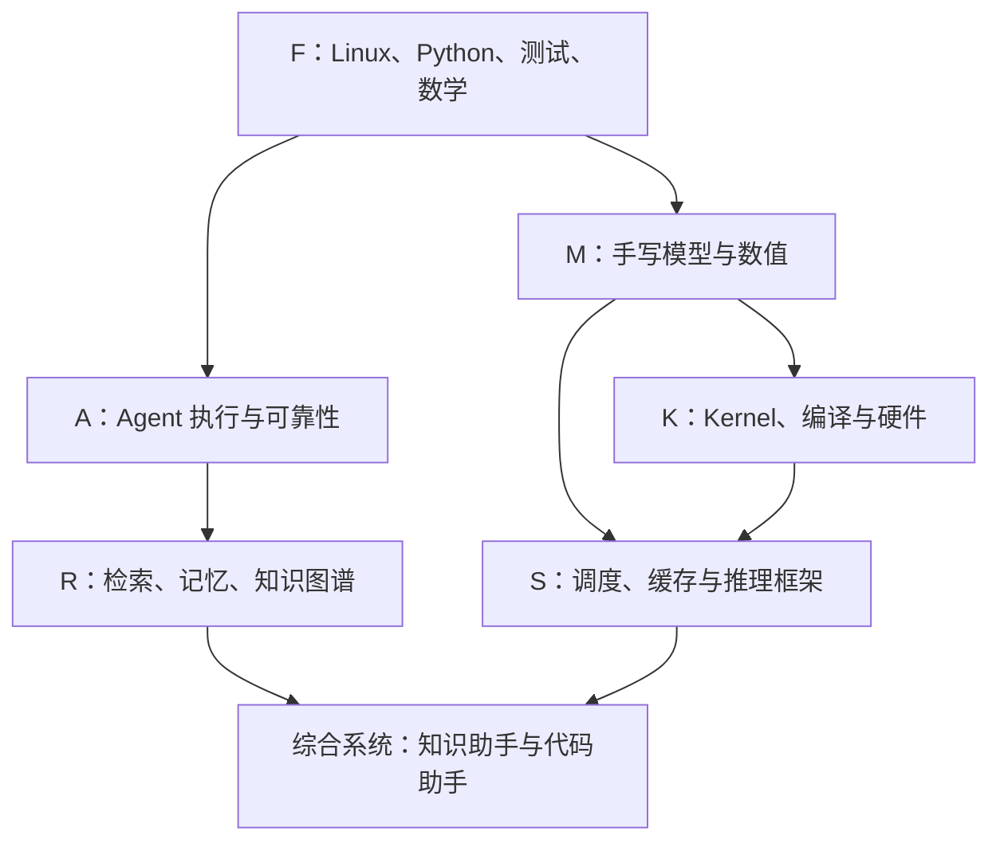

# 课程地图与先修关系

本工程的阅读顺序不是文件夹顺序。应用层可以先建立直觉，底层能力需要逐步补足；学习两条主线时应共享基础，不必先把一整本硬件手册读完才能写 Agent。

图表达主依赖，不要求把整个上游分卷全部学完再开始下游。精确到章的先修要求在 [课程索引](CATALOG.md) 和每章入口中。

## 阶段 0：把电脑变成可以解释的工作环境

从 F 卷的环境、文件、Shell 和进程开始。你应能说明一条命令由谁解析、工作目录是什么、相对路径如何定位文件、标准输出和错误输出去哪里、进程何时结束、环境变量由谁继承。此时不要把 GPU 环境安装当成主线。

小任务：在自己的练习目录创建文本，使用管道筛选，运行一个故意报错的 Python 程序，分别保存输出和错误，检查退出状态；打开第二个终端解释为什么 `cd` 和临时环境变量没有同时改变。完成后你开始拥有诊断能力，而不仅是记住命令。

验收产物：一份包含命令、输出和解释的运行记录；能在新终端从零重复。无法解释就回到相应基础章，不用通过不停加 `sudo` 来“修好”。

## 阶段 1：能独立写和维护小型 Python 项目

掌握函数、数据结构、对象、模块、异常、文件、JSON、测试、日志和 CLI。补上 Git、虚拟环境和 SQLite；异步课程在开始并行工具调用前完成。完成 F 卷的日志分析和任务服务项目。

此阶段的关键跨越是从“一个能运行的脚本”到“接口稳定、错误可解释、修改有测试的程序”。例如日志输入中混入坏行时，你要能选择跳过、计数或拒绝，并让退出码与文档一致；任务服务遇到重复请求时，状态不能莫名多变一次。

验收产物：可用一条命令运行的项目、至少一个边界测试、一次从失败到修复的 Git 提交。请能指出解析输入、业务逻辑、持久化和展示结果分别在哪。

## 阶段 2：同时获得 Agent 和模型的最小可操作理解

开始 A 卷最小循环、协议、工具契约和事件；同时学习 M 卷张量、概率、梯度与基础注意力。前者解释系统怎样持续行动，后者解释模型调用内部的大致计算。二者不能互相替代：会写 prompt 不等于会实现模型，会写矩阵乘法也不等于会做可靠 Agent。

Agent 侧用脚本化模型验证控制流程，不依赖真实 API 随机性。模型侧用小数组和固定参数手算，再对照 NumPy。你可以先产生一个确定的工具调用，并逐字段验证参数；也可以计算 2×2 注意力，并核对 softmax 的轴。

验收产物：一个会调用两个工具并停止的 Agent；一个你能解释每个张量维度的注意力实现；各有至少一个反例测试。此时再看真实服务的消息和 token 统计会清晰得多。

## 阶段 3A：Agent 深入主线

学习流式聚合、异常与重试、预算、上下文管理、异步、持久化恢复、工作流图、多 Agent 与评测，再完成 A 卷两个项目。每前进一个机制，都问“中途崩溃怎么办”“重复交付怎么办”“模型输出非法怎么办”“工具返回内容可信吗”。这些问题应成为代码路径和测试，不只是原则列表。

随后将 R 卷接入：从可解释 BM25 开始，理解 dense embedding 与索引，再做混合检索、重排、引用校验、权限过滤、文档版本、记忆修正、知识图谱和多跳检索。先在几十个合成文档上验证行为，再增加真实数据量。不要用文档数量掩盖召回、权限和证据问题。

最后进入真实框架研读任务，比较你自己的状态机与 LangGraph 等框架提供的持久化和中断语义。此时读框架文档不是背 API，而是确认它替你管理了哪种状态、哪些保证仍需要自己实现。协议标准也要区分 MCP 的工具／数据接口与 A2A 的 Agent 间任务交互。

验收产物：可恢复的知识工作助手；版本化证据和记忆；带失败注入的评测集；至少一次真实 API 运行记录；对状态图和多 Agent 复杂度的有依据取舍。

## 阶段 3B：模型实现主线

沿原始编码器—解码器 Transformer 到现代稠密 decoder，再到 KV/GQA、低秩注意力、MoE、局部／块稀疏注意力、线性注意力、状态空间模型和残差变体。每次改结构，明确改变的是参数、计算图、复杂度、状态容量还是训练行为。

不要把不同轴混在一起：MoE 主要改变前馈层参数激活方式，稀疏注意力改变 token 间连接，线性注意力用可递推状态改写特定计算，残差方法改变层间信息聚合。它们可以组合，但不能因为都含“稀疏”或“记忆”就认为同一种机制。

验收产物：原始 Transformer 的可运行小实现；稠密 decoder；完整与增量解码的对照；MoE routing 的手算核对；至少两组结构等价性／差异实验；小模型训练记录。进入新旗舰模型源码时，能把公开配置中的改变映射到这些基础机制，并指出没有公开的信息。

## 阶段 4：框架与算子深入主线

先在 S 卷模拟请求生命周期、连续批处理、KV 页分配、前缀共享、取消和抢占。你要能手工追踪某个页属于谁、引用计数为什么变化、调度预算何时耗尽。接着读固定提交的 vLLM／SGLang 源码，找到对应对象和接口，并用一条请求的实际路径连接它们。

K 卷从地址和布局开始，随后线程与块、访存、归约、GEMM、在线 softmax 与 attention、CUDA／Triton、反向和量化。GPU 优化前必须有 CPU 参考和误差标准。先写得对，再解释为什么慢；不要用一次更快的计时掩盖越界、漏算尾部或不同 dtype。

学习编译与硬件时，以自己写的一个 Kernel 为主线：Python／CUDA 源码经过哪些表示、何时编译、哪些参数被特化、谁发起执行、线程映射到什么资源、哪个同步点保证了哪种可见性。之后再读 warp specialization、persistent kernel 与 MegaKernel，才能判断它们到底减少了什么成本。

验收产物：调度器／分页缓存正确性测试；一项真实框架的有限代码修改；若干自行编写并对照验证的 GPU 算子；一份带形状、精度和同步说明的性能报告。

## 阶段 5：交叉综合项目

从 [综合项目页](../projects/README.md) 选择项目，用同一条请求串起知识库、Agent、服务与观测。首先保证功能和证据，然后比较成本和延迟。遇到错误，能够判断它属于上下文、协议、检索、模型、框架调度还是 Kernel 数值。

综合项目的最后一项产物不是漂亮界面，而是能让别人复现你的问题、判断和修复的工程记录。你应该能回答：哪些性质由测试保证，哪些只有测量证据，哪些仍然未知。

## 学习速度和复习

本课程没有规定几周“成为专家”。有些小实验只需几分钟，有些源码任务需要数次集中工作。按验收而不是页数推进。每隔几章回到旧项目，加入新机制并检查回归：为初版 Agent 加持久化；为检索器加删除；为 attention 加缓存；为 GEMM 加尾块处理。这样的复习会把孤立知识变成一套可调用的能力。

两条深入主线可以交替，但不要在同一天同时安装多个框架、阅读多个大型仓库、调试多个 CUDA 版本。先限定一个问题和一个环境，形成可靠证据再扩展。个人进度工具只辅助记录，不替你判断是否真正理解。
